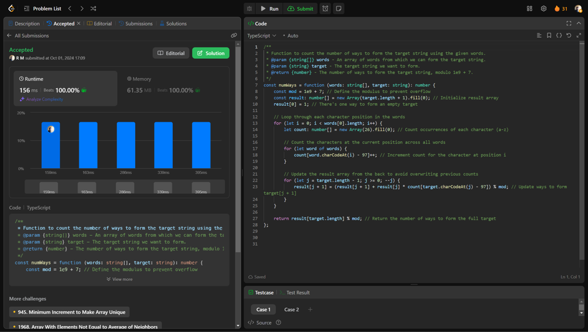

# 💥💥Beats 100% on runtime and memory [EXPLAINED]

**Author:** r9n
**Votes:** 0
**Link:** [https://leetcode.com/problems/number-of-ways-to-form-a-target-string-given-a-dictionary/solutions/5857864/](https://leetcode.com/problems/number-of-ways-to-form-a-target-string-given-a-dictionary/solutions/5857864/)

---




# Intuition
The goal is to form a specific target string using characters from a given list of words. Each character in the target can only be created from characters at specific positions in the words, and once a character is used from a position, it can't be reused for other characters in the target.


# Approach
Count how many times each character from the target can be formed at each position across all words, then use dynamic programming to calculate the number of ways to build the target by progressively using these counts for each character.


# Complexity
- Time complexity:
O(m * n), where m is the length of the words and n is the length of the target; we iterate over each position of the words and update the results for each character in the target.


- Space complexity:
O(n), since we maintain a result array of size equal to the length of the target plus one.


# Code
```typescript []
/**
 * Function to count the number of ways to form the target string using the given words.
 * @param {string[]} words - An array of words from which we can form the target string.
 * @param {string} target - The target string we want to form.
 * @return {number} - The number of ways to form the target string, modulo 1e9 + 7.
 */
const numWays = function (words: string[], target: string): number {
    const mod = 1e9 + 7; // Define the modulus to prevent overflow
    const result: number[] = new Array(target.length + 1).fill(0); // Initialize result array
    result[0] = 1; // There's one way to form an empty target

    // Loop through each character position in the words
    for (let i = 0; i < words[0].length; i++) {
        let count: number[] = new Array(26).fill(0); // Count occurrences of each character (a-z)

        // Count the characters at the current position across all words
        for (let word of words) {
            count[word.charCodeAt(i) - 97]++; // Increment count for the character at position i
        }

        // Update the result array from the back to avoid overwriting previous counts
        for (let j = target.length - 1; j >= 0; --j) {
            result[j + 1] = (result[j + 1] + result[j] * count[target.charCodeAt(j) - 97]) % mod; // Update ways to form target[j + 1]
        }
    }

    return result[target.length] % mod; // Return the number of ways to form the full target
};


```