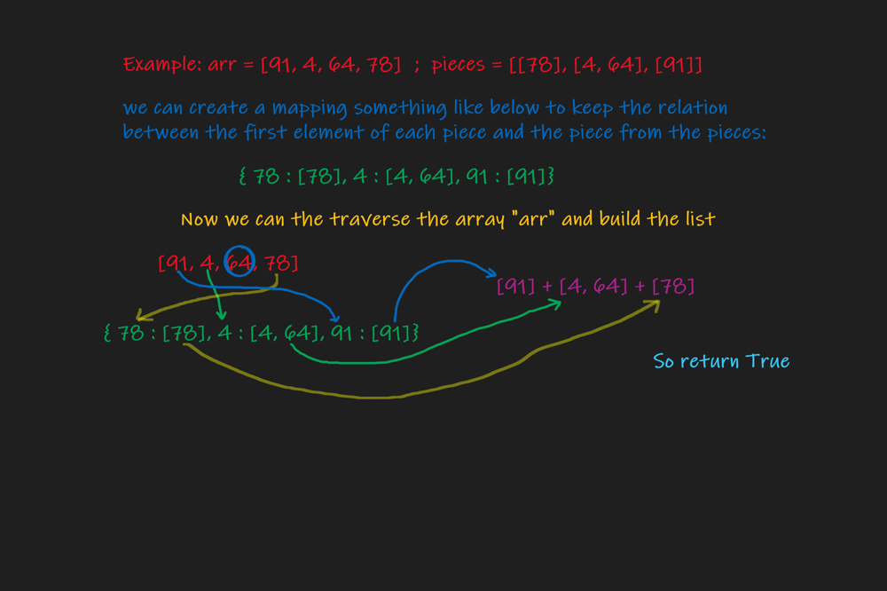

# "Python" easy explanation blackboard

**Author:** harish_sahu
**Votes:** 32
**Link:** [https://leetcode.com/problems/check-array-formation-through-concatenation/solutions/996343/](https://leetcode.com/problems/check-array-formation-through-concatenation/solutions/996343/)

---

* **Simple and easy python3 solution**
* **The approch is well explained in the below image**




```
class Solution:
    def canFormArray(self, arr: List[int], pieces: List[List[int]]) -> bool:
        keys, ans = {}, []
        for piece in pieces:
            keys[piece[0]] = piece
        for a in arr:
            if a in keys:
                ans.extend(keys[a])
        return ''.join(map(str, arr)) == ''.join(map(str, ans))
```