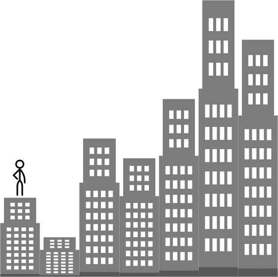

# [1642. Furthest Building You Can Reach](https://leetcode.com/problems/furthest-building-you-can-reach/)

| Category | Difficulty | Likes | Dislikes |
| :------: | :--------: | :---: | :------: |
| Algorithms | Medium | 6179 | 149 |

**Tags:** [`array`](https://leetcode.com/tag/array), [`greedy`](https://leetcode.com/tag/greedy), [`heap-priority-queue`](https://leetcode.com/tag/heap-priority-queue)

**Companies:** `amazon`, `phonepe`, `google`, `oyo`, `apple`, `microsoft`, `tiktok`, `de-shaw`, `dream11`, `uber`, `twilio`, `medianet`

## Description

You are given an integer array `heights` representing the heights of buildings, some `bricks`, and some `ladders`.

You start your journey from building `0` and move to the next building by possibly using bricks or ladders.

While moving from building `i` to building `i+1` (**0-indexed**),

	- If the current building's height is **greater than or equal** to the next building's height, you do **not** need a ladder or bricks.

	- If the current building's height is less than the next building's height, you can either use **one ladder** or `(h[i+1] - h[i])` **bricks**.

*Return the furthest building index (0-indexed) you can reach if you use the given ladders and bricks optimally.*

 

**Example 1:**


```

Input: heights = [4,2,7,6,9,14,12], bricks = 5, ladders = 1
Output: 4
Explanation: Starting at building 0, you can follow these steps:
- Go to building 1 without using ladders nor bricks since 4 &gt;= 2.
- Go to building 2 using 5 bricks. You must use either bricks or ladders because 2 &lt; 7.
- Go to building 3 without using ladders nor bricks since 7 &gt;= 6.
- Go to building 4 using your only ladder. You must use either bricks or ladders because 6 &lt; 9.
It is impossible to go beyond building 4 because you do not have any more bricks or ladders.

```

**Example 2:**

```

Input: heights = [4,12,2,7,3,18,20,3,19], bricks = 10, ladders = 2
Output: 7

```

**Example 3:**

```

Input: heights = [14,3,19,3], bricks = 17, ladders = 0
Output: 3

```

 

**Constraints:**

	- `1 <= heights.length <= 10^5`

	- `1 <= heights[i] <= 10^6`

	- `0 <= bricks <= 10^9`

	- `0 <= ladders <= heights.length`

---

**Links:** [Submissions](https://leetcode.com/problems/furthest-building-you-can-reach/) | [Solutions](https://leetcode.com/problems/furthest-building-you-can-reach/)
