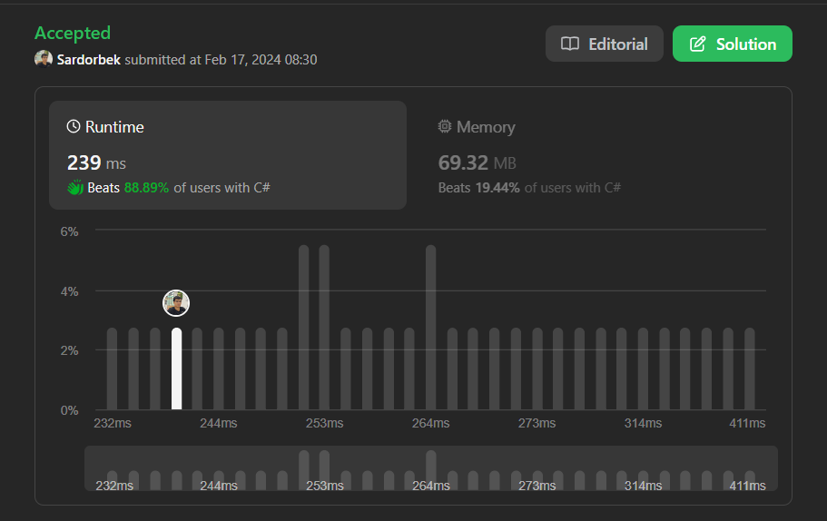

# 🚀✅🚀 EASY SOLUTiON || EXPLAiNED ✅✅✅|| via Ilxamovic

**Author:** ilxamovic
**Votes:** 7
**Link:** [https://leetcode.com/problems/furthest-building-you-can-reach/solutions/4739654/](https://leetcode.com/problems/furthest-building-you-can-reach/solutions/4739654/)

---



# Intuition
The problem seems to involve traversing a building sequence, making jumps, and using either bricks or ladders to reach the furthest building. The key is to optimize the use of ladders by saving them for the taller jumps.

# Approach
1. We can iterate through the building heights, calculating the difference between each consecutive pair.
2. If the difference is positive (indicating an upward jump), we subtract it from the available bricks.
3. We keep track of the differences and use a priority queue (min heap) to store the negative differences. This helps us prioritize the larger jumps.
4. If the bricks become negative, we check if there are available ladders. If yes, we use a ladder to cover the difference of the largest jump so far. We dequeue the largest negative difference from the priority queue and add it back to the bricks.
5. If there are no ladders available, we stop and return the index of the building before the current one.

# Complexity
- Time complexity: O(n log k), where n is the number of buildings and k is the number of ladders. The priority queue operations take log k time, and there are n buildings.
- Space complexity: O(k), where k is the number of ladders. The priority queue stores the k largest jumps.

# Codes
``` C# []
public class Solution {
    public int FurthestBuilding(int[] heights, int bricks, int ladders) {
        PriorityQueue<int, int> jumps = new PriorityQueue<int, int>();

        for (int i = 1; i < heights.Length; i++) {
            int difference = heights[i] - heights[i - 1];

            if (difference > 0) {
                bricks -= difference;
                jumps.Enqueue(difference, -difference);

                if (bricks < 0) {
                    if (ladders == 0) {
                        return i - 1;
                    }
                    else {
                        bricks += jumps.Dequeue();
                        ladders--;
                    }
                }
            }
        }

        return heights.Length - 1;
    }
}
```
``` Java []
public class Solution {
    public int furthestBuilding(int[] heights, int bricks, int ladders) {
        PriorityQueue<Integer> jumps = new PriorityQueue<>();

        for (int i = 1; i < heights.length; i++) {
            int difference = heights[i] - heights[i - 1];

            if (difference > 0) {
                bricks -= difference;
                jumps.offer(-difference);

                if (bricks < 0) {
                    if (ladders == 0) {
                        return i - 1;
                    } else {
                        bricks += Math.abs(jumps.poll());
                        ladders--;
                    }
                }
            }
        }
        return heights.length - 1;
    }
}
```
``` C++ []
class Solution {
public:
    int furthestBuilding(vector<int>& heights, int bricks, int ladders) {
        priority_queue<int> jumps;

        for (int i = 1; i < heights.size(); i++) {
            int difference = heights[i] - heights[i - 1];

            if (difference > 0) {
                bricks -= difference;
                jumps.push(difference);

                if (bricks < 0) {
                    if (ladders == 0) {
                        return i - 1;
                    } else {
                        bricks += jumps.top();
                        jumps.pop();
                        ladders--;
                    }
                }
            }
        }

        return heights.size() - 1;
    }
};
```


## Please upvote me !!!