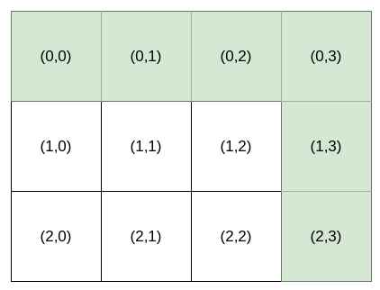
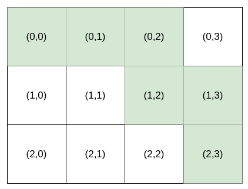
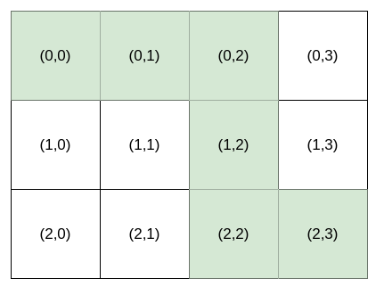

# [1643. Kth Smallest Instructions](https://leetcode.com/problems/kth-smallest-instructions/)

| Category | Difficulty | Likes | Dislikes |
| :------: | :--------: | :---: | :------: |
| Algorithms | Hard | 563 | 16 |

**Tags:** [`array`](https://leetcode.com/tag/array), [`math`](https://leetcode.com/tag/math), [`dynamic-programming`](https://leetcode.com/tag/dynamic-programming), [`combinatorics`](https://leetcode.com/tag/combinatorics)

**Companies:** `amazon`

## Description

Bob is standing at cell `(0, 0)`, and he wants to reach `destination`: `(row, column)`. He can only travel **right** and **down**. You are going to help Bob by providing **instructions** for him to reach `destination`.

The **instructions** are represented as a string, where each character is either:

	- `'H'`, meaning move horizontally (go **right**), or

	- `'V'`, meaning move vertically (go **down**).

Multiple **instructions** will lead Bob to `destination`. For example, if `destination` is `(2, 3)`, both `"HHHVV"` and `"HVHVH"` are valid **instructions**.

However, Bob is very picky. Bob has a lucky number `k`, and he wants the `k^th` **lexicographically smallest instructions** that will lead him to `destination`. `k` is **1-indexed**.

Given an integer array `destination` and an integer `k`, return *the *`k^th`* **lexicographically smallest instructions** that will take Bob to *`destination`.

 

**Example 1:**



```

Input: destination = [2,3], k = 1
Output: &quot;HHHVV&quot;
Explanation: All the instructions that reach (2, 3) in lexicographic order are as follows:
[&quot;HHHVV&quot;, &quot;HHVHV&quot;, &quot;HHVVH&quot;, &quot;HVHHV&quot;, &quot;HVHVH&quot;, &quot;HVVHH&quot;, &quot;VHHHV&quot;, &quot;VHHVH&quot;, &quot;VHVHH&quot;, &quot;VVHHH&quot;].

```

**Example 2:**

****

```

Input: destination = [2,3], k = 2
Output: &quot;HHVHV&quot;

```

**Example 3:**

****

```

Input: destination = [2,3], k = 3
Output: &quot;HHVVH&quot;

```

 

**Constraints:**

	- `destination.length == 2`

	- `1 <= row, column <= 15`

	- `1 <= k <= nCr(row + column, row)`, where `nCr(a, b)` denotes `a` choose `b`​​​​​.

---

**Links:** [Submissions](https://leetcode.com/problems/kth-smallest-instructions/) | [Solutions](https://leetcode.com/problems/kth-smallest-instructions/)
