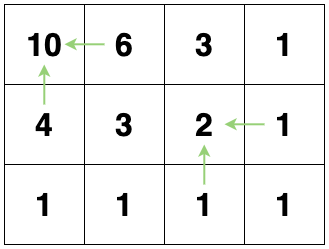
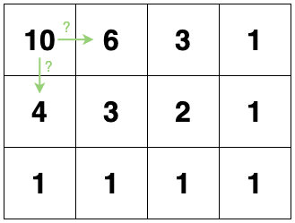

# [Golang] O(m*n) solution with picture explain, end->start then start->end

**Author:** gbin10533
**Votes:** 3
**Link:** [https://leetcode.com/problems/kth-smallest-instructions/solutions/920248/](https://leetcode.com/problems/kth-smallest-instructions/solutions/920248/)

---

First we calculate how many paths from any point to end point, using f(i, j) = f(i+1, j) + f(i, j+1).


Then we can walk from start point to end point, say we want kth path where k=3.
Now we know from (0, 1) to end point there are 6 paths, and from (1, 0) to end point there are 4 paths.


No matter what the suffix is, the 6 paths from (0, 1) must be:
Hxxxx
Hxxxx
Hxxxx
Hxxxx
Hxxxx
Hxxxx
and the 4 paths from (1, 0) must be:
Vxxxx
Vxxxx
Vxxxx
Vxxxx

So it is certain that any path in the 6 paths from (0, 1) **must be smaller than** any path in the 4 paths from (1, 0), so the 3rd path must in (0, 1).
And if k=7, the 7th path must in (1, 0).

Repeat this until we reach the end point.

```go
func kthSmallestPath(destination []int, k int) string {
    row, col := destination[0], destination[1]
    f := make([][]int, row+2)
    for i := 0; i <= row+1; i++ {
        f[i] = make([]int, col+2)
    }
    f[row][col] = 1
    for i := row; i >= 0; i-- {
        for j := col; j >= 0; j-- {
            if i == row && j == col {
                continue
            }
            f[i][j] = f[i+1][j] + f[i][j+1]
        }
    }
    result := ""
    i, j := 0, 0
    for {
        if i == row {
            j++
            result = result + "H"
        } else if j == col {
            i++
            result = result + "V"
        } else {
            if k <= f[i][j+1] {
                j++
                result = result + "H"
            } else {
                k -= f[i][j+1]
                i++
                result = result + "V"
            }
        }
        if i == row && j == col {
            break
        }
    }
    
    return result
}
```