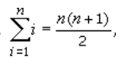
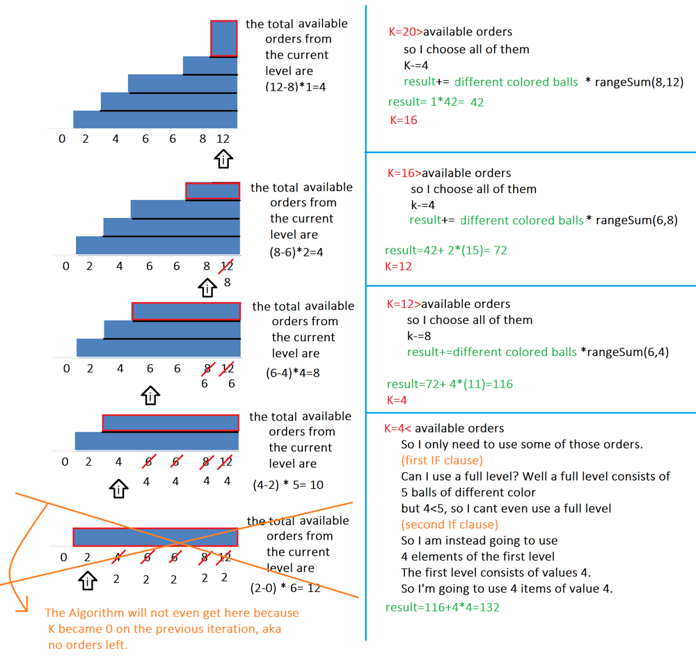

# [Javascript] DRAWING + DETAILED EXPLANATION + EXAMPLES

**Author:** George_Chrysochoou
**Votes:** 27
**Link:** [https://leetcode.com/problems/sell-diminishing-valued-colored-balls/solutions/928851/](https://leetcode.com/problems/sell-diminishing-valued-colored-balls/solutions/928851/)

---

Ok boyos we re going to build this as we go. It's easy so **don't panic**
First, let's do some Maths tho to get that out of the way. Consider we want to calculate the sum of elements of a given interval (a,b]. Let's denote it with **rangeSum(a,b)** . 
It's trivial to notice that **rangeSum(a,b)=rangeSum(0,b)-rangeSum(0,a)**. Thankfully, there is a known mathematical formula for any  rangeSum(0,k) though.
	   =**rangeSum(0,n)**
	So we can now calculate any given rangeSum(a,b) through 2 of those formulas.

Ok, the maths part is gone, it's all logic from now on. Now let's look at the problem through an example
					Balls=[  4, 2, 6 ,12, 6, 8]  Orders=K=20
It's easy to realise that the first choices are always going to be the best ones, as I want to maximize my value. So let's just sort the array to begin with. 
		Balls=[ 2, 4, 6, 6, 8, 12]  Orders=K=20
Now I know, that on every iteration of my algorithm, I want to pick the BEST choices, which are (for now) in the end of my array.
IF K was 4 instead here are the best picks and the array after each of those picks.
		**Balls**=[ 2, 4, 6, 6, 8, 12]  K=**4**
		**Balls**=[ 2, 4, 6, 6, 8, 11]  K=**3** result=12
		**Balls**=[ 2, 4, 6, 6, 8, 10]  K=**2** result=12+11
		**Balls**=[ 2, 4, 6, 6, 8, 9]   K=**1**  result=12+11+10
		**Balls**=[ 2, 4, 6, 6, 8, 8]   K=**0**  result=12+11+10+9
This approach is OK, and would theoretically work if it wasnt for the next 2 issues: 
1.  If K was 5, I would also have to pick the last 8, so my array would become [ 2, 4, 6, 6, 8, 7] which doesnt have the best choice in the end anymore. 
2.  It's slow given a large K/ large numbers of Balloons ant will TLE even through the use of a heap to keep the items sorted.

The most important observation that one can make here is that the previous example **can be calculated in O(1)**  through our aforementioned formula. Notice how the result=9+10+11+12= **rangeSum(8,12)**=** rangeSum(Balls[n-1],Balls[n-1]-k)** . However 2 cases arise 
1.  What if k> 12-8? **(aka the best and the second best item's difference)**
2.  What if k< 12-8?

Regarding the first case, I would have to use more orders to cover the remaining K. In our previous example, if K=6, the last 2 choices will have to be the remaining 2 8s, making my array
	Balls=[ 2, 4, 6, 6, **7, 7**] , result=**rangeSum(8,12)**+8+8
If K=8, I would have to use the 7s too!
	Balls=[ 2, 4, **6, 6, 6, 6**] , result=**rangeSum(8,12)**+**8+7+ 8+7** =**rangeSum(8,12)**+**2\\*rangeSum(6,8)**
if (K=16) I would have to use all 6s, and all 5's
	Balls=[ 2, **4, 4, 4, 4, 4**] , result=**rangeSum(8,12)**+**2\\*rangeSum(6,8)** +**4\\*rangeSum(4,6)**

**Original Balls**=[ 2, 4, 6, 6, 8, 12]  
So let's just look at the bigger picture now.  Starting from the last item, we re making some orders, relatively to its previous element. From 8-12 we made  a total of 4 orders, but from 6-12 we made  4+**2\\*2**=8 orders. Finally from 4 to 12 we made a total of 4+4+**4\\*2**=16 orders. It's easy to notice that from an index i one has in total 
	**(n-i)*(A[i+1]-A[i])** **available orders** .if A[i]==A[i+1]==...==A[n-1]
* If we consider all the A[i]'s (for example all 6's) a **level** then A[i+1]-A[i] gives us the **NUMBER OF LEVELS**
*  **(n-i) is the total number of different colored balloons that we use (aka the columns)**

so if my array was [3,5,5,5,5]
then at index 1 my total available choices would be (5-1)\\*(5-3)
That would be 2 levels of 4 orders each, so 8 orders in total
The first level would trivially be **5,5,5,5**
		and the second would be **4,4,4,4**
Notice that after I used all of my available orders for that item, the array becomes [3,3,3,3,3], so If i still have some orders to go I can go to the left of my index and consider the next "best available choices" ,so my new i=0.
**But wait!, there's more**
So If my array was [3,3,3,3,3], what's  the total number of my available orders now? Well as we ve said it's **(A[i]-A[i-1]) \\* (n-1)**, but i=0. 
So that's a problem cos there's no A[-1]. **Well  doesn't it make total sense to prepend a 0 for that reason?**. I mean I do have 3 available layers of 5 items, which is trivially (3-0)\\*(5-0)=**(A[i]-A[i-1]) \\* (n-1)** if my array was [**0**, 3,3,3,3,3] instead. So that's why from now on we ll always have a 0 as a sentinel element at the beginning. 

Let's answer our last question now, which is what happens when I'm at an index, and I dont have enough orders left for all of the available orders. Demonstrating,
			Balls=[0,3,3,3] K=7
In this case I ll have to take some of the levels instead. **But how many of those full levels can I take?**
A level consists of 3 elements now doesnt it? So I can take 2 full levels, namely 
3,3,3 and 2,2,2 . Then I would have 1 order left to make. 
**Math.floor(K/(n-i))**=Math.floor(7/3)=2 is the formula to calculate the number of **FULL LEVELS** that I can take.
Ohh, and knowing how many levels to take can also help me to calculate the total value added to the result
result+= levels\\*rangeSum(0,3)
K=K-6=1
The remaining order is to be taken from  [0,1,1,1] and is trivially going to be one of those ones
so result+= K*(A[i])
Here follows an example for
 Balls=[ 0, 2, 4, 6, 6, 8, 12 ], K=20



		
```
var maxProfit = function(A, k) {
    //rangeSum Formula
    let rangesum=(i,j)=>{
        i=BigInt(i),j=BigInt(j)
        return ((j*((j+1n))/2n)-(i*(i+1n)/2n))
    }
    A.unshift(0) //prepend the sentinel 0 
    A.sort((a,b)=>a-b)
    let n=A.length,result=0n,mod=BigInt(1e9+7),i=n-1
    // can use all current levels
    while((k>=(n-i)*(A[i]-A[i-1]))&&i>0){
        if(A[i]!=A[i-1])
            result=(result+(rangesum(A[i-1],A[i])*BigInt(n-i)))%mod,
            k-=(n-i)*(A[i]-A[i-1])
        i--
    }
    //can use some of the current levels
    if(k>0&&k>=n-i){
        let levels=Math.floor(k/(n-i)) //the levels i can use 
        result=(result+(BigInt(n-i)*rangesum(A[i]-levels,A[i])))%mod
        k-=levels*(n-i)
        A[i]-=levels
    }
    // can use some of the items OF the first level
    if(k>0&&k<n-i)
        result=(result+BigInt(k)*BigInt(A[i]))%mod
    return Number(result)
};
```