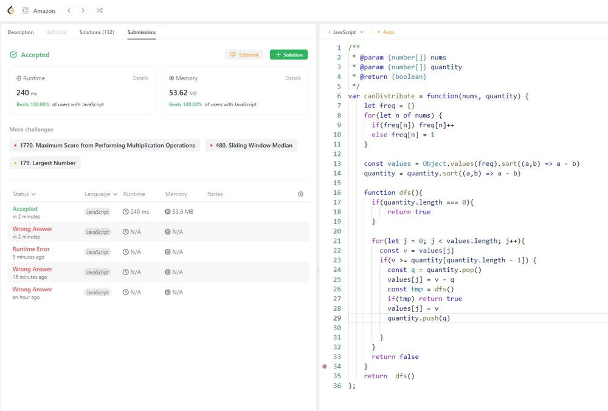

# JavaScript solution. Backtracking.  Faster than 100%

**Author:** EstherWein
**Votes:** 0
**Link:** [https://leetcode.com/problems/distribute-repeating-integers/solutions/4360661/](https://leetcode.com/problems/distribute-repeating-integers/solutions/4360661/)

---




# Code
```
/**
 * @param {number[]} nums
 * @param {number[]} quantity
 * @return {boolean}
 */
var canDistribute = function(nums, quantity) {
    let freq = {}
    for(let n of nums) {
      if(freq[n]) freq[n]++
      else freq[n] = 1
    }

    const values = Object.values(freq)
    quantity = quantity.sort((a,b) => a - b)

    function dfs(){
      if(quantity.length === 0) return true
      for(let j = 0; j < values.length; j++){
        const v = values[j]
        if(v < quantity[quantity.length - 1]) continue
        const q = quantity.pop()
        values[j] = v - q
        if(dfs()) return true
        values[j] = v
        quantity.push(q)
      }
      return false
    }
    return  dfs()
};
```