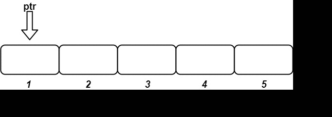

# [1656. Design an Ordered Stream](https://leetcode.com/problems/design-an-ordered-stream/)

| Category | Difficulty | Likes | Dislikes |
| :------: | :--------: | :---: | :------: |
| Algorithms | Easy | 565 | 3612 |

**Tags:** [`array`](https://leetcode.com/tag/array), [`hash-table`](https://leetcode.com/tag/hash-table), [`design`](https://leetcode.com/tag/design), [`data-stream`](https://leetcode.com/tag/data-stream)

**Companies:** `bloomberg`

## Description

There is a stream of `n` `(idKey, value)` pairs arriving in an **arbitrary** order, where `idKey` is an integer between `1` and `n` and `value` is a string. No two pairs have the same `id`.

Design a stream that returns the values in **increasing order of their IDs** by returning a **chunk** (list) of values after each insertion. The concatenation of all the **chunks** should result in a list of the sorted values.

Implement the `OrderedStream` class:

	- `OrderedStream(int n)` Constructs the stream to take `n` values.

	- `String[] insert(int idKey, String value)` Inserts the pair `(idKey, value)` into the stream, then returns the **largest possible chunk** of currently inserted values that appear next in the order.

 

**Example:**

****

```

Input
[&quot;OrderedStream&quot;, &quot;insert&quot;, &quot;insert&quot;, &quot;insert&quot;, &quot;insert&quot;, &quot;insert&quot;]
[[5], [3, &quot;ccccc&quot;], [1, &quot;aaaaa&quot;], [2, &quot;bbbbb&quot;], [5, &quot;eeeee&quot;], [4, &quot;ddddd&quot;]]
Output
[null, [], [&quot;aaaaa&quot;], [&quot;bbbbb&quot;, &quot;ccccc&quot;], [], [&quot;ddddd&quot;, &quot;eeeee&quot;]]

Explanation
// Note that the values ordered by ID is [&quot;aaaaa&quot;, &quot;bbbbb&quot;, &quot;ccccc&quot;, &quot;ddddd&quot;, &quot;eeeee&quot;].
OrderedStream os = new OrderedStream(5);
os.insert(3, &quot;ccccc&quot;); // Inserts (3, &quot;ccccc&quot;), returns [].
os.insert(1, &quot;aaaaa&quot;); // Inserts (1, &quot;aaaaa&quot;), returns [&quot;aaaaa&quot;].
os.insert(2, &quot;bbbbb&quot;); // Inserts (2, &quot;bbbbb&quot;), returns [&quot;bbbbb&quot;, &quot;ccccc&quot;].
os.insert(5, &quot;eeeee&quot;); // Inserts (5, &quot;eeeee&quot;), returns [].
os.insert(4, &quot;ddddd&quot;); // Inserts (4, &quot;ddddd&quot;), returns [&quot;ddddd&quot;, &quot;eeeee&quot;].
// Concatentating all the chunks returned:
// [] + [&quot;aaaaa&quot;] + [&quot;bbbbb&quot;, &quot;ccccc&quot;] + [] + [&quot;ddddd&quot;, &quot;eeeee&quot;] = [&quot;aaaaa&quot;, &quot;bbbbb&quot;, &quot;ccccc&quot;, &quot;ddddd&quot;, &quot;eeeee&quot;]
// The resulting order is the same as the order above.

```

 

**Constraints:**

	- `1 <= n <= 1000`

	- `1 <= id <= n`

	- `value.length == 5`

	- `value` consists only of lowercase letters.

	- Each call to `insert` will have a unique `id.`

	- Exactly `n` calls will be made to `insert`.

---

**Links:** [Submissions](https://leetcode.com/problems/design-an-ordered-stream/) | [Solutions](https://leetcode.com/problems/design-an-ordered-stream/)
