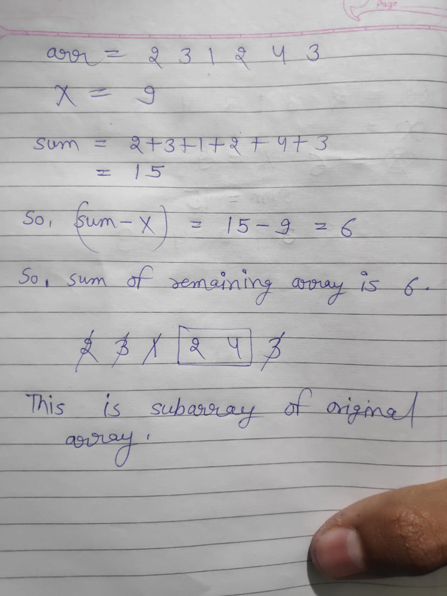

# Are you stuck ? once read this . logic explained clearly | easy-to-understand

**Author:** kevaljoshi2312
**Votes:** 325
**Link:** [https://leetcode.com/problems/minimum-operations-to-reduce-x-to-zero/solutions/1080880/](https://leetcode.com/problems/minimum-operations-to-reduce-x-to-zero/solutions/1080880/)

---

so , the problem is saying that we can remove either leftmost or rightmost element and we have to remove them in such a way that 
1.remove minimum number of elements and
2. sum of all removed element is X 

Now main point is that if successfully remove elements such that sum of removed elements is X , then 
1. sum of remaining array elements will be (sum-X) 
2. remaing array will be subarray of original array.


.

So , now our task is find subaarray whose sum is (sum - X) and its length is maximum ( because we want to remove minimum number of elements , so we will have to maximise remianing element ) .

time - O(N)
space - O(1)

```
int minOperations(vector<int>& v, int x) 
    {
        int i,len=0,sum1=0,sum2=0;
        for(i=0;i<v.size();i++)
            sum2+=v[i];                  // calculating sum of whole array 
			
        sum2-=x;   //  this is sum of remiaing elements . after removing X 
		
        if(sum2==0)        // sum of array is equal to X . means we'll have to remove all elements
            return v.size();
			
// sliding window technique 
// i points to begining of subarray and j points to end of subarray 

		// sum2 is desired sum while sum1 is current sum
        int j;i=0;
        for(j=0;j<v.size();j++)
        {
            sum1+=v[j];
			
            while(i<v.size()&&sum1>sum) // if sum of current subaaray is greater than desired sum
                sum1-=v[i++];
				
            if(sum1==sum2)  // if sum of current subarray is equal to desired sum then update length
                len=max(len,j-i+1); // we want subarray  with maximum length 
        }
        if(!len)        // No subarray found with desired sum .
            return -1;
        return v.size()-len;
    }

