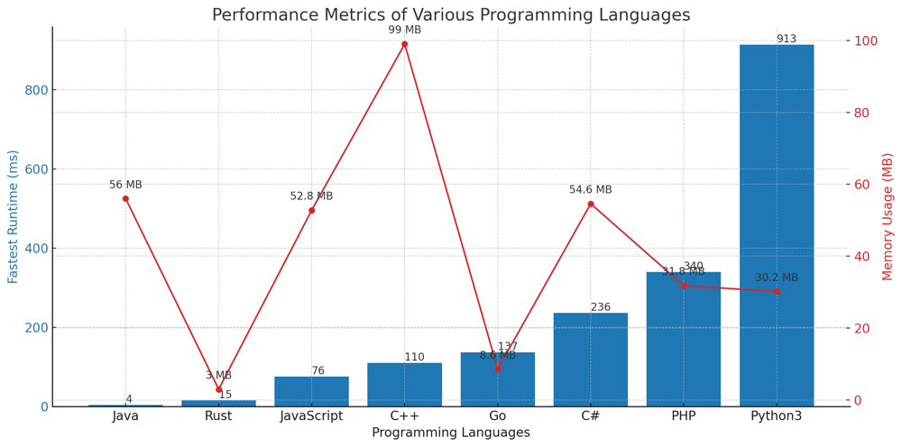

# ✅ 96.51% Sliding Window

**Author:** vanAmsen
**Votes:** 145
**Link:** [https://leetcode.com/problems/minimum-operations-to-reduce-x-to-zero/solutions/4066422/](https://leetcode.com/problems/minimum-operations-to-reduce-x-to-zero/solutions/4066422/)

---

# Comprehensive Guide to Solving "Minimum Operations to Reduce X to Zero"

## Introduction & Problem Statement

Given an integer array `nums` and an integer `x`, the task is to find the minimum number of operations to reduce `x` to exactly 0 by removing either the leftmost or rightmost element from the array `nums` in each operation. What makes this problem intriguing is that it's not a straightforward minimization problem; it involves searching for subarrays, working with prefix sums, and applying two-pointer techniques.

## Key Concepts and Constraints

### What Makes This Problem Unique?

1. **Array Constraints**:  
    - $$1 \\leq \	ext{nums.length} \\leq 10^5$$
    - $$1 \\leq \	ext{nums}[i] \\leq 10^4$$
  
2. **Target Number `x`**:
    - $$1 \\leq x \\leq 10^9$$

3. **Operations**:  
    You can either remove the leftmost or the rightmost element from the array `nums` and subtract its value from $$ x $$.

4. **Minimization Objective**:  
    The goal is to minimize the number of operations to reduce $$ x $$ to zero.

---

## One Primary Strategy to Solve the Problem:

## Live Coding & Explain
https://youtu.be/3dhzAV81hBI?si=QgcosgkvdbMBBKtq

# Approach: Sliding Window with Prefix Sum

To solve this problem, we apply the Sliding Window technique with a twist involving Prefix Sum. We use two pointers, `left` and `right`, to traverse the array `nums` and find the longest subarray whose sum equals the total sum of elements in `nums` minus `x`.

## Key Data Structures:

- **max_len**: An integer to store the length of the longest subarray that can be excluded to make the sum equal to `x`.
- **cur_sum**: An integer to store the sum of elements in the current subarray.

## Enhanced Breakdown:

1. **Initialize and Calculate the Target**:
   - Compute `target = sum(nums) - x`, as we're interested in finding a subarray with this sum.
   - Initialize `max_len`, `cur_sum`, and `left` to 0.
  
2. **Check for Edge Cases**:
   - If `target` is zero, it means we need to remove all elements to make the sum equal to `x`. In this case, return the total number of elements, `n`.

3. **Traverse the Array with Two Pointers**:
   - Iterate through `nums` using a `right` pointer.
   - Update `cur_sum` by adding the current element `nums[right]`.
   
4. **Sliding Window Adjustment**:
   - If `cur_sum` exceeds `target`, slide the `left` pointer to the right by one position and decrease `cur_sum` by `nums[left]`.

5. **Update Max Length**:
   - If `cur_sum` matches `target`, update `max_len` with the length of the current subarray, which is `right - left + 1`.

6. **Conclude and Return**:
   - After the loop, if `max_len` is non-zero, return `n - max_len`. Otherwise, return -1, indicating it's not possible to reduce `x` to zero.

## Complexity Analysis:

**Time Complexity**: 
- Since we traverse the array only once, the time complexity is $$ O(n) $$.

**Space Complexity**: 
- The algorithm uses only a constant amount of extra space, thus having a space complexity of $$ O(1) $$.

---

# Code
``` Python []
class Solution:
    def minOperations(self, nums: List[int], x: int) -> int:
        target, n = sum(nums) - x, len(nums)
        
        if target == 0:
            return n
        
        max_len = cur_sum = left = 0
        
        for right, val in enumerate(nums):
            cur_sum += val
            while left <= right and cur_sum > target:
                cur_sum -= nums[left]
                left += 1
            if cur_sum == target:
                max_len = max(max_len, right - left + 1)
        
        return n - max_len if max_len else -1
```
``` Go []
func minOperations(nums []int, x int) int {
    target, n := -x, len(nums)
    for _, num := range nums {
        target += num
    }
    
    if target == 0 {
        return n
    }
    
    maxLen, curSum, left := 0, 0, 0
    
    for right, val := range nums {
        curSum += val
        for left <= right && curSum > target {
            curSum -= nums[left]
            left++
        }
        if curSum == target {
            if right - left + 1 > maxLen {
                maxLen = right - left + 1
            }
        }
    }
    
    if maxLen != 0 {
        return n - maxLen
    }
    return -1
}
```
``` Rust []
impl Solution {
    pub fn min_operations(nums: Vec<i32>, x: i32) -> i32 {
        let mut target: i32 = -x;
        let n = nums.len() as i32;
        
        for &num in &nums {
            target += num;
        }
        
        if target == 0 {
            return n;
        }
        
        let (mut max_len, mut cur_sum, mut left) = (0, 0, 0);
        
        for right in 0..n as usize {
            cur_sum += nums[right];
            while left <= right as i32 && cur_sum > target {
                cur_sum -= nums[left as usize];
                left += 1;
            }
            if cur_sum == target {
                max_len = std::cmp::max(max_len, right as i32 - left + 1);
            }
        }
        
        if max_len != 0 { n - max_len } else { -1 }
    }
}
```
``` C++ []
class Solution {
public:
    int minOperations(vector<int>& nums, int x) {
        int target = 0, n = nums.size();
        for (int num : nums) target += num;
        target -= x;
        
        if (target == 0) return n;
        
        int max_len = 0, cur_sum = 0, left = 0;
        
        for (int right = 0; right < n; ++right) {
            cur_sum += nums[right];
            while (left <= right && cur_sum > target) {
                cur_sum -= nums[left];
                left++;
            }
            if (cur_sum == target) {
                max_len = max(max_len, right - left + 1);
            }
        }
        
        return max_len ? n - max_len : -1;
    }
};
```
``` Java []
public class Solution {
    public int minOperations(int[] nums, int x) {
        int target = -x, n = nums.length;
        for (int num : nums) target += num;
        
        if (target == 0) return n;
        
        int maxLen = 0, curSum = 0, left = 0;
        
        for (int right = 0; right < n; ++right) {
            curSum += nums[right];
            while (left <= right && curSum > target) {
                curSum -= nums[left];
                left++;
            }
            if (curSum == target) {
                maxLen = Math.max(maxLen, right - left + 1);
            }
        }
        
        return maxLen != 0 ? n - maxLen : -1;
    }
}
```
``` PHP []
class Solution {
    function minOperations($nums, $x) {
        $target = 0;
        $n = count($nums);
        foreach ($nums as $num) $target += $num;
        $target -= $x;
        
        if ($target === 0) return $n;
        
        $maxLen = $curSum = $left = 0;
        
        for ($right = 0; $right < $n; ++$right) {
            $curSum += $nums[$right];
            while ($left <= $right && $curSum > $target) {
                $curSum -= $nums[$left];
                $left++;
            }
            if ($curSum === $target) {
                $maxLen = max($maxLen, $right - $left + 1);
            }
        }
        
        return $maxLen ? $n - $maxLen : -1;
    }
}
```
``` JavaScript []
/**
 * @param {number[]} nums
 * @param {number} x
 * @return {number}
 */
var minOperations = function(nums, x) {
    let target = -x, n = nums.length;
    for (let num of nums) target += num;
    
    if (target === 0) return n;
    
    let maxLen = 0, curSum = 0, left = 0;
    
    for (let right = 0; right < n; ++right) {
        curSum += nums[right];
        while (left <= right && curSum > target) {
            curSum -= nums[left];
            left++;
        }
        if (curSum === target) {
            maxLen = Math.max(maxLen, right - left + 1);
        }
    }
    
    return maxLen ? n - maxLen : -1;
};
```
``` C# []
public class Solution {
    public int MinOperations(int[] nums, int x) {
        int target = -x, n = nums.Length;
        foreach (int num in nums) target += num;
        
        if (target == 0) return n;
        
        int maxLen = 0, curSum = 0, left = 0;
        
        for (int right = 0; right < n; ++right) {
            curSum += nums[right];
            while (left <= right && curSum > target) {
                curSum -= nums[left];
                left++;
            }
            if (curSum == target) {
                maxLen = Math.Max(maxLen, right - left + 1);
            }
        }
        
        return maxLen != 0 ? n - maxLen : -1;
    }
}
```

## Performance

| Language  | Fastest Runtime (ms) | Memory Usage (MB) |
|-----------|----------------------|-------------------|
| Java      | 4                    | 56                |
| Rust      | 15                   | 3                 |
| JavaScript| 76                   | 52.8              |
| C++       | 110                  | 99                |
| Go        | 137                  | 8.6               |
| C#        | 236                  | 54.6              |
| PHP       | 340                  | 31.8              |
| Python3   | 913                  | 30.2              |




## Live Coding in Rust
https://youtu.be/CU93rMboS7w?si=r2ryBueD4fCiKZ7w

## Conclusion

The problem "Minimum Operations to Reduce X to Zero" may look complicated initially due to its minimization objective. However, understanding the underlying logic of subarray sums and applying a sliding window approach can simplify it. This not only solves the problem efficiently but also enhances one's understanding of array manipulation techniques. Happy coding!