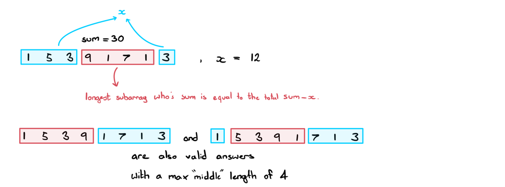
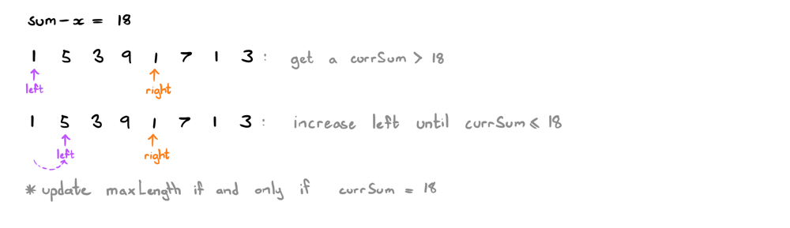

# Change Your Perspective | JAVA Explanation

**Author:** ciote
**Votes:** 666
**Link:** [https://leetcode.com/problems/minimum-operations-to-reduce-x-to-zero/solutions/2136570/](https://leetcode.com/problems/minimum-operations-to-reduce-x-to-zero/solutions/2136570/)

---

### Logic
Initially, this question might look like a DP problem: pick either left or right recursively and collect the number of operations along the way. A brute force approach would result in an `O(2^n)` complexity which isn't great. Memoization would improve this but we'll exceed the memory limit as I've tested. Besides, we can do better.

By simply reframing the question, we can come up with an `O(n)` complexity solution. The difficulty in this question arises from deciding whether to choose the left or the right element to remove at any given point. However, while we're removing elements from the array, we're definitely going to be letting some elements remain as well. In particular, the middle elements. 

**Key observation:**
> The number of elements removed equals <ins>n minus the number of elements that *aren't* removed</ins>.
>> Therefore, to find the minimum number of elements to remove, we can find the maximum number of elements to not remove!


So, instead of trying to find the minimum number of operations, why don't we focus on finding the longest subarray in the middle. One main thing to note is that our subarray should sum to **`sum - x`** (where `sum` is the sum of all elements in our array).
Why? because the middle elements are technically the ones we don't want. If the sum of the outer elements equals `x`, then we're looking for a middle sum of `sum - x`. If this doesn't quite make sense, pay attention to the below diagram with `nums = [1,5,3,9,1,7,1,3], x = 12`:

(Keep in mind that this approach only works due to the absence of negative numbers!)
___
### Finding our max middle subarray length:
We can find this using a two-pointer / sliding window approach. Start left and right both at index 0.
* Increment right until the current window sum is `> sum - x`
* Update our `maxLength` if and only if our current window sum `== sum - x`
* Repeat the above steps until we reach the end of the array.



Awesome! Now we have everything we need to start coding.
___
### How should I approach this question in an interview?
When you're presented this question, it might not be obvious that there exists a solution other than DP (at least, it wasn't obvious for me!). So, how would you know to approach the question through any other means? What saved me when doing this question was the simple realisation that removing edge values is the same as shrinking the array. Hence, there will always remain a middle subarray of length >= 0.

A habit that I've developed over time whenever I run into trouble coming up with a solution is to <ins>reframe the question</ins>. Often times when you're given a question in an interview, it's riddled with questionable requirements or red herrings. The interviewer is likely expecting you to *extract out* the core requirements from the question and truncate it down to as simple a question as you can manage.

It does take time and practice to spot the owl from the trees. That being said, here are some effective ways to ease yourself into the right mindset: 
* If a question is implicitly asking for A when the question is actually solved using B, draw examples and look for alternate patterns.
* Pay attention to the constraints of the inputs/outputs (in this question, the values being strictly positive was a hint!)
* Be creative! Even try rewording the question to something as different as you can think of while still maintaining the requirements of the question. 

If all else fails, pay attention to the subtle hints your interviewer might be throwing your way. (By the way, the best way to get hints from your interviewer is to explain all your thoughts to them as you go. If they don't know where you're stuck, they can't help you). 

___
### Code:
If you have any questions, suggestions or improvements, feel free to let me know. Thanks for reading!
```java
public int minOperations(int[] nums, int x) {
	int sum = 0;
	for (int num: nums) sum += num;

	int maxLength = -1, currSum = 0;
	for (int l=0, r=0; r<nums.length; r++) {
		currSum += nums[r];
		while (l <= r && currSum > sum - x) currSum -= nums[l++];
		if (currSum == sum - x) maxLength = Math.max(maxLength, r-l+1);
	}

	return maxLength == -1 ? -1 : nums.length - maxLength;
}
```

**Time complexity:** `O(n)`
**Space complexity:** `O(1)`