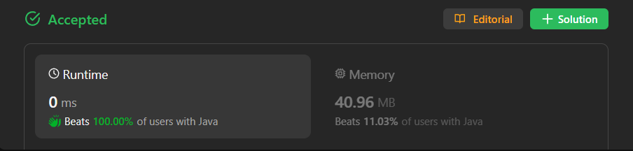

# ✅ Beats 100% - C++/Java/Python/JS - Simple Concatenation - Visualized Too

**Author:** lancertech6
**Votes:** 54
**Link:** [https://leetcode.com/problems/check-if-two-string-arrays-are-equivalent/solutions/4348026/](https://leetcode.com/problems/check-if-two-string-arrays-are-equivalent/solutions/4348026/)

---



# YouTube Channel:

[https://youtu.be/iso3nx4AdFI](https://youtu.be/iso3nx4AdFI)
<!-- **If you want a video for this question please write in the comments** -->

**\uD83D\uDD25 Please like, share, and subscribe to support our channel's mission of making complex concepts easy to understand.**

Subscribe Link: https://www.youtube.com/@leetlogics/?sub_confirmation=1

*Current Subscribers: 515*
*Subscribe Goal: 600 Subscribers*

---
# Intuition
<!-- Describe your first thoughts on how to solve this problem. -->
To determine if two string arrays represent the same string, we need to concatenate the elements of each array and compare the resulting strings. The order of concatenation is crucial.

# Approach
<!-- Describe your approach to solving the problem. -->
1. Initialize two `StringBuilder` objects, `str1` and `str2`, to build the concatenated strings for `word1` and `word2` respectively.
2. Iterate through each word in `word1`, appending it to `str1`.
3. Iterate through each word in `word2`, appending it to `str2`.
4. Convert both `StringBuilder` objects to strings, `s1` and `s2`.
5. Compare `s1` and `s2`. If they are equal, return `true`; otherwise, return `false`.

# Complexity
- Let `m` be the total number of characters in `word1` and `n` be the total number of characters in `word2`.
- Building `str1` and `str2` takes O(m + n) time.
- Converting `str1` and `str2` to strings takes O(m + n) time.
- The overall `time complexity` is `O(m + n)`.
- The `space complexity` is `O(m + n)` due to the `StringBuilder` objects and the resulting strings.

# Code
```java []
class Solution {
    public boolean arrayStringsAreEqual(String[] word1, String[] word2) {
        StringBuilder str1 = new StringBuilder();
        StringBuilder str2 = new StringBuilder();

        for(String word : word1){
            str1.append(word);
        }
        for(String word : word2){
            str2.append(word);
        }
        String s1 = str1.toString();
        String s2 = str2.toString();

        if(s1.equals(s2)){
            return true;
        }
        else{
            return false;
        }
    }
}
```
```C++ []
class Solution {
public:
    bool arrayStringsAreEqual(vector<string>& word1, vector<string>& word2) {
        string s1 = "";
        string s2 = "";

        for(const string& s : word1)
            s1 += s;
        for(const string& s : word2)
            s2 += s;

        return s1==s2;
    }
};
```
```Python []
class Solution(object):
    def arrayStringsAreEqual(self, word1, word2):
        str1 = ''.join(word1)
        str2 = ''.join(word2)
        return str1 == str2        
```
```JavaScript []
/**
 * @param {string[]} word1
 * @param {string[]} word2
 * @return {boolean}
 */
var arrayStringsAreEqual = function(word1, word2) {
    const str1 = word1.join('');
    const str2 = word2.join('');
    return str1 === str2;
};
```

