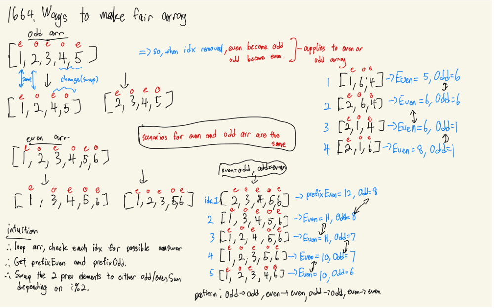
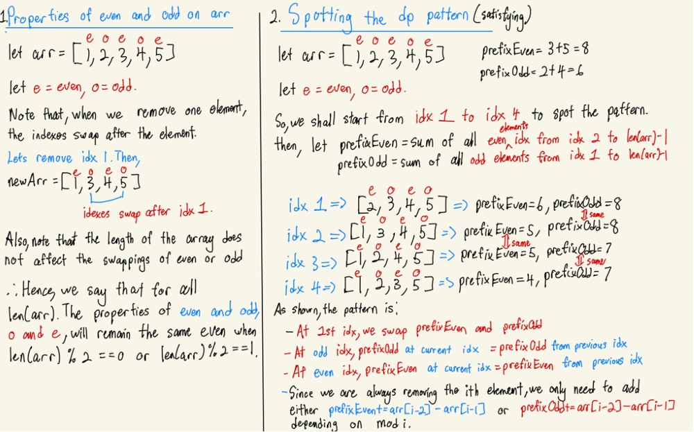
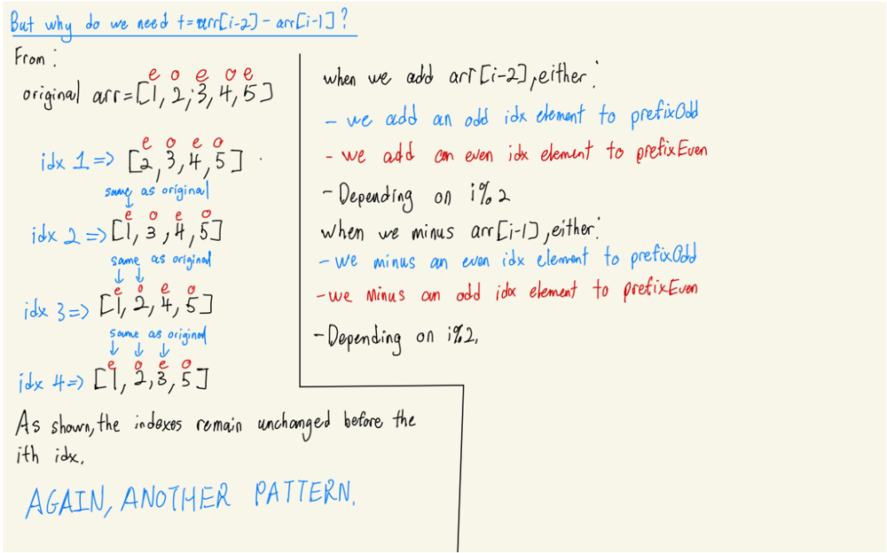

# WEEB EXPLAINS PYTHON/C++ DP/PREFIX SUM SOLN

**Author:** Skywalker5423
**Votes:** 9
**Link:** [https://leetcode.com/problems/ways-to-make-a-fair-array/solutions/1775588/](https://leetcode.com/problems/ways-to-make-a-fair-array/solutions/1775588/)

---

My initial sketch for the question:
	

Here is my explanation for my messy sketch:
	
	Correction : 
	- At odd idx, prefixOdd at current idx == prefixOdd at the **next** idx (not previous idx)
	- At even idx, prefixEven at current idx == prefixEven at the **next** idx (not previous idx)
	

**Python**

	class Solution:
		def waysToMakeFair(self, nums: List[int]) -> int:
			if len(nums) == 1:
				return 1

			if len(nums) == 2:
				return 0

			prefixEven = sum(nums[2::2])
			prefixOdd = sum(nums[1::2])
			result = 0

			if prefixEven == prefixOdd and len(set(nums)) == 1:
				result += 1

			for i in range(1,len(nums)):
				if i == 1:
					prefixOdd, prefixEven = prefixEven, prefixOdd 

				if i > 1:
					if i % 2 == 0:
						prefixEven -= nums[i-1]
						prefixEven += nums[i-2]

					else:
						prefixOdd -= nums[i-1]
						prefixOdd += nums[i-2]

				if prefixOdd == prefixEven:
					result += 1

			return result

**C++**

	class Solution {
	public:
		int waysToMakeFair(vector<int>& nums) {
			if (nums.size() == 1) return 1;

			if (nums.size() == 2) return 0;

			long int prefixEven = 0;
			long int prefixOdd = 0;
			set<int> set;
			int result = 0;

			for (int i=1; i < nums.size(); i++){
				if (i % 2 == 1) prefixOdd += nums[i];

				else{
					prefixEven += nums[i];
				}

				if (set.find(nums[i]) == set.end()) set.insert(nums[i]);
			}

			if (prefixOdd == prefixEven){
				if (set.size() == 1) result++;
			}

			for (int i=1; i < nums.size(); i++){
				if (i == 1){
					long int temp = prefixEven;
					prefixEven = prefixOdd;
					prefixOdd = temp;

				}

				if (i > 1){
					if (i % 2 == 0){
						prefixEven -= nums[i-1];
						prefixEven += nums[i-2];
					}

					else{
						prefixOdd -= nums[i-1];
						prefixOdd += nums[i-2];
					}
				}

				if (prefixEven == prefixOdd) result++;
			}

			return result;
		}
	};

Enough coding, dp takes a toll on your brain
Especially this one, its just one BIG pattern spotting question
Have a break, watch some anime instead
Check out **\u30EF\u30FC\u30AD\u30F3\u30B0!! (Working!!)**

# Episodes: 13 (1st Season) + 13 (2nd Season) + 14 (3rd Season)
# Genres: Comedy, Romance, Slice of Life
# Demographic: Seinen

There is an alternative setting for this anime, its called  **WWW.Working!!** which is a side story of this anime.
Anyways, watch this show to kill some time.
Also, please give this an upvote if u find this post useful, tq