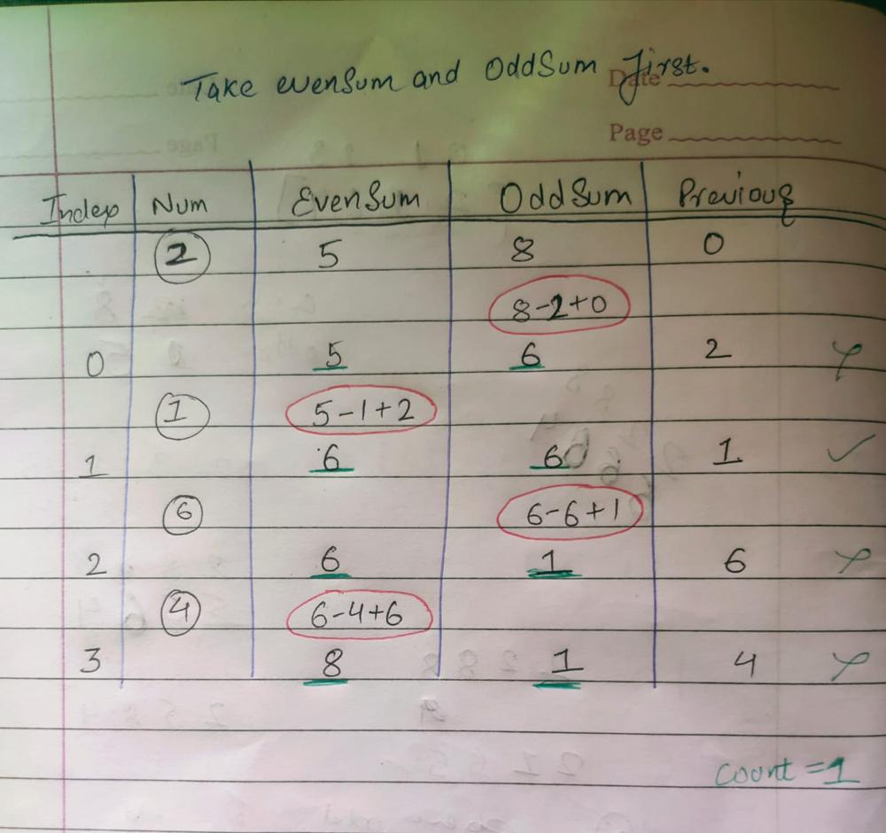

# As Easy As You Like 📌 T.C-(N) 📌 S.C-(1)

**Author:** cOde_Ranvir25
**Votes:** 5
**Link:** [https://leetcode.com/problems/ways-to-make-a-fair-array/solutions/4166262/](https://leetcode.com/problems/ways-to-make-a-fair-array/solutions/4166262/)

---



```
class Solution {
    public int waysToMakeFair(int[] nums) {
        int esum = 0;  // Sum of even-indexed elements
        int osum = 0;  // Sum of odd-indexed elements
        int n=nums.length;
        for (int i = 0; i < n; i++) {
            if (i % 2 == 0) {
                osum += nums[i];
            } else {
                esum += nums[i];
            }
        }
        int count = 0;
        int prev = 0;
        for (int i = 0; i < n; i++) {
            if (i % 2 == 0) {
                osum = osum - nums[i] + prev;
            } else {
                esum = esum - nums[i] + prev;
            }
            if (esum == osum) {
                count++;
            }
            prev = nums[i];
        }
        return count;
    }
}

```
# Upvoting is Must