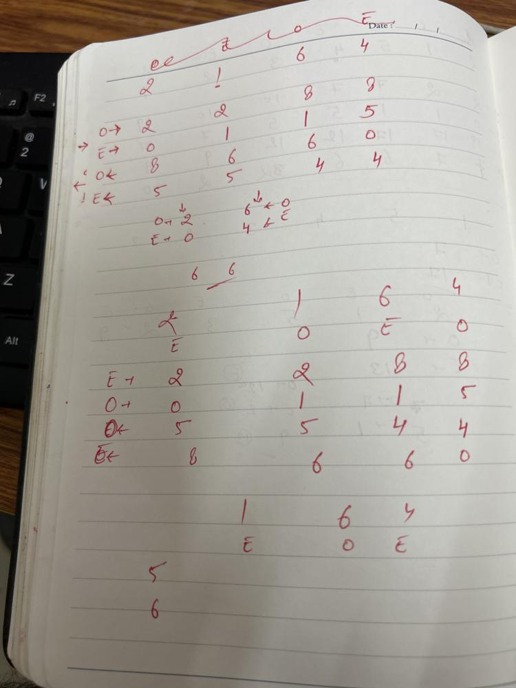
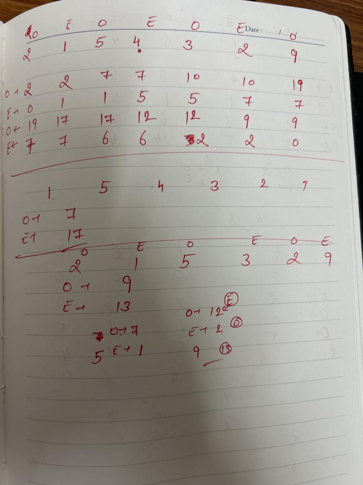

# ❇ ways-to-make-a-fair-array👌 🏆O(N)❤️ Javascript🎯 Memory👀95.45%🕕 ++Explanation✍️ 🔴🔥 ✅ 👉 💪🙏

**Author:** anurag-sindhu
**Votes:** 2
**Link:** [https://leetcode.com/problems/ways-to-make-a-fair-array/solutions/4915454/](https://leetcode.com/problems/ways-to-make-a-fair-array/solutions/4915454/)

---


Time Complexity: O(N)
Space Complexity: O(N)



```
var waysToMakeFair = function (nums) {
    let evenSum = 0;
    let oddSum = 0;
    let evenSumFromLeft = [];
    let oddSumFromLeft = [];
    let evenSumFromRight = [];
    let oddSumFromRight = [];
    for (let index = 0; index < nums.length; index++) {
        if (index % 2 === 0) {
            evenSum += nums[index];
        } else {
            oddSum += nums[index];
        }
        oddSumFromLeft.push(oddSum);
        evenSumFromLeft.push(evenSum);
    }
    evenSum = 0;
    oddSum = 0;
    for (let index = nums.length - 1; index >= 0; index--) {
        if (index % 2 === 0) {
            evenSum += nums[index];
        } else {
            oddSum += nums[index];
        }
        oddSumFromRight.push(oddSum);
        evenSumFromRight.push(evenSum);
    }
    oddSumFromRight.reverse();
    evenSumFromRight.reverse();
    let count = 0;

    for (let index = 0; index < nums.length; index++) {
        let leftEvenSum = evenSumFromLeft[index];
        let leftOddSum = oddSumFromLeft[index];
        let rightEvenSum = oddSumFromRight[index];
        let rightOddSum = evenSumFromRight[index];
        if (index % 2 === 0) {
            leftEvenSum -= nums[index];
            rightOddSum -= nums[index];
        } else {
            leftOddSum -= nums[index];
            rightEvenSum -= nums[index];
        }
        if (leftEvenSum + rightEvenSum === leftOddSum + rightOddSum) {
            count++;
        }
    }
    return count;
};
```