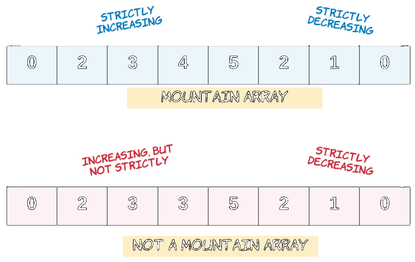
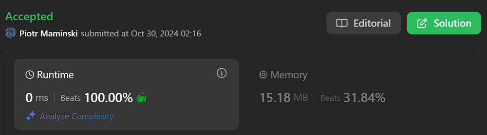
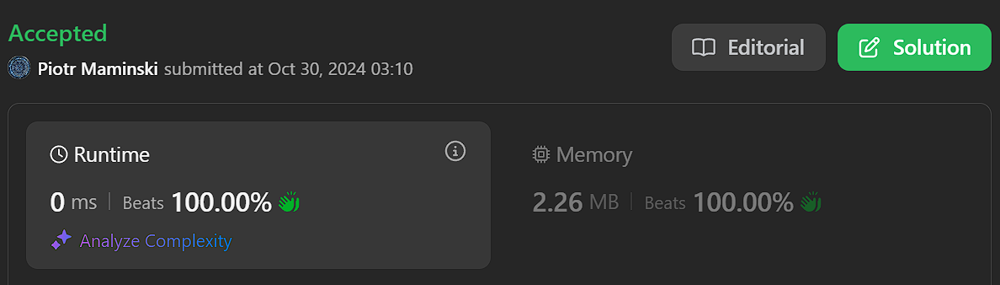

# ✅ Explained step by step | Beats 100% | ✅ Working 30.10.2024

**Author:** Piotr_Maminski
**Votes:** 48
**Link:** [https://leetcode.com/problems/minimum-number-of-removals-to-make-mountain-array/solutions/5984675/](https://leetcode.com/problems/minimum-number-of-removals-to-make-mountain-array/solutions/5984675/)

---



```python3 []
# Longest Increasing Subsequence (LIS) Solution from both directions

class Solution:
    def minimumMountainRemovals(self, nums: List[int]) -> int:
        # Get the length of input array
        size = len(nums)
        
        # Arrays to store longest increasing subsequence lengths
        # left[i]: length of LIS from left to index i
        # right[i]: length of LIS from right to index i
        left = [0] * size
        right = [0] * size
        
        # First pass: Calculate LIS lengths from left to right
        dp = []  # Dynamic array to build LIS
        for i in range(size):
            # Find position to insert current number in sorted dp array
            idx = bisect_left(dp, nums[i])
            if idx == len(dp):
                # If number is larger than all elements in dp, append it
                dp.append(nums[i])
            else:
                # Replace element at idx with current number
                dp[idx] = nums[i]
            # Store length of LIS ending at index i
            left[i] = len(dp)
        
        # Second pass: Calculate LIS lengths from right to left
        dp = []  # Reset dp array for right to left pass
        for i in range(size - 1, -1, -1):
            # Same process as above, but moving right to left
            idx = bisect_left(dp, nums[i])
            if idx == len(dp):
                dp.append(nums[i])
            else:
                dp[idx] = nums[i]
            # Store length of LIS starting from index i
            right[i] = len(dp)
        
        # Third pass: Find minimum removals needed
        minRemove = size
        for i in range(size):
            # Check if current index can be peak of mountain
            # Need at least 2 elements on both sides
            if left[i] > 1 and right[i] > 1:
                # Calculate removals needed:
                # size - (left[i] + right[i] - 1)
                # -1 because peak is counted twice
                minRemove = min(minRemove, size - left[i] - right[i] + 1)
        
        return minRemove
```
```cpp []
class Solution {
public:
// Longest Increasing Subsequence (LIS) Solution from both directions

    // Helper function to calculate LIS lengths for each position
    vector<int> lisLength(vector<int>& v){
        // Start with first element
        vector<int> lis = {v[0]};
        // Track LIS length ending at each position
        vector<int> lisLen(v.size(), 1);

        for(int i = 1 ; i < v.size() ; i++){
            // If current element is larger than last LIS element, extend the sequence
            if(v[i] > lis.back()){
                lis.push_back(v[i]);
            } else {
                // Replace the smallest element that's >= current element
                // This maintains the potential for longer sequences
                int index = lower_bound(lis.begin(), lis.end(), v[i]) - lis.begin();
                lis[index] = v[i];
            }
            // Store length of LIS up to current position
            lisLen[i] = lis.size();
        }
        return lisLen;
    }

    int minimumMountainRemovals(vector<int>& nums) {
        int n = nums.size();
        
        // Get LIS lengths from left to right (increasing part)
        vector<int> lis = lisLength(nums);
        
        // Get LIS lengths from right to left (decreasing part)
        reverse(nums.begin(), nums.end());
        vector<int> lds = lisLength(nums);
        reverse(lds.begin(), lds.end());
        
        int removals = INT_MAX;
        
        // For each potential peak position
        for(int i = 0 ; i < n ; i++){
            // Valid mountain needs both sides to have length > 1
            if(lis[i] > 1 && lds[i] > 1){
                // Calculate removals needed:
                // Total length - (increasing length + decreasing length - 1)
                // -1 because peak is counted twice
                removals = min(removals, n + 1 - lis[i] - lds[i]);
            }
        }
        
        return removals;
    }
};
```
```java []
import java.util.*;

// Longest Increasing Subsequence (LIS) Solution from both directions

class Solution {
    // Helper function to calculate LIS lengths for each position
    private List<Integer> lisLength(int[] nums) {
        // Start with first element
        List<Integer> lis = new ArrayList<>();
        lis.add(nums[0]);
        // Track LIS length ending at each position
        List<Integer> lisLen = new ArrayList<>();
        for (int i = 0; i < nums.length; i++) {
            lisLen.add(1);
        }
        
        for (int i = 1; i < nums.length; i++) {
            // If current element is larger than last LIS element, extend the sequence
            if (nums[i] > lis.get(lis.size() - 1)) {
                lis.add(nums[i]);
            } else {
                // Replace the smallest element that's >= current element
                // This maintains the potential for longer sequences
                int index = Collections.binarySearch(lis, nums[i]);
                if (index < 0) {
                    index = -(index + 1);
                }
                lis.set(index, nums[i]);
            }
            // Store length of LIS up to current position
            lisLen.set(i, lis.size());
        }
        return lisLen;
    }
    
    public int minimumMountainRemovals(int[] nums) {
        int n = nums.length;
        
        // Get LIS lengths from left to right (increasing part)
        List<Integer> lis = lisLength(nums);
        
        // Get LIS lengths from right to left (decreasing part)
        int[] reversed = new int[n];
        for (int i = 0; i < n; i++) {
            reversed[i] = nums[n - 1 - i];
        }
        List<Integer> lds = lisLength(reversed);
        Collections.reverse(lds);
        
        int removals = Integer.MAX_VALUE;
        
        // For each potential peak position
        for (int i = 0; i < n; i++) {
            // Valid mountain needs both sides to have length > 1
            if (lis.get(i) > 1 && lds.get(i) > 1) {
                // Calculate removals needed:
                // Total length - (increasing length + decreasing length - 1)
                // -1 because peak is counted twice
                removals = Math.min(removals, n + 1 - lis.get(i) - lds.get(i));
            }
        }
        
        return removals;
    }
}
```
```csharp []
// Longest Increasing Subsequence (LIS) Solution from both directions

public class Solution {
    // Helper function to calculate LIS lengths for each position
    private List<int> LisLength(int[] v) {
        // Start with first element
        List<int> lis = new List<int> { v[0] };
        // Track LIS length ending at each position
        List<int> lisLen = new List<int>(new int[v.Length]);
        
        for (int i = 0; i < v.Length; i++) {
            lisLen[i] = 1;
        }

        for (int i = 1; i < v.Length; i++) {
            // If current element is larger than last LIS element, extend the sequence
            if (v[i] > lis[lis.Count - 1]) {
                lis.Add(v[i]);
            } else {
                // Replace the smallest element that's >= current element
                // This maintains the potential for longer sequences
                int index = lis.BinarySearch(v[i]);
                if (index < 0) {
                    index = ~index;
                }
                lis[index] = v[i];
            }
            // Store length of LIS up to current position
            lisLen[i] = lis.Count;
        }
        return lisLen;
    }

    public int MinimumMountainRemovals(int[] nums) {
        int n = nums.Length;
        
        // Get LIS lengths from left to right (increasing part)
        List<int> lis = LisLength(nums);
        
        // Get LIS lengths from right to left (decreasing part)
        Array.Reverse(nums);
        List<int> lds = LisLength(nums);
        lds.Reverse();
        Array.Reverse(nums);
        
        int removals = int.MaxValue;
        
        // For each potential peak position
        for (int i = 0; i < n; i++) {
            // Valid mountain needs both sides to have length > 1
            if (lis[i] > 1 && lds[i] > 1) {
                // Calculate removals needed:
                // Total length - (increasing length + decreasing length - 1)
                // -1 because peak is counted twice
                removals = Math.Min(removals, n + 1 - lis[i] - lds[i]);
            }
        }
        
        return removals;
    }
}
```
```golang []
// Longest Increasing Subsequence (LIS) Solution from both directions


func lisLength(v []int) []int {
    // Start with first element
    lis := []int{v[0]}
    // Track LIS length ending at each position
    lisLen := make([]int, len(v))
    for i := range lisLen {
        lisLen[i] = 1
    }

    for i := 1; i < len(v); i++ {
        // If current element is larger than last LIS element, extend the sequence
        if v[i] > lis[len(lis)-1] {
            lis = append(lis, v[i])
        } else {
            // Replace the smallest element that's >= current element
            index := sort.SearchInts(lis, v[i])
            lis[index] = v[i]
        }
        // Store length of LIS up to current position
        lisLen[i] = len(lis)
    }
    return lisLen
}

func minimumMountainRemovals(nums []int) int {
    n := len(nums)
    
    // Get LIS lengths from left to right (increasing part)
    lis := lisLength(nums)
    
    // Get LIS lengths from right to left (decreasing part)
    // Create reversed copy of nums
    reversed := make([]int, n)
    copy(reversed, nums)
    for i, j := 0, n-1; i < j; i, j = i+1, j-1 {
        reversed[i], reversed[j] = reversed[j], reversed[i]
    }
    
    lds := lisLength(reversed)
    // Reverse lds
    for i, j := 0, n-1; i < j; i, j = i+1, j-1 {
        lds[i], lds[j] = lds[j], lds[i]
    }
    
    removals := math.MaxInt32
    
    // For each potential peak position
    for i := 0; i < n; i++ {
        // Valid mountain needs both sides to have length > 1
        if lis[i] > 1 && lds[i] > 1 {
            // Calculate removals needed:
            // Total length - (increasing length + decreasing length - 1)
            // -1 because peak is counted twice
            removals = min(removals, n+1-lis[i]-lds[i])
        }
    }
    
    return removals
}

func min(a, b int) int {
    if a < b {
        return a
    }
    return b
}
```
```swift []
class Solution {
    // Helper function to calculate LIS lengths for each position
    private func lisLength(_ v: [Int]) -> [Int] {
        // Start with first element
        var lis = [v[0]]
        // Track LIS length ending at each position
        var lisLen = Array(repeating: 1, count: v.count)
        
        for i in 1..<v.count {
            // If current element is larger than last LIS element, extend the sequence
            if v[i] > lis.last! {
                lis.append(v[i])
            } else {
                // Replace the smallest element that's >= current element
                // This maintains the potential for longer sequences
                let index = lis.firstIndex { $0 >= v[i] } ?? 0
                lis[index] = v[i]
            }
            // Store length of LIS up to current position
            lisLen[i] = lis.count
        }
        return lisLen
    }

    func minimumMountainRemovals(_ nums: [Int]) -> Int {
        let n = nums.count
        
        // Get LIS lengths from left to right (increasing part)
        let lis = lisLength(nums)
        
        // Get LIS lengths from right to left (decreasing part)
        let reversedNums = Array(nums.reversed())
        var lds = lisLength(reversedNums)
        lds.reverse()
        
        var removals = Int.max
        
        // For each potential peak position
        for i in 0..<n {
            // Valid mountain needs both sides to have length > 1
            if lis[i] > 1 && lds[i] > 1 {
                // Calculate removals needed:
                // Total length - (increasing length + decreasing length - 1)
                // -1 because peak is counted twice
                removals = min(removals, n + 1 - lis[i] - lds[i])
            }
        }
        
        return removals
    }
}
```
```javascript [JS]
// JavaScript

// Helper function to calculate LIS lengths for each position
function lisLength(arr) {
    // Start with first element
    const lis = [arr[0]];
    // Track LIS length ending at each position
    const lisLen = new Array(arr.length).fill(1);

    for (let i = 1; i < arr.length; i++) {
        // If current element is larger than last LIS element, extend the sequence
        if (arr[i] > lis[lis.length - 1]) {
            lis.push(arr[i]);
        } else {
            // Find the smallest element that's >= current element
            const index = lowerBound(lis, arr[i]);
            lis[index] = arr[i];
        }
        // Store length of LIS up to current position
        lisLen[i] = lis.length;
    }
    return lisLen;
}

// Helper function to implement lower_bound functionality
function lowerBound(arr, target) {
    let left = 0;
    let right = arr.length;
    
    while (left < right) {
        const mid = Math.floor((left + right) / 2);
        if (arr[mid] < target) {
            left = mid + 1;
        } else {
            right = mid;
        }
    }
    return left;
}

function minimumMountainRemovals(nums) {
    const n = nums.length;
    
    // Get LIS lengths from left to right (increasing part)
    const lis = lisLength(nums);
    
    // Get LIS lengths from right to left (decreasing part)
    const reversed = [...nums].reverse();
    const lds = lisLength(reversed);
    lds.reverse();
    
    let removals = Infinity;
    
    // For each potential peak position
    for (let i = 0; i < n; i++) {
        // Valid mountain needs both sides to have length > 1
        if (lis[i] > 1 && lds[i] > 1) {
            // Calculate removals needed:
            // Total length - (increasing length + decreasing length - 1)
            // -1 because peak is counted twice
            removals = Math.min(removals, n + 1 - lis[i] - lds[i]);
        }
    }
    
    return removals;
}


```
```typescript [TS]
// TypeScript

// Helper function to calculate LIS lengths for each position
function lisLength(v: number[]): number[] {
    // Start with first element
    const lis: number[] = [v[0]];
    // Track LIS length ending at each position
    const lisLen: number[] = new Array(v.length).fill(1);

    for (let i = 1; i < v.length; i++) {
        // If current element is larger than last LIS element, extend the sequence
        if (v[i] > lis[lis.length - 1]) {
            lis.push(v[i]);
        } else {
            // Replace the smallest element that's >= current element
            // This maintains the potential for longer sequences
            const index = lowerBound(lis, v[i]);
            lis[index] = v[i];
        }
        // Store length of LIS up to current position
        lisLen[i] = lis.length;
    }
    return lisLen;
}

// Helper function to implement lower_bound functionality
function lowerBound(arr: number[], target: number): number {
    let left = 0;
    let right = arr.length;
    
    while (left < right) {
        const mid = Math.floor((left + right) / 2);
        if (arr[mid] < target) {
            left = mid + 1;
        } else {
            right = mid;
        }
    }
    return left;
}

function minimumMountainRemovals(nums: number[]): number {
    const n = nums.length;
    
    // Get LIS lengths from left to right (increasing part)
    const lis = lisLength(nums);
    
    // Get LIS lengths from right to left (decreasing part)
    nums.reverse();
    const lds = lisLength(nums);
    lds.reverse();
    nums.reverse(); // restore original array
    
    let removals = Number.MAX_SAFE_INTEGER;
    
    // For each potential peak position
    for (let i = 0; i < n; i++) {
        // Valid mountain needs both sides to have length > 1
        if (lis[i] > 1 && lds[i] > 1) {
            // Calculate removals needed:
            // Total length - (increasing length + decreasing length - 1)
            // -1 because peak is counted twice
            removals = Math.min(removals, n + 1 - lis[i] - lds[i]);
        }
    }
    
    return removals;
}
```
```rust []
impl Solution {
    // Helper function to calculate LIS lengths for each position
    fn lis_length(v: &Vec<i32>) -> Vec<i32> {
        let mut lis = vec![v[0]];
        let mut lis_len = vec![1; v.len()];
        
        for i in 1..v.len() {
            if v[i] > *lis.last().unwrap() {
                lis.push(v[i]);
            } else {
                let index = lis.partition_point(|&x| x < v[i]);
                lis[index] = v[i];
            }
            lis_len[i] = lis.len() as i32;
        }
        lis_len
    }
    
    pub fn minimum_mountain_removals(nums: Vec<i32>) -> i32 {
        let n = nums.len();
        
        // Get LIS lengths from left to right
        let lis = Self::lis_length(&nums);
        
        // Get LIS lengths from right to left
        let mut reversed_nums = nums.clone();
        reversed_nums.reverse();
        let mut lds = Self::lis_length(&reversed_nums);
        lds.reverse();
        
        let mut removals = i32::MAX;
        
        // Check each potential peak position
        for i in 0..n {
            if lis[i] > 1 && lds[i] > 1 {
                removals = removals.min(n as i32 + 1 - lis[i] - lds[i]);
            }
        }
        
        removals
    }
}
```
```ruby []
# Helper function to calculate LIS lengths for each position
def lis_length(arr)
  # Start with first element
  lis = [arr[0]]
  # Track LIS length ending at each position
  lis_len = Array.new(arr.size, 1)

  (1...arr.size).each do |i|
    # If current element is larger than last LIS element, extend the sequence
    if arr[i] > lis[-1]
      lis.push(arr[i])
    else
      # Replace the smallest element that's >= current element
      # This maintains the potential for longer sequences
      index = lis.bsearch_index { |x| x >= arr[i] } || lis.size
      lis[index] = arr[i]
    end
    # Store length of LIS up to current position
    lis_len[i] = lis.size
  end
  lis_len
end

def minimum_mountain_removals(nums)
  n = nums.size
  
  # Get LIS lengths from left to right (increasing part)
  lis = lis_length(nums)
  
  # Get LIS lengths from right to left (decreasing part)
  nums.reverse!
  lds = lis_length(nums)
  lds.reverse!
  nums.reverse! # restore original array
  
  removals = Float::INFINITY
  
  # For each potential peak position
  (0...n).each do |i|
    # Valid mountain needs both sides to have length > 1
    if lis[i] > 1 && lds[i] > 1
      # Calculate removals needed:
      # Total length - (increasing length + decreasing length - 1)
      # -1 because peak is counted twice
      removals = [removals, n + 1 - lis[i] - lds[i]].min
    end
  end
  
  removals
end
```
### Without comments
```python3 []
class Solution:
    def minimumMountainRemovals(self, nums: List[int]) -> int:
        size = len(nums)
        
        left = [0] * size
        right = [0] * size
        
        dp = []
        for i in range(size):
            idx = bisect_left(dp, nums[i])
            if idx == len(dp):
                dp.append(nums[i])
            else:
                dp[idx] = nums[i]
            left[i] = len(dp)
        
        dp = []
        for i in range(size - 1, -1, -1):
            idx = bisect_left(dp, nums[i])
            if idx == len(dp):
                dp.append(nums[i])
            else:
                dp[idx] = nums[i]
            right[i] = len(dp)
        
        minRemove = size
        for i in range(size):
            if left[i] > 1 and right[i] > 1:
                minRemove = min(minRemove, size - left[i] - right[i] + 1)
        
        return minRemove
```
```cpp []
class Solution {
public:

    vector<int> lisLength(vector<int>& v){
        vector<int> lis = {v[0]};
        vector<int> lisLen(v.size(), 1);

        for(int i = 1 ; i < v.size() ; i++){
            if(v[i] > lis.back()){
                lis.push_back(v[i]);
            } else {
                int index = lower_bound(lis.begin(), lis.end(), v[i]) - lis.begin();
                lis[index] = v[i];
            }
            lisLen[i] = lis.size();
        }
        return lisLen;
    }

    int minimumMountainRemovals(vector<int>& nums) {
        int n = nums.size();
        vector<int> lis = lisLength(nums);

        reverse(nums.begin(), nums.end());
        vector<int> lds = lisLength(nums);
        reverse(lds.begin(), lds.end());

        int removals = INT_MAX;

        for(int i = 0 ; i < n ; i++){
            if(lis[i] > 1 && lds[i] > 1){
                removals = min(removals, n + 1 - lis[i] - lds[i]);
            }
        }

        return removals;
    }
};
```
```java []
import java.util.*;

class Solution {
    private List<Integer> lisLength(int[] nums) {
        List<Integer> lis = new ArrayList<>();
        lis.add(nums[0]);
        List<Integer> lisLen = new ArrayList<>();
        for (int i = 0; i < nums.length; i++) {
            lisLen.add(1);
        }
        
        for (int i = 1; i < nums.length; i++) {
            if (nums[i] > lis.get(lis.size() - 1)) {
                lis.add(nums[i]);
            } else {
                int index = Collections.binarySearch(lis, nums[i]);
                if (index < 0) {
                    index = -(index + 1);
                }
                lis.set(index, nums[i]);
            }
            lisLen.set(i, lis.size());
        }
        return lisLen;
    }
    
    public int minimumMountainRemovals(int[] nums) {
        int n = nums.length;
        
        List<Integer> lis = lisLength(nums);
        
        int[] reversed = new int[n];
        for (int i = 0; i < n; i++) {
            reversed[i] = nums[n - 1 - i];
        }
        List<Integer> lds = lisLength(reversed);
        Collections.reverse(lds);
        
        int removals = Integer.MAX_VALUE;
        
        for (int i = 0; i < n; i++) {
            if (lis.get(i) > 1 && lds.get(i) > 1) {
                removals = Math.min(removals, n + 1 - lis.get(i) - lds.get(i));
            }
        }
        
        return removals;
    }
}
```
```csharp []
public class Solution {
    private List<int> LisLength(int[] v) {
        List<int> lis = new List<int> { v[0] };
        List<int> lisLen = new List<int>(new int[v.Length]);
        
        for (int i = 0; i < v.Length; i++) {
            lisLen[i] = 1;
        }

        for (int i = 1; i < v.Length; i++) {
            if (v[i] > lis[lis.Count - 1]) {
                lis.Add(v[i]);
            } else {
                int index = lis.BinarySearch(v[i]);
                if (index < 0) {
                    index = ~index;
                }
                lis[index] = v[i];
            }
            lisLen[i] = lis.Count;
        }
        return lisLen;
    }

    public int MinimumMountainRemovals(int[] nums) {
        int n = nums.Length;
        
        List<int> lis = LisLength(nums);
        
        Array.Reverse(nums);
        List<int> lds = LisLength(nums);
        lds.Reverse();
        Array.Reverse(nums);
        
        int removals = int.MaxValue;
        
        for (int i = 0; i < n; i++) {
            if (lis[i] > 1 && lds[i] > 1) {
                removals = Math.Min(removals, n + 1 - lis[i] - lds[i]);
            }
        }
        
        return removals;
    }
}
```
```golang []
func lisLength(v []int) []int {
    lis := []int{v[0]}
    lisLen := make([]int, len(v))
    for i := range lisLen {
        lisLen[i] = 1
    }

    for i := 1; i < len(v); i++ {
        if v[i] > lis[len(lis)-1] {
            lis = append(lis, v[i])
        } else {
            index := sort.SearchInts(lis, v[i])
            lis[index] = v[i]
        }
        lisLen[i] = len(lis)
    }
    return lisLen
}

func minimumMountainRemovals(nums []int) int {
    n := len(nums)
    
    lis := lisLength(nums)
    
    reversed := make([]int, n)
    copy(reversed, nums)
    for i, j := 0, n-1; i < j; i, j = i+1, j-1 {
        reversed[i], reversed[j] = reversed[j], reversed[i]
    }
    
    lds := lisLength(reversed)
    for i, j := 0, n-1; i < j; i, j = i+1, j-1 {
        lds[i], lds[j] = lds[j], lds[i]
    }
    
    removals := math.MaxInt32
    
    for i := 0; i < n; i++ {
        if lis[i] > 1 && lds[i] > 1 {
            removals = min(removals, n+1-lis[i]-lds[i])
        }
    }
    
    return removals
}

func min(a, b int) int {
    if a < b {
        return a
    }
    return b
}
```
```swift []
class Solution {
    private func lisLength(_ v: [Int]) -> [Int] {
        var lis = [v[0]]
        var lisLen = Array(repeating: 1, count: v.count)
        
        for i in 1..<v.count {
            if v[i] > lis.last! {
                lis.append(v[i])
            } else {
                let index = lis.firstIndex { $0 >= v[i] } ?? 0
                lis[index] = v[i]
            }
            lisLen[i] = lis.count
        }
        return lisLen
    }

    func minimumMountainRemovals(_ nums: [Int]) -> Int {
        let n = nums.count
        
        let lis = lisLength(nums)
        
        let reversedNums = Array(nums.reversed())
        var lds = lisLength(reversedNums)
        lds.reverse()
        
        var removals = Int.max
        
        for i in 0..<n {
            if lis[i] > 1 && lds[i] > 1 {
                removals = min(removals, n + 1 - lis[i] - lds[i])
            }
        }
        
        return removals
    }
}
```
```javascript [JS]
function lisLength(arr) {
    const lis = [arr[0]];
    const lisLen = new Array(arr.length).fill(1);

    for (let i = 1; i < arr.length; i++) {
        if (arr[i] > lis[lis.length - 1]) {
            lis.push(arr[i]);
        } else {
            const index = lowerBound(lis, arr[i]);
            lis[index] = arr[i];
        }
        lisLen[i] = lis.length;
    }
    return lisLen;
}

function lowerBound(arr, target) {
    let left = 0;
    let right = arr.length;
    
    while (left < right) {
        const mid = Math.floor((left + right) / 2);
        if (arr[mid] < target) {
            left = mid + 1;
        } else {
            right = mid;
        }
    }
    return left;
}

function minimumMountainRemovals(nums) {
    const n = nums.length;
    
    const lis = lisLength(nums);
    
    const reversed = [...nums].reverse();
    const lds = lisLength(reversed);
    lds.reverse();
    
    let removals = Infinity;
    
    for (let i = 0; i < n; i++) {
        if (lis[i] > 1 && lds[i] > 1) {
            removals = Math.min(removals, n + 1 - lis[i] - lds[i]);
        }
    }
    
    return removals;
}
```
```typescript [TS]
function lisLength(v: number[]): number[] {
    const lis: number[] = [v[0]];
    const lisLen: number[] = new Array(v.length).fill(1);

    for (let i = 1; i < v.length; i++) {
        if (v[i] > lis[lis.length - 1]) {
            lis.push(v[i]);
        } else {
            const index = lowerBound(lis, v[i]);
            lis[index] = v[i];
        }
        lisLen[i] = lis.length;
    }
    return lisLen;
}

function lowerBound(arr: number[], target: number): number {
    let left = 0;
    let right = arr.length;
    
    while (left < right) {
        const mid = Math.floor((left + right) / 2);
        if (arr[mid] < target) {
            left = mid + 1;
        } else {
            right = mid;
        }
    }
    return left;
}

function minimumMountainRemovals(nums: number[]): number {
    const n = nums.length;
    
    const lis = lisLength(nums);
    
    nums.reverse();
    const lds = lisLength(nums);
    lds.reverse();
    nums.reverse();
    
    let removals = Number.MAX_SAFE_INTEGER;
    
    for (let i = 0; i < n; i++) {
        if (lis[i] > 1 && lds[i] > 1) {
            removals = Math.min(removals, n + 1 - lis[i] - lds[i]);
        }
    }
    
    return removals;
}
```
```rust []
impl Solution {
    fn lis_length(v: &Vec<i32>) -> Vec<i32> {
        let mut lis = vec![v[0]];
        let mut lis_len = vec![1; v.len()];
        
        for i in 1..v.len() {
            if v[i] > *lis.last().unwrap() {
                lis.push(v[i]);
            } else {
                let index = lis.partition_point(|&x| x < v[i]);
                lis[index] = v[i];
            }
            lis_len[i] = lis.len() as i32;
        }
        lis_len
    }
    
    pub fn minimum_mountain_removals(nums: Vec<i32>) -> i32 {
        let n = nums.len();
        
        let lis = Self::lis_length(&nums);
        
        let mut reversed_nums = nums.clone();
        reversed_nums.reverse();
        let mut lds = Self::lis_length(&reversed_nums);
        lds.reverse();
        
        let mut removals = i32::MAX;
        
        for i in 0..n {
            if lis[i] > 1 && lds[i] > 1 {
                removals = removals.min(n as i32 + 1 - lis[i] - lds[i]);
            }
        }
        
        removals
    }
}
```
```ruby []
def lis_length(arr)
  lis = [arr[0]]
  lis_len = Array.new(arr.size, 1)

  (1...arr.size).each do |i|
    if arr[i] > lis[-1]
      lis.push(arr[i])
    else
      index = lis.bsearch_index { |x| x >= arr[i] } || lis.size
      lis[index] = arr[i]
    end
    lis_len[i] = lis.size
  end
  lis_len
end

def minimum_mountain_removals(nums)
  n = nums.size
  
  lis = lis_length(nums)
  
  nums.reverse!
  lds = lis_length(nums)
  lds.reverse!
  nums.reverse!
  
  removals = Float::INFINITY
  
  (0...n).each do |i|
    if lis[i] > 1 && lds[i] > 1
      removals = [removals, n + 1 - lis[i] - lds[i]].min
    end
  end
  
  removals
end
```


### Complexity 
- Time complexity: O(n log n)

- Space complexity: O(n)


# Explained Step by Step


## Intuition:

- A mountain array needs to strictly increase up to a peak, then strictly decrease
- We can find potential peaks by looking at increasing sequences from both directions
- For each position, if we know:
    1. Length of longest increasing sequence ending there from left
    2. Length of longest increasing sequence starting there from right Then we can calculate how many elements need to be removed to make that position a peak

## Approach:

1. Calculate Longest Increasing Subsequence (LIS) from both directions:
    - Left to right: Store length of increasing sequence ending at each index
    - Right to left: Store length of increasing sequence starting at each index
2. Use Binary Search Optimization:
- Instead of O(n\xB2) DP approach, use binary search to build LIS in O(n log n)
- Maintain a sorted array of current subsequence
- For each number, find where it fits in current subsequence
3. Find Minimum Removals:
- For each index i, check if it can be a peak:
    - Must have increasing sequence of length > 1 on left
    - Must have increasing sequence of length > 1 on right
- Calculate removals needed = total length - (left LIS + right LIS - 1)
- The -1 accounts for peak being counted twice


## Step by Step
1. Initialization:
```
size = len(nums)
left = [0] * size   # LIS lengths from left
right = [0] * size  # LIS lengths from right
```
2. Left to Right Pass:
- Uses binary search to efficiently build LIS
- For each number:
    - Find insertion position using bisect_left
    - Either append or replace in dp array
    - Store LIS length at current index
```
# First pass
dp = []
for i in range(size):
    idx = bisect_left(dp, nums[i])
    if idx == len(dp):
        dp.append(nums[i])
    else:
        dp[idx] = nums[i]
    left[i] = len(dp)

```

3. Right to Left Pass:
- Similar to left pass but in reverse direction
- Builds LIS from right end
```
# Second pass
dp = []
for i in range(size - 1, -1, -1):
    idx = bisect_left(dp, nums[i])
    if idx == len(dp):
        dp.append(nums[i])
    else:
        dp[idx] = nums[i]
    right[i] = len(dp)
```

4. Finding Minimum Removals:
- Iterate through each possible peak position
- Check if position can be valid peak (needs >1 element on both sides)
- Calculate removals needed at each valid peak
```
minRemove = size
for i in range(size):
    if left[i] > 1 and right[i] > 1:
        minRemove = min(minRemove, size - left[i] - right[i] + 1)

```

- Uses binary search (bisect_left) for efficient LIS construction
- Combines two LIS calculations to find mountain array

**if I helped, upvote <3**





