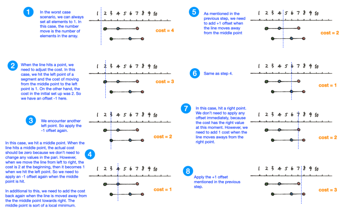

# Java solution with explaination

**Author:** DanielYoung
**Votes:** 4
**Link:** [https://leetcode.com/problems/minimum-moves-to-make-array-complementary/solutions/966297/](https://leetcode.com/problems/minimum-moves-to-make-array-complementary/solutions/966297/)

---

I did not come up with this idea myself, the solution is amazing though it is not straight foward. My suggestions is do not dive into the problem directly, but think about some important numbers.

Thanks to this post I began understanding the solution:https://ryansblog2718281.medium.com/leetcode-1674-minimum-moves-to-make-array-complementary-afa6e9fef054. It also has a very good demostration.

The other Java solotion was qutie a neat one: https://leetcode.com/problems/minimum-moves-to-make-array-complementary/discuss/956852/Java-simple-solution




```
public int minMoves(int[] nums, int limit) {        
        
        int length = nums.length;
        int[] segments = new int[limit*2+2]; // record the start and end of the segment, green and red dots
        Map<Integer, Integer> sums = new HashMap<>(); // record the sum frequence, they do not need any move
        
        for( int i = 0; i< nums.length/2; i++) {
            if(sums.keySet().contains(nums[i] + nums[length-1-i])){
                sums.put(nums[i] + nums[length-1-i], sums.get(nums[i] + nums[length-1-i]) + 1);
            } else {
                sums.put(nums[i] + nums[length-1-i], 1);
            }
            int a = Math.min(nums[i], nums[length-1-i]);
            int b = Math.max(nums[i], nums[length-1-i]);
            segments[a+1]--;
            segments[b+limit+1]++;
        }
        
        if(sums.keySet().size() == 1) {
            return 0;
        }        
       
        int change = length;
        int res = change;
        
        for(int i=2; i<segments.length; i++) {
            change = change + segments[i] - sums.getOrDefault(i, 0) + sums.getOrDefault(i-1, 0);
            res = Math.min(res, change);
        }           
        
        return res;
        
    }    
```