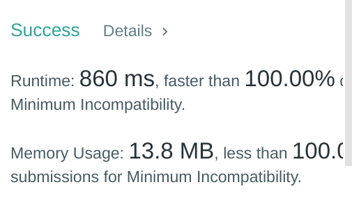

# [Python] simple backtracking beats 100%

**Author:** YTP27
**Votes:** 8
**Link:** [https://leetcode.com/problems/minimum-incompatibility/solutions/961654/](https://leetcode.com/problems/minimum-incompatibility/solutions/961654/)

---


```python
class Solution(object):
    def minimumIncompatibility(self, nums, k):
        nums.sort(reverse = True)
        upperbound = len(nums) // k
        arr = [[] for _ in range(k)]
        self.res = float('inf')
        def assign(i):
            if i == len(nums):
                self.res = min(self.res, sum(arr[i][0]-arr[i][-1] for i in range(k)))
                return True
            flag = 0
            for j in range(k):
                if not arr[j] or (len(arr[j]) < upperbound and arr[j][-1] != nums[i]):
                    arr[j].append(nums[i])
                    if assign(i+1):
                        flag += 1
                    arr[j].pop()
                if flag >= 2: break
            return flag != 0
        if max(collections.Counter(nums).values()) > k: return -1
        assign(0)
        return self.res
```

Backtracking is a very time consuming algorithm. If we don't have early break, its time complexity will be O(n!) (for example Hamiltonian and NQueens problems). So we usually need to have an early break condition, which is a tricky part.

In this case, I implemented backtracking with two attemps (nums[i] can be assigned to arr[j] and arr[j+1]). A simple and fast solution.