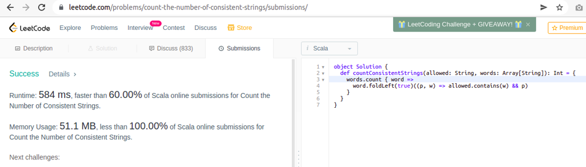

# Scala Solution / 1 Liner / Runtime Faster than 60.00% / Memory less than 100.00%

**Author:** maverickss
**Votes:** 1
**Link:** [https://leetcode.com/problems/count-the-number-of-consistent-strings/solutions/1665067/](https://leetcode.com/problems/count-the-number-of-consistent-strings/solutions/1665067/)

---

```
def countConsistentStrings(allowed: String, words: Array[String]): Int =
    words.count(_.foldLeft(true)((p, w) => allowed.contains(w) && p))
```

