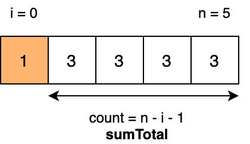
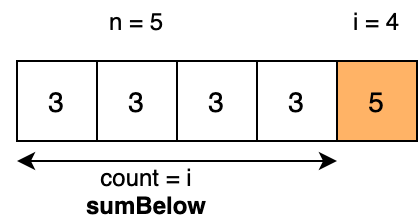
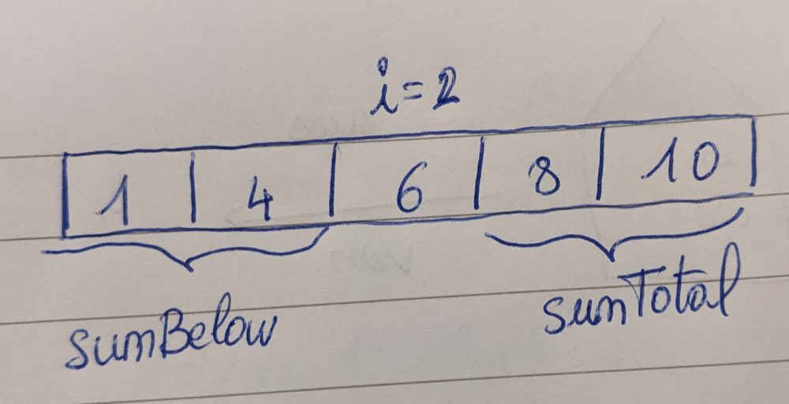

# Illustrations for O(n) formula [Java, Kotlin, Python]

**Author:** chenon
**Votes:** 38
**Link:** [https://leetcode.com/problems/sum-of-absolute-differences-in-a-sorted-array/solutions/969761/](https://leetcode.com/problems/sum-of-absolute-differences-in-a-sorted-array/solutions/969761/)

---

It is usually Hard to come up with a formula. For example:
```
res[i] = sumTotal - (n - i - 1) * nums[i]  +  i * nums[i] - sumBelow
```
To infer the general formula, I like to use examples and plug real numbers.

# **Tip on sum of absolute difference**
Reminder of `abs` function:

## 1 Sum on the right side

- (1) if `a > b` =>  `|a-b| = a - b > 0` , for n elements `n*|a-b| = n*(a-b)`
- 
The sum of differences  with this array below


The count of elements on the right is `n-i-1`
`sumTotal` is sum of array elements minus the current element (index i)
`n` is the array size.  

```
sum(|nums[i]-nums[j]|) =  |3-1| + |3-1| + |3-1| + |3-1|
=  4 * |3-1| = 4 * 3 - 4 * 1 
```

Formula of sum of absolute differences on the right side
```
SumAbsoluteDifferencesRight = sumTotal - (n-i-1) * nums[i]
```

## 2 Sum on the left side
- (2) if `b > a` =>  `|a-b| = b - a > 0`,  for n elements `n*|a-b| = n*(b-a)`

The current index `i` is on the other end.



The count of elements on the right is `i`
`sumBelow` is the accumulated sum of array elements below the current element (index i)

```
sum(|nums[i]-nums[j]|) = |3-5| + |3-5| + |3-5| + |3-5|
= 4 * |3-5| 
= 4 * (5-3)
= 4*5 - 4*3
```

Formula of sum of absolute differences on the left side
```
SumAbsoluteDifferencesLeft = | sumBelow - (i) * nums[i] |
=  i * nums[i] - sumBelow 
```
# **O(n) computation**

To be linear, the trick is to calculate the sum of abs difference on left and right side  `res[i] = SumAbsoluteDifferencesRight + SumAbsoluteDifferencesLeft`



The current value at index i `nums[i]` is cancelled by its own difference.
Now combine both and the general formula is

```
res[i] = SumAbsoluteDifferencesRight (1*) + SumAbsoluteDifferencesLeft (2*)
res[i] = sumTotal - (n - i - 1) * nums[i]  +  i * nums[i] - sumBelow
```

## Solutions
Time complexity: O(n)
Space complexity: O(n)

**Java**

```
class Solution {
    public int[] getSumAbsoluteDifferences(int[] nums) {
        int n = nums.length;
        int[] res = new int[n];
        int sumBelow = 0;
        int sumTotal = Arrays.stream(nums).sum();

        for (int i = 0; i < n; i++) {
            int num = nums[i];
            sumTotal -= num;
            res[i] = sumTotal - (n - i - 1) * num + i * num - sumBelow;
            sumBelow += num;
        }
        return res;
    }
}
```

**Kotlin**
```
class Solution {
    fun getSumAbsoluteDifferences(nums: IntArray): IntArray {
        val n = nums.size
        val res = IntArray(n)
        var sumBelow = 0
        var sumTotal = 0
        for (num in nums) {
            sumTotal += num
        }
        for (i in 0 until n) {
            val num = nums[i]
            sumTotal -= num
            res[i] = sumTotal - (n - i - 1) * num + i * num - sumBelow
            sumBelow += num
        }
        return res
    }
}
```

**Python**
```
class Solution:
    def getSumAbsoluteDifferences(self, nums: List[int]) -> List[int]:
        n = len(nums)
        sum_below = 0
        sum_total = 0
        for num in nums:
            sum_total += num
        
        res = []
        for i in range(n):
            num = nums[i]
            sum_total -= num
            res.append(sum_total - (n - 1 - i) * num + i * num - sum_below)
            sum_below += num
        return res
```

Special thanks to 
https://leetcode.com/problems/sum-of-absolute-differences-in-a-sorted-array/discuss/969506/O(n)-python
https://leetcode.com/problems/sum-of-absolute-differences-in-a-sorted-array/discuss/969525/C%2B%2B-O(n)-Track-Balance

**Feel free to ask any question in the comment section.**