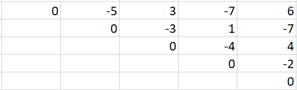

# [Python3] Easy code with explanation - DP

**Author:** mihirrane
**Votes:** 9
**Link:** [https://leetcode.com/problems/stone-game-vii/solutions/971804/](https://leetcode.com/problems/stone-game-vii/solutions/971804/)

---

The subproblem for the DP solution is that,
For n = 1, Alice or Bob picks the stone and nobody gets any score.
For n = 2, the person picks first stone and the score equals second stone or vice versa.
so on....

Now, that we have the subproblem how do we fill the DP table and fill it with what?
I thought of 3 choice for entries into the DP table - Alice's score, Bob's score or **difference of their scores**.
It gets messy for the rest so I chose difference of their scores. After zeroing on that, what should be the size of the table?
Each table entry dp[i][j] signifies the difference in scores between the ith stone and jth stone.
Now that we know what i and j mean its obvious that we have to find the difference of scores between the 0th stone and nth stone.

Okay, next question that arises is, how do we fill the table entry when its Bob's turn and when its Alice's turn?
Note that: the difference of scores is : (sum of scores obtained by Alice) - (sum of scores obtained by Bob)
When its **Bob's turn**, his target is to minimize the difference:
**dp[i][j]  = min(dp[i][j-1] - (score after removing jth stone), dp[i+1][j] - (score after removing ith stone))**

dp[i][j] -> Difference in score between ith and jth stone
dp[i][j-1] -> Difference in score between ith and j-1 th stone
dp[i+1][j] -> Difference in score between i+1 th and j th stone

The intuition is to make the negative part larger to minimize the difference.

When its **Alice's turn**, her target is to maximize the difference:
**dp[i][j]  = min(dp[i][j-1] + (score after removing jth stone), dp[i+1][j] + (score after removing ith stone))**

dp[i][j] -> Difference in score between ith and jth stone
dp[i][j-1] -> Difference in score between ith and j-1 th stone
dp[i+1][j] -> Difference in score between i+1 th and j th stone

The intuition is to make the positive part larger to maximize the difference.

If even number of stones were removed from the array then the upcoming turn is Alice's and similary for Bob odd number of stones must be removed.

The direction left to right and bottom to top.

Example of DP table for : 5,3,1,4,2



Running time: O(n^2)
Memory : O(n^2)

This question is similar to: https://leetcode.com/problems/stone-game-vi/

```
class Solution:
    def stoneGameVII(self, stones: List[int]) -> int:
        dp = [[0 for _ in range(len(stones))] for _ in range(len(stones))]     # dp table n x n
        run_sum = [0]                            # running sum -> sum [i..j] = run_sum[j] - run_sum[i]
        s = 0
        
		## Calculation of running sum
        for i in stones:
            s += i
            run_sum.append(s)
		
        n = len(stones) 
        
        for k in range(1, n):               # no. of stones left
            for i in range(0, n - k):   # from each starting point
                remove_i_stone = (run_sum[i+k+1] - run_sum[i+1])    # score after removing i th stone
                remove_j_stone = (run_sum[i+k] - run_sum[i])             # score after removing j th stone
                
                if (n-(k+1))%2 == 0:        # alice's move 
                    dp[i][i+k] = max(remove_i_stone + dp[i+1][i+k],
                                    remove_j_stone + dp[i][i+k-1])
                else:                       # bob's move
                    dp[i][i+k] = min(-remove_i_stone + dp[i+1][i+k],
                                    - remove_j_stone + dp[i][i+k-1])
                    
        return dp[0][n - 1]
```