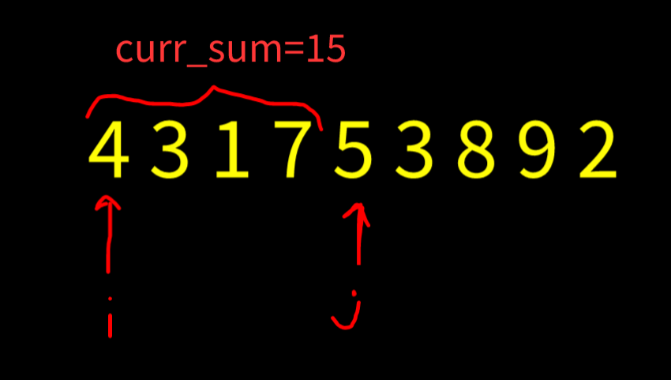
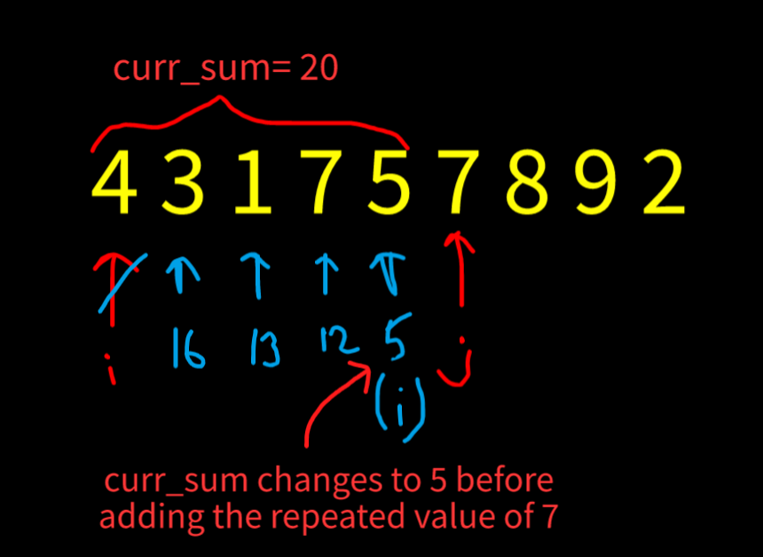

# Easy C++ Solution using Two Pointers

**Author:** harshit7962
**Votes:** 21
**Link:** [https://leetcode.com/problems/maximum-erasure-value/solutions/2140860/](https://leetcode.com/problems/maximum-erasure-value/solutions/2140860/)

---

The idea here is to keep track  of all the elements already visited using a set and deploy two pointers (i&j) to adjust our current window.
The flow is as follows:
* If the current element is not already present in the set we simply add it to our curr_sum and extend the window...
* If the element is already present in the set, we start removing elements from start of our window until we delete the required element...
* We keep track of maximum result using another variable...

**Example 1: Lets take this to be our current i and j positions...**

Now since 5 is not already present in our set, we simply add it to curr_sum variable and increment the j value...


**Example 2:**

Now here we are adding 7, which is already present in our set, so we start remove elements of ith index from set and also subtract them from our curr_sum value until we remove the value 7...

**If you found the solution, pls upvote this thread.**

```
class Solution {
public:
    int maximumUniqueSubarray(vector<int>& nums) {
        int curr_sum=0, res=0;
		
		//set to store the elements
        unordered_set<int> st;
        
        int i=0,j=0;
        while(j<nums.size()) {
            while(st.count(nums[j])>0) {
				//Removing the ith element untill we reach the repeating element
                st.erase(nums[i]);
                curr_sum-=nums[i];
                i++;
            }
			//Add the current element to set and curr_sum value
            curr_sum+=nums[j];
            st.insert(nums[j++]);
			
			//res variable to keep track of largest curr_sum encountered till now...
            res = max(res, curr_sum);
        }
        
        return res;
    }
};
```