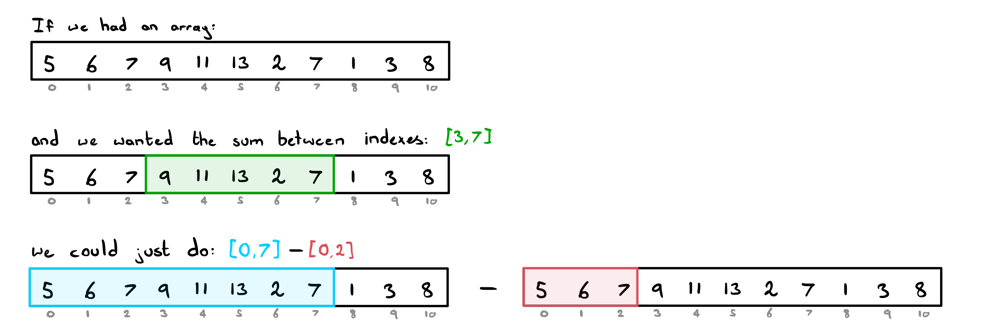

# An Interesting Optimisation | JAVA Explanation

**Author:** ciote
**Votes:** 109
**Link:** [https://leetcode.com/problems/maximum-erasure-value/solutions/2140577/](https://leetcode.com/problems/maximum-erasure-value/solutions/2140577/)

---

### Introduction:
Before we discuss the optimisation, let's make sure we're on the same page regarding the classic two-pointer approach.
We can solve this question by simply expanding a right pointer while keeping track of the sum until we reach a value we've seen before. Then, we increment our left pointer until the duplicate no longer exists. Finally, we can just update our maximum sum! I've included the code for this approach below as well.

### Optimising our code:
Now, as you may have noticed, we continuously expand our left pointer until we reach that duplicate. Doesn't it feel like we could be saving some time here? I mean, if we already knew the <ins>last indexes of all values</ins>, we could just jump our left pointer straight there. Awesome, now we're getting somewhere.

> Interview tip: To optimise your code, look for inefficiencies or repetitive work in your current approach and see if you can negate them. 

Hang on, but what about our sums? The benefit of the regular two-pointer approach was that we get to adjust our sum while our left pointer is increasing. Well, what if we already knew the sums at any given range? Turns out we can do this using a prefix sum array.

> Interview tip: If you find yourself thinking "man, it would be great if I had x", then try to enforce that behaviour in your algorithm.

### Prefix Sums:
The idea behind prefix sums is that if we want the sum between the range `[left, right]`, we can obtain it by evaluating: 
**`sum[left, right] = sum[0, right] - sum[0, left - 1]`**. In other words, this is a *range sum query*.

Observe this in the below illustration:


In other words, the sum from any range from 0 to `i` where `i` is any index in the array, is called the <ins>prefix sum</ins>. If we store the prefix sum at each index, we can obtain any given sum range! If we combine this idea with the idea to keep track of "last indexes", we have ourselves an optimised approach.

And there we have it! Just by spending a bit more extra space, we managed to improve our linear solution quite a bit! Now we're ready to start coding.
___
### Code:
**Two-pointer Solution:**
> Time complexity: `O(n)`
> Space complexity: `O(m)` where `m` is the number of unique elements.
```java
public int maximumUniqueSubarray(int[] nums) {        
	int maxScore = 0, currScore = 0;
	Set<Integer> set = new HashSet<>();

	for (int l=0, r=0; r<nums.length; r++) {
		while (!set.add(nums[r])) {
			currScore -= nums[l];
			set.remove(nums[l++]);
		}
		currScore += nums[r];
		maxScore = Math.max(maxScore, currScore);
	}

	return maxScore;
}
```
**Prefix Sum Solution:**
> Time complexity: `O(n)`
> Space complexity: `O(n)`
```java
public int maximumUniqueSubarray(int[] nums) {
	Map<Integer, Integer> lastIndex = new HashMap<>();
	int[] prefixSum = new int[nums.length + 1];

	int maxScore = 0;
	for (int l=0, r=0; r<nums.length; r++) {
		prefixSum[r+1] = prefixSum[r] + nums[r];
		if (lastIndex.containsKey(nums[r])) 
			l = Math.max(l, lastIndex.get(nums[r]) + 1);
		maxScore = Math.max(maxScore, prefixSum[r+1] - prefixSum[l]);
		lastIndex.put(nums[r], r);
	}

	return maxScore;
}
```
Note: Both approaches can be improved using arrays instead of a set or map! I left the sets and maps in there to make the intention clear for this guide.