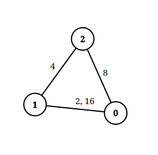
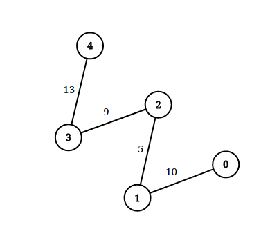

# [1697. Checking Existence of Edge Length Limited Paths](https://leetcode.com/problems/checking-existence-of-edge-length-limited-paths/)

| Category | Difficulty | Likes | Dislikes |
| :------: | :--------: | :---: | :------: |
| Algorithms | Hard | 2079 | 48 |

**Tags:** [`array`](https://leetcode.com/tag/array), [`two-pointers`](https://leetcode.com/tag/two-pointers), [`union-find`](https://leetcode.com/tag/union-find), [`graph`](https://leetcode.com/tag/graph), [`sorting`](https://leetcode.com/tag/sorting)

**Companies:** `google`

## Description

An undirected graph of `n` nodes is defined by `edgeList`, where `edgeList[i] = [u_i, v_i, dis_i]` denotes an edge between nodes `u_i` and `v_i` with distance `dis_i`. Note that there may be **multiple** edges between two nodes.

Given an array `queries`, where `queries[j] = [p_j, q_j, limit_j]`, your task is to determine for each `queries[j]` whether there is a path between `p_j` and `q_j` such that each edge on the path has a distance **strictly less than** `limit_j` .

Return *a **boolean array** *`answer`*, where *`answer.length == queries.length` *and the *`j^th` *value of *`answer` *is *`true`* if there is a path for *`queries[j]`* is *`true`*, and *`false`* otherwise*.

 

**Example 1:**


```

Input: n = 3, edgeList = [[0,1,2],[1,2,4],[2,0,8],[1,0,16]], queries = [[0,1,2],[0,2,5]]
Output: [false,true]
Explanation: The above figure shows the given graph. Note that there are two overlapping edges between 0 and 1 with distances 2 and 16.
For the first query, between 0 and 1 there is no path where each distance is less than 2, thus we return false for this query.
For the second query, there is a path (0 -&gt; 1 -&gt; 2) of two edges with distances less than 5, thus we return true for this query.

```

**Example 2:**


```

Input: n = 5, edgeList = [[0,1,10],[1,2,5],[2,3,9],[3,4,13]], queries = [[0,4,14],[1,4,13]]
Output: [true,false]
Explanation: The above figure shows the given graph.

```

 

**Constraints:**

	- `2 <= n <= 10^5`

	- `1 <= edgeList.length, queries.length <= 10^5`

	- `edgeList[i].length == 3`

	- `queries[j].length == 3`

	- `0 <= u_i, v_i, p_j, q_j <= n - 1`

	- `u_i != v_i`

	- `p_j != q_j`

	- `1 <= dis_i, limit_j <= 10^9`

	- There may be **multiple** edges between two nodes.

---

**Links:** [Submissions](https://leetcode.com/problems/checking-existence-of-edge-length-limited-paths/) | [Solutions](https://leetcode.com/problems/checking-existence-of-edge-length-limited-paths/)
