# Image Explanation🏆- [Easiest & Complete Intuition] - C++/Java/Python

**Author:** lc00701
**Votes:** 78
**Link:** [https://leetcode.com/problems/checking-existence-of-edge-length-limited-paths/solutions/3464929/](https://leetcode.com/problems/checking-existence-of-edge-length-limited-paths/solutions/3464929/)

---

# Video Solution (`Aryan Mittal`) - Link in LeetCode Profile
`Checking Existence of Edge Length Limited Paths` by `Aryan Mittal`


# Approach & Intution
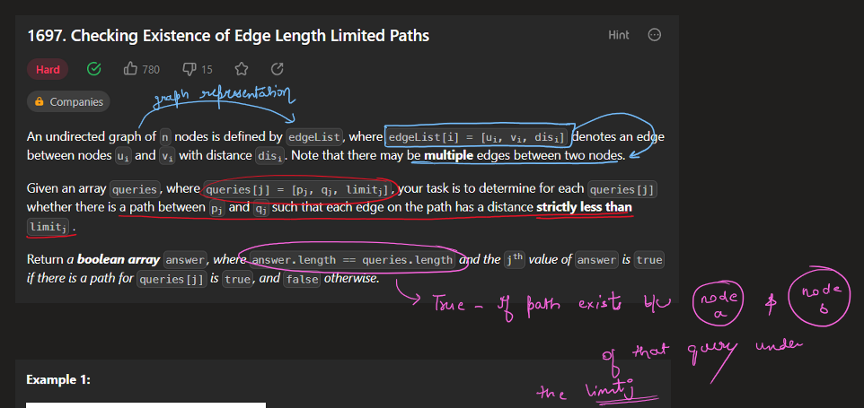
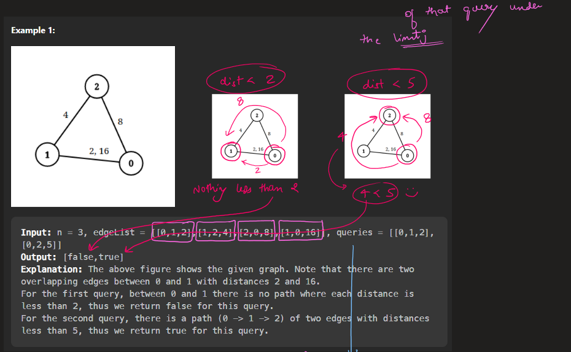
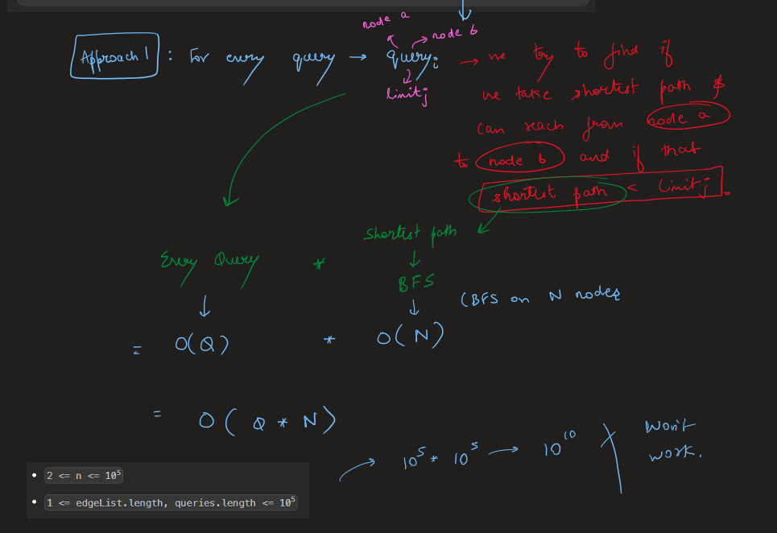
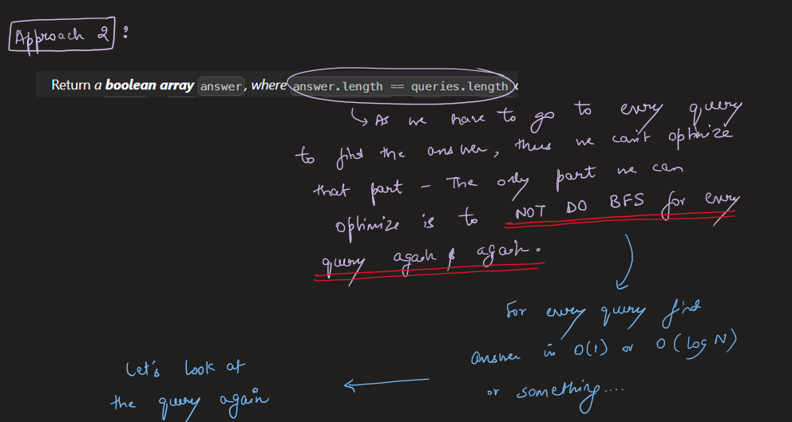
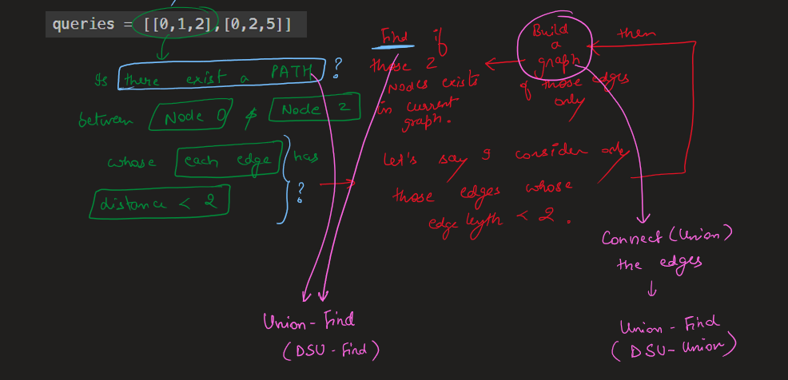
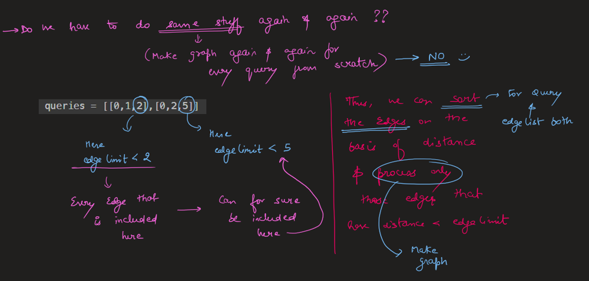
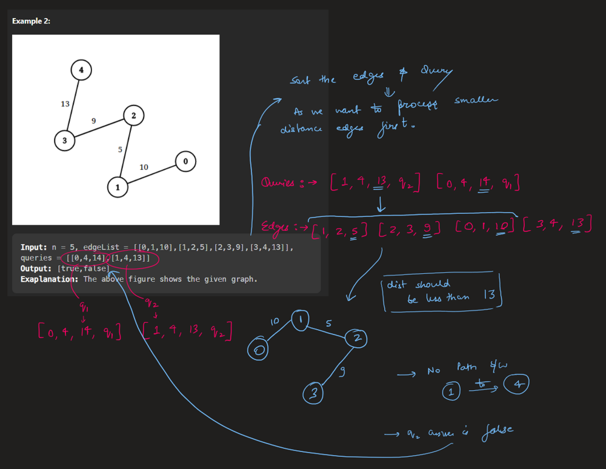
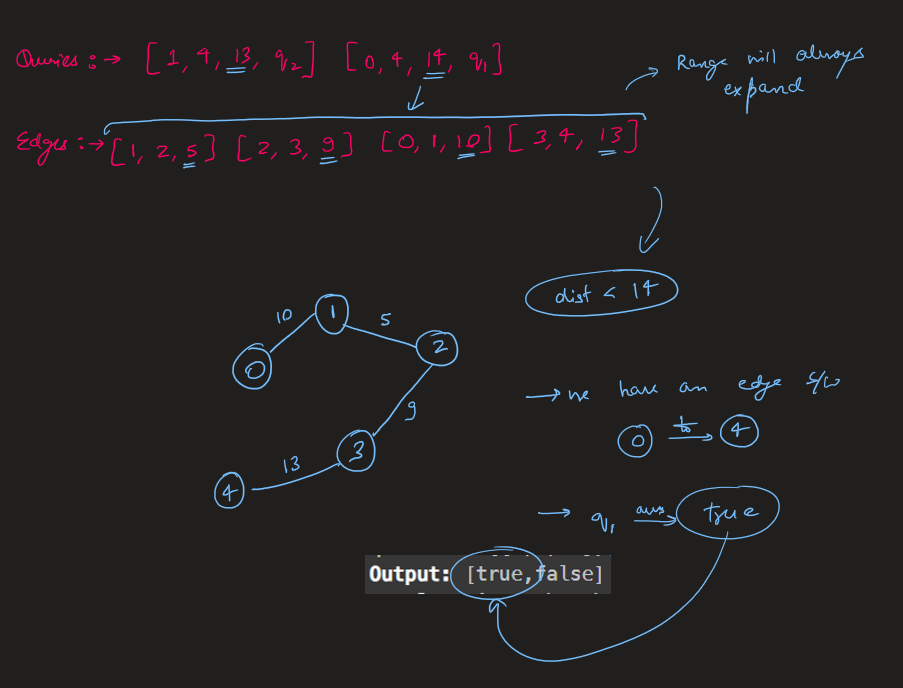
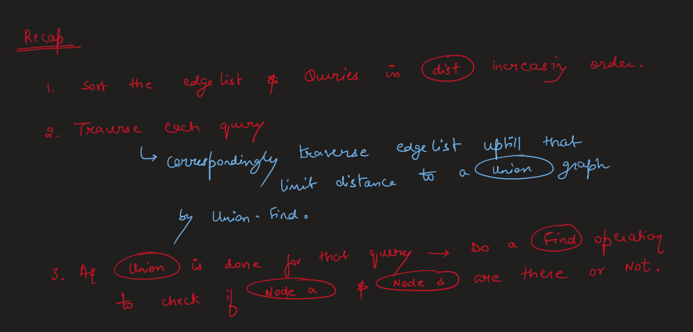
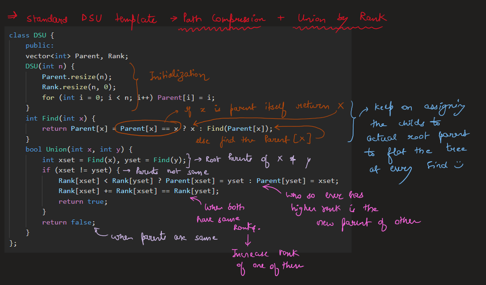
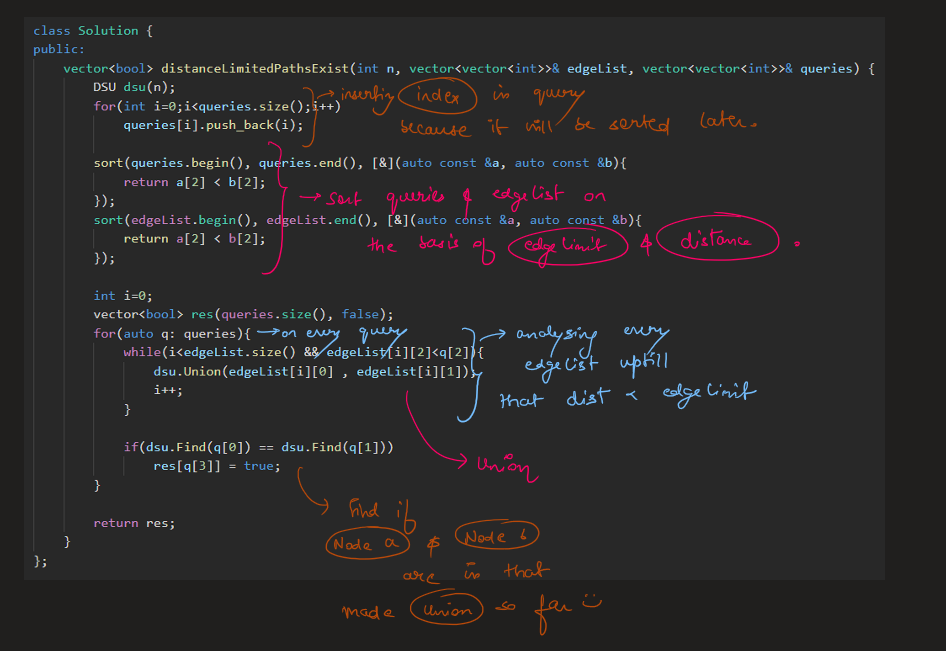
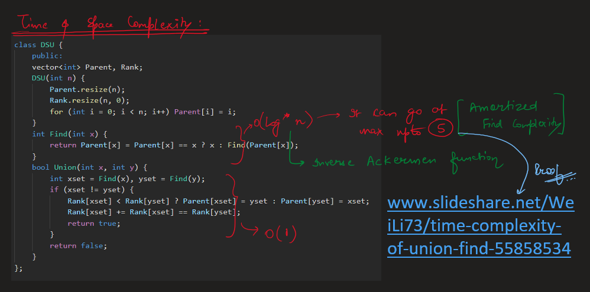
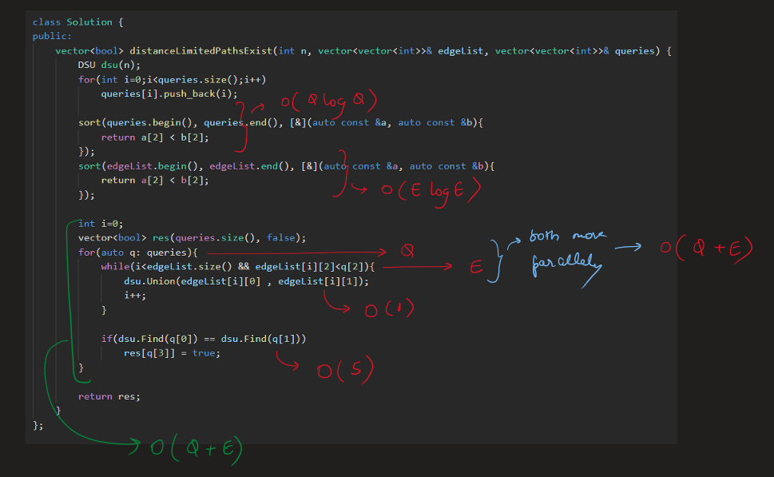
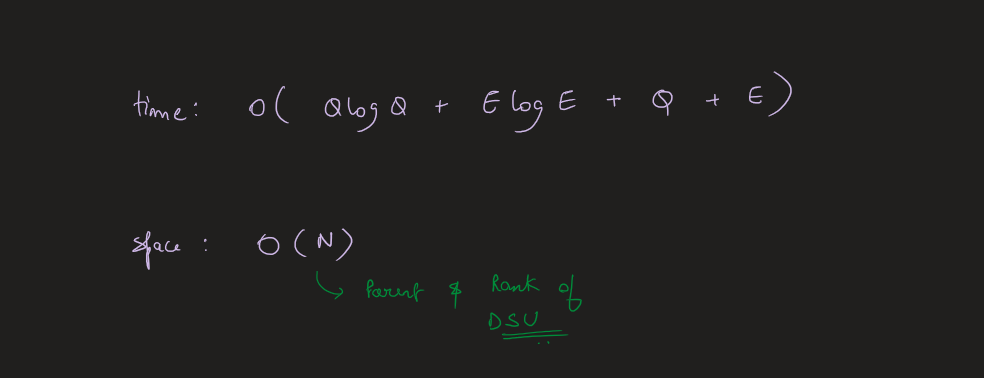


# Code
`Mark the DSU Code as the template [I always use this ONLY]`
```C++ []
class DSU {
    public:
    vector<int> Parent, Rank;
    DSU(int n) {
        Parent.resize(n);
        Rank.resize(n, 0);
        for (int i = 0; i < n; i++) Parent[i] = i;
    }
    int Find(int x) {
        return Parent[x] = Parent[x] == x ? x : Find(Parent[x]);
    }
    bool Union(int x, int y) {
        int xset = Find(x), yset = Find(y);
        if (xset != yset) {
            Rank[xset] < Rank[yset] ? Parent[xset] = yset : Parent[yset] = xset;
            Rank[xset] += Rank[xset] == Rank[yset];
            return true;
        }
        return false;
    }
};

class Solution {
public:
    vector<bool> distanceLimitedPathsExist(int n, vector<vector<int>>& edgeList, vector<vector<int>>& queries) {
        DSU dsu(n);
        for(int i=0;i<queries.size();i++)
            queries[i].push_back(i);
        
        sort(queries.begin(), queries.end(), [&](auto const &a, auto const &b){
            return a[2] < b[2];
        });
        sort(edgeList.begin(), edgeList.end(), [&](auto const &a, auto const &b){
            return a[2] < b[2];
        });
        
        int i=0;
        vector<bool> res(queries.size(), false);
        for(auto q: queries){
            while(i<edgeList.size() && edgeList[i][2]<q[2]){
                dsu.Union(edgeList[i][0] , edgeList[i][1]);
                i++;
            }
            
            if(dsu.Find(q[0]) == dsu.Find(q[1]))
                res[q[3]] = true;
        }
        
        return res;
    }
};
```
```Java []
class DSU {
    private int[] parent;
    private int[] rank;

    public DSU(int n) {
        parent = new int[n];
        rank = new int[n];
        for (int i = 0; i < n; i++) {
            parent[i] = i;
        }
    }

    public int find(int x) {
        if (parent[x] == x) {
            return x;
        }
        return parent[x] = find(parent[x]);
    }

    public boolean union(int x, int y) {
        int xset = find(x), yset = find(y);
        if (xset != yset) {
            if (rank[xset] < rank[yset]) {
                parent[xset] = yset;
            } else {
                parent[yset] = xset;
            }
            if (rank[xset] == rank[yset]) {
                rank[xset]++;
            }
            return true;
        }
        return false;
    }
}

class Solution {
    public boolean[] distanceLimitedPathsExist(int n, int[][] edgeList, int[][] queries) {
        DSU dsu = new DSU(n);
        for (int i = 0; i < queries.length; i++) {
            queries[i] = new int[] { queries[i][0], queries[i][1], queries[i][2], i };
        }

        Arrays.sort(queries, (a, b) -> Integer.compare(a[2], b[2]));
        Arrays.sort(edgeList, (a, b) -> Integer.compare(a[2], b[2]));

        int i = 0;
        boolean[] res = new boolean[queries.length];
        for (int[] q : queries) {
            while (i < edgeList.length && edgeList[i][2] < q[2]) {
                dsu.union(edgeList[i][0], edgeList[i][1]);
                i++;
            }

            if (dsu.find(q[0]) == dsu.find(q[1])) {
                res[q[3]] = true;
            }
        }

        return res;
    }
}
```
```Python []
class DSU:
    def __init__(self, n):
        self.parent = list(range(n))
        self.rank = [0] * n

    def find(self, x):
        if self.parent[x] == x:
            return x
        self.parent[x] = self.find(self.parent[x])
        return self.parent[x]

    def union(self, x, y):
        xset, yset = self.find(x), self.find(y)
        if xset != yset:
            if self.rank[xset] < self.rank[yset]:
                self.parent[xset] = yset
            else:
                self.parent[yset] = xset
            if self.rank[xset] == self.rank[yset]:
                self.rank[xset] += 1
            return True
        return False

class Solution:
    def distanceLimitedPathsExist(self, n: int, edgeList: List[List[int]], queries: List[List[int]]) -> List[bool]:
        dsu = DSU(n)
        for i, q in enumerate(queries):
            queries[i].append(i)

        queries.sort(key=lambda q: q[2])
        edgeList.sort(key=lambda e: e[2])

        i = 0
        res = [False] * len(queries)
        for q in queries:
            while i < len(edgeList) and edgeList[i][2] < q[2]:
                dsu.union(edgeList[i][0], edgeList[i][1])
                i += 1

            if dsu.find(q[0]) == dsu.find(q[1]):
                res[q[3]] = True

        return res
```
