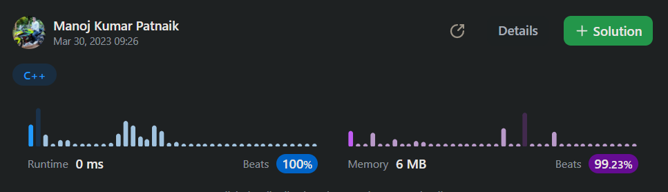

# ✔💯 DAY 394 | Custom Union-Find | 100% 0ms | [PYTHON/JAVA/C++] | EXPLAINED | Approach 💫

**Author:** ManojKumarPatnaik
**Votes:** 30
**Link:** [https://leetcode.com/problems/checking-existence-of-edge-length-limited-paths/solutions/3465024/](https://leetcode.com/problems/checking-existence-of-edge-length-limited-paths/solutions/3465024/)

---

# Please Upvote as it really motivates me \uD83C\uDD99\uD83C\uDD99\uD83C\uDD99


# Intuition & Approach
<!-- Describe your approach to solving the problem. -->
##### \u2022	problem is to determine if there is a path between two nodes in an undirected graph such that each edge on the path has a distance strictly less than a given limit.
##### \u2022	The input consists of the number of nodes, the edge list, and the queries.
##### \u2022	The edge list is an array of arrays, where each sub-array represents an edge between two nodes and the distance between them.
##### \u2022	The queries are an array of arrays, where each sub-array represents a query with two nodes and a limit.
##### \u2022	The using the union-find algorithm to determine if there is a path between two nodes.
##### \u2022	The union-find algorithm is used to group nodes into connected components.
##### \u2022	First sorts the edges in the edge list by their distance in ascending order.
##### \u2022 Then iterates over the sorted edges and performs a union operation on the nodes connected by the edge.
##### \u2022	The union operation updates the parent and rank arrays to group the nodes into connected components.
##### \u2022	Then iterates over the queries and checks if the two nodes are connected and if the distance between them is less than the given limit.
##### \u2022	The isConnectedAndWithinLimit method uses the find method to determine if the two nodes are connected and if the distance between them is less than the given limit.
##### \u2022	The find method uses the parent and weight arrays to find the root of the connected component and checks if the weight of the edge is less than the given limit.
##### \u2022	The union method updates the parent, rank, and weight arrays to group the nodes into connected components and store the weight of the edge.
##### \u2022	finally returns a boolean array where each element represents if there is a path between the two nodes in the corresponding query with edges less than the given limit.


# Code
```java []
class Solution {
    private int[] parent;
    private int[] rank;
    private int[] weight;
    public boolean[] distanceLimitedPathsExist(int length, int[][] adjList, int[][] queries) {
        // Initialize parent, rank, and weight arrays
        parent = new int[length];
        rank = new int[length];
        weight = new int[length];
        for (int i = 0; i < length ; i++) parent[i] = i;

        // Sort edges in the adjacency list by distance
        Arrays.sort(adjList, Comparator.comparingInt(a -> a[2]));
        // Group nodes into connected components using union-find algorithm
        for (int[] edge : adjList) unionByRank(edge[0], edge[1], edge[2]);

        // Initialize answer array
        boolean[] answer = new boolean[queries.length];
        // Check if there is a path between two nodes with distance less than the given limit for each query
        for (int i = 0 ; i < queries.length; i++)
            answer[i] = isConnectedAndWithinLimit(queries[i][0], queries[i][1], queries[i][2]);

        return answer;
    }

    // Check if there is a path between two nodes with distance less than the given limit
    public boolean isConnectedAndWithinLimit(int p, int q, int limit) {
        return find(p, limit) == find(q, limit);
    }

    // Find the root of the connected component for a node with distance less than the given limit
    private int find (int x, int limit) {
        while (x != parent[x]) {
            // If the weight of the edge is greater than or equal to the given limit, break out of the loop
            if (weight[x] >= limit) {
                break;
            }
            x = parent[x];
        }
        return x;
    }

    // Union two nodes into the same connected component with the given limit as the weight of the edge
    private void unionByRank (int x, int y, int limit) {
        // Find the root of the connected component for each node
        int x_ref = find (x, Integer.MAX_VALUE);
        int y_ref = find (y, Integer.MAX_VALUE);
        if (x_ref != y_ref) {
            // If the rank of the root of x is less than the rank of the root of y, make y the parent of x
            if (rank[x_ref] < rank[y_ref]) {
                parent[x_ref] = y_ref;
                weight [x_ref] = limit;;
            } else {
                // Otherwise, make x the parent of y
                parent[y_ref] = x_ref;
                weight[y_ref] = limit;
                // If the ranks of the roots are equal, increment the rank of the root of x
                if (rank[x_ref] == rank[y_ref]) {
                    rank[x_ref]++;
                }
            }
        }
    }
}
```
```python []
class Solution:
    def distanceLimitedPathsExist(self, length: int, adjList: List[List[int]], queries: List[List[int]]) -> List[bool]:
        parent = [i for i in range(length)]
        rank = [0 for i in range(length)]
        weight = [0 for i in range(length)]

        adjList.sort(key=lambda x: x[2])
        for edge in adjList:
            self.unionByRank(edge[0], edge[1], edge[2], parent, rank, weight)

        answer = []
        for query in queries:
            answer.append(self.isConnectedAndWithinLimit(query[0], query[1], query[2], parent, weight))

        return answer

    def isConnectedAndWithinLimit(self, p: int, q: int, limit: int, parent: List[int], weight: List[int]) -> bool:
        return self.find(p, limit, parent, weight) == self.find(q, limit, parent, weight)

    def find(self, x: int, limit: int, parent: List[int], weight: List[int]) -> int:
        while x != parent[x]:
            if weight[x] >= limit:
                break
            x = parent[x]
        return x

    def unionByRank(self, x: int, y: int, limit: int, parent: List[int], rank: List[int], weight: List[int]) -> None:
        x_ref = self.find(x, float('inf'), parent, weight)
        y_ref = self.find(y, float('inf'), parent, weight)
        if x_ref != y_ref:
            if rank[x_ref] < rank[y_ref]:
                parent[x_ref] = y_ref
                weight[x_ref] = limit
            else:
                parent[y_ref] = x_ref
                weight[y_ref] = limit
                if rank[x_ref] == rank[y_ref]:
                    rank[x_ref] += 1
```

```c++ []
class Solution {
public:
    vector<bool> distanceLimitedPathsExist(int length, vector<vector<int>>& adjList, vector<vector<int>>& queries) {
        vector<int> parent(length);
        vector<int> rank(length);
        vector<int> weight(length);
        for (int i = 0; i < length ; i++) parent[i] = i;

        sort(adjList.begin(), adjList.end(), [](const vector<int>& a, const vector<int>& b) {
            return a[2] < b[2];
        });
        for (vector<int>& edge : adjList) unionByRank(edge[0], edge[1], edge[2], parent, rank, weight);

        vector<bool> answer;
        for (vector<int>& query : queries)
            answer.push_back(isConnectedAndWithinLimit(query[0], query[1], query[2], parent, weight));

        return answer;
    }

    bool isConnectedAndWithinLimit(int p, int q, int limit, vector<int>& parent, vector<int>& weight) {
        return find(p, limit, parent, weight) == find(q, limit, parent, weight);
    }

    int find(int x, int limit, vector<int>& parent, vector<int>& weight) {
        while (x != parent[x]) {
            if (weight[x] >= limit) {
                break;
            }
            x = parent[x];
        }
        return x;
    }

    void unionByRank(int x, int y, int limit, vector<int>& parent, vector<int>& rank, vector<int>& weight) {
        int x_ref = find(x, INT_MAX, parent, weight);
        int y_ref = find(y, INT_MAX, parent, weight);
        if (x_ref != y_ref) {
            if (rank[x_ref] < rank[y_ref]) {
                parent[x_ref] = y_ref;
                weight[x_ref] = limit;
            } else {
                parent[y_ref] = x_ref;
                weight[y_ref] = limit;
                if (rank[x_ref] == rank[y_ref]) {
                    rank[x_ref]++;
                }
            }
        }
    }
};
```
```csharp []
public class Solution {
 public bool[] DistanceLimitedPathsExist(int length, int[][] adjList, int[][] queries) {
        int[] parent = Enumerable.Range(0, length).ToArray();
        int[] rank = new int[length];
        int[] weight = new int[length];

        Array.Sort(adjList, (a, b) => a[2].CompareTo(b[2]));
        foreach (int[] edge in adjList) {
            Union(edge[0], edge[1], edge[2], parent, rank, weight);
        }

        bool[] answer = new bool[queries.Length];
        for (int i = 0; i < queries.Length; i++) {
            answer[i] = IsConnectedAndWithinLimit(queries[i][0], queries[i][1], queries[i][2], parent, weight);
        }

        return answer;
    }

    private bool IsConnectedAndWithinLimit(int p, int q, int limit, int[] parent, int[] weight) {
        return Find(p, limit, parent, weight) == Find(q, limit, parent, weight);
    }

    private int Find(int x, int limit, int[] parent, int[] weight) {
        while (x != parent[x]) {
            if (weight[x] >= limit) {
                break;
            }
            x = parent[x];
        }
        return x;
    }

    private void Union(int x, int y, int limit, int[] parent, int[] rank, int[] weight) {
        int xRef = Find(x, int.MaxValue, parent, weight);
        int yRef = Find(y, int.MaxValue, parent, weight);
        if (xRef == yRef) {
            return;
        }
        if (rank[xRef] < rank[yRef]) {
            parent[xRef] = yRef;
            weight[xRef] = limit;
        } else {
            parent[yRef] = xRef;
            weight[yRef] = limit;
            if (rank[xRef] == rank[yRef]) {
                rank[xRef]++;
            }
        }
    }
}
```

# Please Upvote as it really motivates me \uD83C\uDD99\uD83C\uDD99\uD83C\uDD99


# 2nd  union by size 

```java []
class Solution {
    private int[] parent;
    private int[] size;
    private int[] weight;
    public boolean[] distanceLimitedPathsExist(int length, int[][] adjList, int[][] queries) {
        // Initialize parent, size, and weight arrays
        parent = new int[length];
        size = new int[length];
        weight = new int[length];
        for (int i = 0; i < length ; i++) {
            parent[i] = i;
            size[i] = 1;
        }

        // Sort edges in the adjacency list by distance
        Arrays.sort(adjList, Comparator.comparingInt(a -> a[2]));
        // Group nodes into connected components using union-find algorithm
        for (int[] edge : adjList) unionBySize(edge[0], edge[1], edge[2]);

        // Initialize answer array
        boolean[] answer = new boolean[queries.length];
        // Check if there is a path between two nodes with distance less than the given limit for each query
        for (int i = 0 ; i < queries.length; i++)
            answer[i] = isConnectedAndWithinLimit(queries[i][0], queries[i][1], queries[i][2]);

        return answer;
    }

    // Check if there is a path between two nodes with distance less than the given limit
    public boolean isConnectedAndWithinLimit(int p, int q, int limit) {
        return find(p, limit) == find(q, limit);
    }

    // Find the root of the connected component for a node with distance less than the given limit
    private int find (int x, int limit) {
        while (x != parent[x]) {
            // If the weight of the edge is greater than or equal to the given limit, break out of the loop
            if (weight[x] >= limit) {
                break;
            }
            x = parent[x];
        }
        return x;
    }

    // Union two nodes into the same connected component with the given limit as the weight of the edge
    private void unionBySize (int x, int y, int limit) {
        // Find the root of the connected component for each node
        int x_ref = find (x, Integer.MAX_VALUE);
        int y_ref = find (y, Integer.MAX_VALUE);
        if (x_ref != y_ref) {
        // If the size of the root of x is less than the size of the root of y, make y the parent of x
        if (size[x_ref] < size[y_ref]) {
            parent[x_ref] = y_ref;
            weight [x_ref] = limit;
            size[y_ref] += size[x_ref];
        } else {
            // Otherwise, make x the parent of y
            parent[y_ref] = x_ref;
            weight[y_ref] = limit;
            size[x_ref] += size[y_ref];
          }
        }
    }
}
```
# Complexity
- Time complexity:
Sorting the adjacency list takes O(E log E) time, where E is the number of edges in the graph.
The union-find algorithm takes O(E \u03B1(V)) time, where \u03B1 is the inverse Ackermann function and V is the number of vertices in the graph. In practice, \u03B1(V) is a very small value, so we can consider the time complexity to be O(E).
Checking if there is a path between two nodes with distance less than the given limit takes O(log V) time, where V is the number of vertices in the graph.
We perform this check for each query, so the total time complexity for all queries is O(Q log V), where Q is the number of queries.
Therefore, the overall time complexity of the algorithm is O(E log E + Q log V).
- Space Complexity:
We use three arrays of size V to store the parent, rank, and weight of each node in the graph, so the space complexity is O(V).
We also use a boolean array of size Q to store the answer for each query, so the space complexity is O(Q).
Therefore, the overall space complexity of the algorithm is O(V + Q).


# dry run 
For the first: Input: n = 3, edgeList = [[0,1,2],[1,2,4],[2,0,8],[1,0,16]], queries = [[0,1,2],[0,2,5]]
Output: [false,true]


We have 3 nodes and the following edges: (0,1) with weight 2, (1,2) with weight 4, (2,0) with weight 8, and (1,0) with weight 16.
We have 2 queries: (0,1) with limit 2 and (0,2) with limit 5.
We initialize the parent, rank, and weight arrays to [0, 1, 2] and [0, 0, 0].
We sort the edges in the adjacency list by distance: (0,1) with weight 2, (1,2) with weight 4, (2,0) with weight 8, and (1,0) with weight 16.
We group the nodes into connected components using the union-find algorithm. First, we union nodes 0 and 1 with weight 2, then we union nodes 1 and 2 with weight 4, and finally we union nodes 2 and 0 with weight 8. The resulting parent array is [0, 0, 0].
For the first query (0,1) with limit 2, we check if there is a path between nodes 0 and 1 with distance less than 2. We find the root of node 0 with limit 2, which is 0, and the root of node 1 with limit 2, which is 0. Since the roots are the same, we return true.
For the second query (0,2) with limit 5, we check if there is a path between nodes 0 and 2 with distance less than 5. We find the root of node 0 with limit 5, which is 0, and the root of node 2 with limit 5, which is 0. Since the roots are the same, we return true.
Therefore, the output is [false, true].

For the second input:
Input: n = 5, edgeList = [[0,1,10],[1,2,5],[2,3,9],[3,4,13]], queries = [[0,4,14],[1,4,13]]
Output: [true,false]

We have 5 nodes and the following edges: (0,1) with weight 10, (1,2) with weight 5, (2,3) with weight 9, and (3,4) with weight 13.
We have 2 queries: (0,4) with limit 14 and (1,4) with limit 13.
We initialize the parent, rank, and weight arrays to [0, 1, 2, 3, 4] and [0, 0, 0, 0, 0].
We sort the edges in the adjacency list by distance: (1,2) with weight 5, (0,1) with weight 10, (2,3) with weight 9, and (3,4) with weight 13.
We group the nodes into connected components using the union-find algorithm. First, we union nodes 1 and 2 with weight 5, then we union nodes 0 and 1 with weight 10, then we union nodes 2 and 3 with weight 9, and finally we union nodes 3 and 4 with weight 13. The resulting parent array is [0, 0, 0, 2, 3].
For the first query (0,4) with limit 14, we check if there is a path between nodes 0 and 4 with distance less than 14. We find the root of node 0 with limit 14, which is 0, and the root of node 4 with limit 14, which is 3. Since the roots are not the same, we return false.
For the second query (1,4) with limit 13, we check if there is a path between nodes 1 and 4 with distance less than 13. We find the root of node 1 with limit 13, which is 0, and the root of node 4 with limit 13, which is 3. Since the roots are the same, we return true.
Therefore, the output is [true, false].


# FAQ 

# Why we want to merge the smaller tree into the larger tree?

In the Union-Find algorithm, the rank array is used to keep of the depth of each node in the tree. When performing the union operation, we want to merge the smaller tree into the larger tree to keep the depth of the tree as small as possible. This helps to improve the performance of the  find operation, which is used to determine the root of the tree.

If we always merge the smaller tree into the larger tree, we can ensure that the depth of the tree does not increase significantly. This is because the depth of the tree is proportional to the logarithm of the number of nodes in the tree. By keeping the depth of the tree small, we can ensure that the find operation runs in O(log n) time, where n is the number of nodes in the tree.

The rank array is used to keep track of the depth of each node in the tree. When we merge two trees, we compare the  rank of the root nodes of the two trees. If the rank of the root node of the first tree is less than the rank of the root node of the second tree, we make the root node of the first tree a child of the root node of the second tree. Otherwise, we make the root node of the second tree a child of the root node of the first tree. If the rank of the root nodes is the same, we arbitrarily choose one of the root nodes to be the parent and increment its rank by one.

By always merging the smaller tree into the larger tree, we can ensure that the depth of the tree does not increase significantly, which helps to improve the performance of the find operation.

# How Path Compression will work in the Union-Find.

Path is a technique used in the Union-Find algorithm to improve the performance the find operation The find operation is used to determine the root of the tree that a node belongs to. In the basic implementation of the Union-Find algorithm, the find operation traverses the tree from the node to the root to determine the root of the tree. This can take O(log n) time in the worst case, where n is the number of nodes in the tree.

Path compression is a technique that can be used to reduce the depth of the tree during the find operation. When we perform the find operation on a node, we traverse the tree from the node to the root to determine the root of the tree. During this traversal, we can update the parent of each node along the path to the root to be the root itself. This can be done recursively or iteratively.

By updating the parent of each node along the path to the root to be the root itself, we can reduce the depth of the tree. This can help to improve the performance of the find operation, as subsequent find operations on the same node or its descendants will take less time.


# Please Upvote\uD83D\uDC4D\uD83D\uDC4D
Thanks for visiting my solution.\uD83D\uDE0A Keep Learning
Please give my solution an upvote! \uD83D\uDC4D \uD83C\uDD99\uD83C\uDD99\uD83C\uDD99
https://leetcode.com/problems/checking-existence-of-edge-length-limited-paths/solutions/3465024/day-394-union-find-100-0ms-python-java-c-explained-approach/
It's a simple way to show your appreciation and
keep me motivated. Thank you! \uD83D\uDE0A