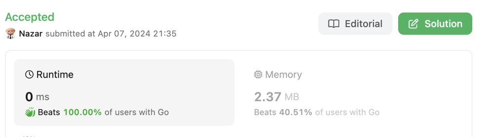
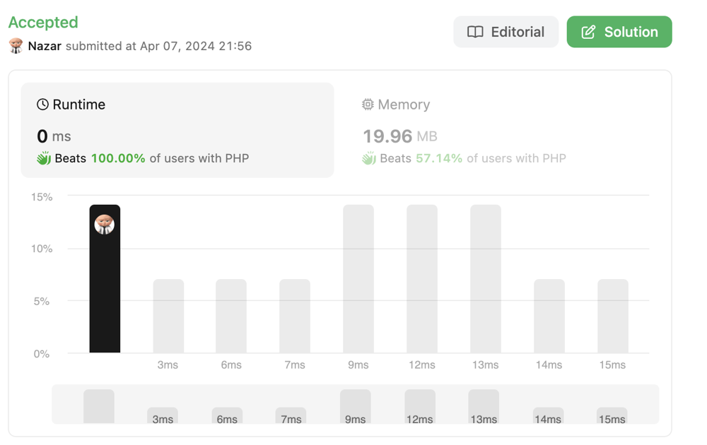

# 🔥🔥🔥 Simple Solution ✅ Beats 100.00% ✅ TC: O(n) ✅ SC: O(1)

**Author:** Nazaroo
**Votes:** 2
**Link:** [https://leetcode.com/problems/number-of-students-unable-to-eat-lunch/solutions/4990611/](https://leetcode.com/problems/number-of-students-unable-to-eat-lunch/solutions/4990611/)

---







# Code
```PHP []
function countStudents($students, $sandwiches) {
    $count = array_count_values($students);
    foreach ($sandwiches as $sandwich) {
        if ($count[$sandwich] == 0) break;
        $count[$sandwich]--;
    }
    return $count[0] + $count[1];
}
```
```Go []
func countStudents(students []int, sandwiches []int) int {
    count := make(map[int]int)
    for _, preference := range students {
        count[preference]++
    }
    for _, sandwich := range sandwiches {
        if count[sandwich] == 0 {
            break
        }
        count[sandwich]--
    }
    return count[0] + count[1]
}
```
```JavaScript []
var countStudents = function(students, sandwiches) {
    let count = {0: 0, 1: 0};
    
    students.forEach(student => {
        count[student]++;
    });

    for (let i = 0; i < sandwiches.length; i++) {
        if (count[sandwiches[i]] === 0) {
            break;
        }
        count[sandwiches[i]]--;
    }

    return count[0] + count[1];
};
```
# Idea
The key idea behind this algorithm is to avoid simulating each student's decision in the queue, which could be less efficient, especially with a large number of students. Instead, by tracking the number of students who prefer each type of sandwich, the algorithm directly updates these counts as sandwiches are taken, allowing it to quickly determine when no further matches are possible.

This approach is significantly more efficient than simulating the queue movement because it reduces the problem to a few simple operations (counting and arithmetic) that are independent of the number of times students might have to move to the back of the queue in a full simulation. The result is a solution that is both concise and performs well, capable of handling the maximum problem constraints effectively.

# Approach
1. **Count Preferences:** The function starts by counting the preferences of the students for each type of sandwich using `array_count_values`, which creates an associative array where the keys are the sandwich types (0 and 1), and the values are the counts of students preferring each type.
2. **Distribute Sandwiches:** It then iterates over the `sandwiches` array, simulating the distribution of sandwiches. For each sandwich at the top of the stack, it checks if there are any students who prefer that type of sandwich. If so, one student takes a sandwich (the count for that type is decremented). If no students prefer the sandwich on top, the loop breaks, indicating that no more sandwiches can be taken.
3. **Calculate Remaining Students:** After either all sandwiches are taken or no student wants the top sandwich, the function calculates the sum of the remaining students who couldn't get their preferred sandwich by adding the counts of both types.

# Complexity
- **Time complexity:** The time complexity of this function is $O(n)$, where n is the total number of students or sandwiches. This is because the function iterates over each sandwich exactly once. The initial counting of student preferences is also $O(n)$, making the overall time complexity linear with respect to the size of the input arrays.

- **Space complexity:** The space complexity is $O(1)$. Although an associative array (`$count`) is used to count the preferences, its size is constant (only two keys, 0 and 1), regardless of the input size. Therefore, the space required does not scale with the size of the input, leading to constant space complexity. Note that this analysis assumes that the space taken by the input arrays themselves is not counted towards the space complexity of the function, as they are part of the input.