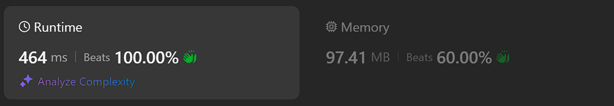

# Kotlin. Beats 100% (464 ms). Two vars, simple loop.

**Author:** mobdev778
**Votes:** 1
**Link:** [https://leetcode.com/problems/average-waiting-time/solutions/5445721/](https://leetcode.com/problems/average-waiting-time/solutions/5445721/)

---



# Code
```
class Solution {
    fun averageWaitingTime(customers: Array<IntArray>): Double {
        var finishTime = 1
        var sum = 0L
        for ((arrival, time) in customers) {
            if (arrival > finishTime) {
                finishTime = arrival + time
            } else {
                finishTime += time
            }
            sum += finishTime - arrival
        }
        return sum.toDouble() / customers.size
    }
}
```