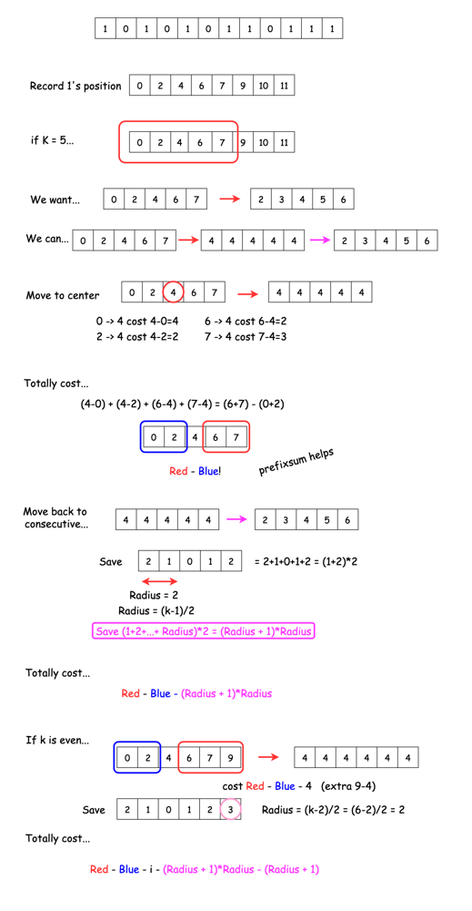

# C++ solution with explanation reference | O(n) | sliding window | prefix sum

**Author:** subhash_sam
**Votes:** 5
**Link:** [https://leetcode.com/problems/minimum-adjacent-swaps-for-k-consecutive-ones/solutions/2725658/](https://leetcode.com/problems/minimum-adjacent-swaps-for-k-consecutive-ones/solutions/2725658/)

---

# Intuition
<!-- Describe your first thoughts on how to solve this problem. -->
use sliding window as we need k adjacent one - all element in continuous order

# Approach
<!-- Describe your approach to solving the problem. -->
- question seems vey hard to solve at the first sight
-  i thought some extraordinary concepts or algo will require to solve this questoion
-  but after watching hint and solution , i realised concept is well known but the logic reuire is extraordinary.
-  it require one logic where **we take median of sorted array as pivot to get min move to gather all element at one point** .
-  require sliding window concept in an awesome way.
-  solution with better explanation - [https://leetcode.com/problems/minimum-adjacent-swaps-for-k-consecutive-ones/solutions/987607/o-n-explanation-with-picture/](https://)
-  first bring all one at pivot point and then put all element contiously in adjacent side .
-  code is done using above explanation pic.
- i am attaching pic of that above link here, 



# Complexity
- Time complexity:
<!-- Add your time complexity here, e.g. $$O(n)$$ -->
O(n)

- Space complexity:
<!-- Add your space complexity here, e.g. $$O(n)$$ -->
O(n)

# Code
```
#define ll long long

class Solution {
public:
    int minMoves(vector<int>& nums, int k) {
        if(k==1){
            return 0;
        }
        int n = nums.size();
        
        // store index of all one in sorted order
        vector<int> index;
        for(int i=0;i<n;i++){
            if(nums[i]){
                index.push_back(i);
            }
        }

        // calculate prefix sum of index array
        vector<ll> prefix;
        ll sum = 0;
        for(int x : index){
            sum += x;
            prefix.push_back(sum);
        }

        // now take window of k size consecutively
        int i=0,j=k-1;
        ll radius = (k%2 ? k/2 : (k-2)/2);
        ll ans = 1e15;
        while(j<index.size()){
            ll temp = 0;
            if(k%2){
                int pivot = (i+j)/2;
                temp = prefix[j]-prefix[pivot] -
                        ((pivot>0 ? prefix[pivot-1] : 0)-(i>0 ? prefix[i-1] : 0)) -
                        radius*(radius+1);
            }
            else{
                int pivot = (i+j)/2;
                temp = prefix[j]-prefix[pivot] -
                        ((pivot>0 ? prefix[pivot-1] : 0)-(i>0 ? prefix[i-1] : 0)) - index[pivot] -
                        radius*(radius+1) - (radius+1);
            }
            ans = min(ans, temp);
            i++;j++;
        }

        return ans;
    }
};
```