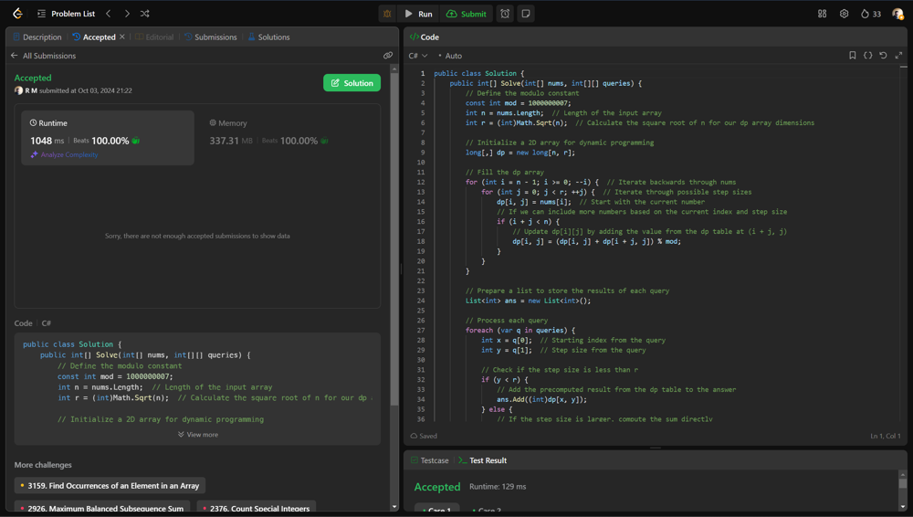

# 💥💥Beats 100% on runtime and memory [EXPLAINED]

**Author:** r9n
**Votes:** 0
**Link:** [https://leetcode.com/problems/sum-of-special-evenly-spaced-elements-in-array/solutions/5866567/](https://leetcode.com/problems/sum-of-special-evenly-spaced-elements-in-array/solutions/5866567/)

---




# Intuition
The goal is to efficiently compute sums of elements in an array based on given queries, where each query specifies a starting index and a step size. Instead of recalculating the sums from scratch for each query, we can use dynamic programming to store intermediate results.

# Approach
We fill a 2D array where each entry holds the sum of elements starting from a certain index and stepping by a specific amount, allowing us to quickly answer queries by checking precomputed sums for smaller step sizes and directly calculating for larger ones.

# Complexity
- Time complexity:
O(n * \u221An) for filling the DP table plus O(m * k) for answering queries, where m is the number of queries and k is the maximum number of steps we iterate for larger queries.

- Space complexity:
O(n * \u221An) for the DP table, where n is the length of the input array.

# Code
```csharp []
public class Solution {
    public int[] Solve(int[] nums, int[][] queries) {
        // Define the modulo constant
        const int mod = 1000000007;
        int n = nums.Length;  // Length of the input array
        int r = (int)Math.Sqrt(n);  // Calculate the square root of n for our dp array dimensions

        // Initialize a 2D array for dynamic programming
        long[,] dp = new long[n, r];

        // Fill the dp array
        for (int i = n - 1; i >= 0; --i) {  // Iterate backwards through nums
            for (int j = 0; j < r; ++j) {  // Iterate through possible step sizes
                dp[i, j] = nums[i];  // Start with the current number
                // If we can include more numbers based on the current index and step size
                if (i + j < n) {
                    // Update dp[i][j] by adding the value from the dp table at (i + j, j)
                    dp[i, j] = (dp[i, j] + dp[i + j, j]) % mod;
                }
            }
        }

        // Prepare a list to store the results of each query
        List<int> ans = new List<int>();

        // Process each query
        foreach (var q in queries) {
            int x = q[0];  // Starting index from the query
            int y = q[1];  // Step size from the query
            
            // Check if the step size is less than r
            if (y < r) {
                // Add the precomputed result from the dp table to the answer
                ans.Add((int)dp[x, y]);
            } else {
                // If the step size is larger, compute the sum directly
                long val = 0;  // Initialize a variable to hold the sum
                // Loop through nums starting from index x and incrementing by y
                for (int j = x; j < n; j += y) {
                    val = (val + nums[j]) % mod;  // Add the current number to the sum with modulo
                }
                // Add the computed sum to the answer
                ans.Add((int)val);
            }
        }

        // Return the results as an array
        return ans.ToArray();
    }
}

```