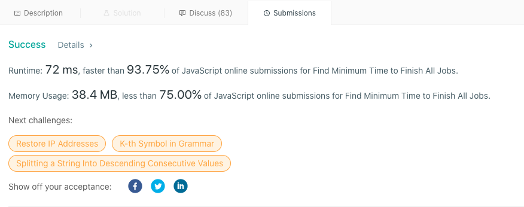

# Explanation, Thought process, Algorithm, Javascript, Backtracking

**Author:** mp3393
**Votes:** 30
**Link:** [https://leetcode.com/problems/find-minimum-time-to-finish-all-jobs/solutions/1155726/](https://leetcode.com/problems/find-minimum-time-to-finish-all-jobs/solutions/1155726/)

---


`Approach 1:` Backtracking.
`Intuition`: 
- Like classic backtracking algorithms, we will try `different combinations of sum` but this time instead of one combination sum we need "k" combination sums. 

- Let's say, we will use `k` buckets to have different combination-sums using the numbers from our input array. During recursion, everytime we would have used all our numbers from input array to populate our buckets, we will note down the value of our "max-filled" bucket. 

-  In the end we will chose the minimum of those max values as our result.

`Algorithm: ` 
- Sort the input array (Ascending or descending)

- Invoke the backtracking function with an index(first or last) for your input array

- Set the base condition for the recursive backtracking function as, either when the index is less than zero or when the index is greater than the entire length of your input array, choose one!

- Within the recursive function, populate the buckets(say, an empty array).

- To speed up, Prune! What do I mean? I mean, Insert the logic for avoiding unnecesary depth/stacks of recursive tree, when you know that a specific step is not going to lead to your answer. For this question, if any step is not leading us to "minimum"..i.e, If addition of any number in the bucket is making the max go above the previous min value, let's just discard it right away. 

- Hope this explanation helps or saves someone's time! (\xAC\u203F\xAC)


```
const minimumTimeRequired = function(jobs, k) {

    jobs.sort((a,b)=>a-b); 
    let result = Infinity;  
    let lastJobIndex = jobs.length-1; 
    if(jobs.length === k) return jobs[lastJobIndex];
    const workersArray = new Array(k).fill(0);      // Creating Buckets
    
    function backtrack(lastJobIndex,workersArray){
        if(lastJobIndex < 0){
            result = Math.min(result, Math.max(...workersArray));
            return;
        }
        if(Math.max(...workersArray) >= result) return;     // Pruning
        for(let currentIndex = 0; currentIndex <  workersArray.length; currentIndex++){  
            if (currentIndex > 0 && workersArray[currentIndex] === workersArray[currentIndex-1]) continue;     // Pruning
            workersArray[currentIndex] += jobs[lastJobIndex];
            backtrack(lastJobIndex-1,workersArray);
            workersArray[currentIndex] -= jobs[lastJobIndex];
        }
    }
    backtrack(lastJobIndex, workersArray);
    return result
};
```



