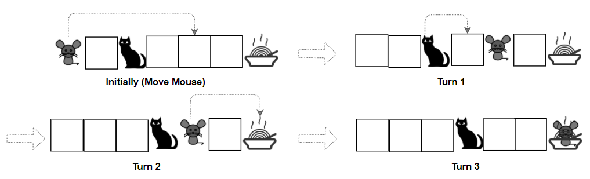

# [1728. Cat and Mouse II](https://leetcode.com/problems/cat-and-mouse-ii/)

| Category | Difficulty | Likes | Dislikes |
| :------: | :--------: | :---: | :------: |
| Algorithms | Hard | 285 | 48 |

**Tags:** [`array`](https://leetcode.com/tag/array), [`math`](https://leetcode.com/tag/math), [`dynamic-programming`](https://leetcode.com/tag/dynamic-programming), [`graph`](https://leetcode.com/tag/graph), [`topological-sort`](https://leetcode.com/tag/topological-sort), [`memoization`](https://leetcode.com/tag/memoization), [`matrix`](https://leetcode.com/tag/matrix), [`game-theory`](https://leetcode.com/tag/game-theory)

**Companies:** `google`

## Description

A game is played by a cat and a mouse named Cat and Mouse.

The environment is represented by a `grid` of size `rows x cols`, where each element is a wall, floor, player (Cat, Mouse), or food.

	- Players are represented by the characters `'C'`(Cat)`,'M'`(Mouse).

	- Floors are represented by the character `'.'` and can be walked on.

	- Walls are represented by the character `'#'` and cannot be walked on.

	- Food is represented by the character `'F'` and can be walked on.

	- There is only one of each character `'C'`, `'M'`, and `'F'` in `grid`.

Mouse and Cat play according to the following rules:

	- Mouse **moves first**, then they take turns to move.

	- During each turn, Cat and Mouse can jump in one of the four directions (left, right, up, down). They cannot jump over the wall nor outside of the `grid`.

	- `catJump, mouseJump` are the maximum lengths Cat and Mouse can jump at a time, respectively. Cat and Mouse can jump less than the maximum length.

	- Staying in the same position is allowed.

	- Mouse can jump over Cat.

The game can end in 4 ways:

	- If Cat occupies the same position as Mouse, Cat wins.

	- If Cat reaches the food first, Cat wins.

	- If Mouse reaches the food first, Mouse wins.

	- If Mouse cannot get to the food within 1000 turns, Cat wins.

Given a `rows x cols` matrix `grid` and two integers `catJump` and `mouseJump`, return `true`* if Mouse can win the game if both Cat and Mouse play optimally, otherwise return *`false`.

 

**Example 1:**


```

Input: grid = [&quot;####F&quot;,&quot;#C...&quot;,&quot;M....&quot;], catJump = 1, mouseJump = 2
Output: true
Explanation: Cat cannot catch Mouse on its turn nor can it get the food before Mouse.

```

**Example 2:**


```

Input: grid = [&quot;M.C...F&quot;], catJump = 1, mouseJump = 4
Output: true

```

**Example 3:**

```

Input: grid = [&quot;M.C...F&quot;], catJump = 1, mouseJump = 3
Output: false

```

 

**Constraints:**

	- `rows == grid.length`

	- `cols = grid[i].length`

	- `1 <= rows, cols <= 8`

	- `grid[i][j]` consist only of characters `'C'`, `'M'`, `'F'`, `'.'`, and `'#'`.

	- There is only one of each character `'C'`, `'M'`, and `'F'` in `grid`.

	- `1 <= catJump, mouseJump <= 8`

---

**Links:** [Submissions](https://leetcode.com/problems/cat-and-mouse-ii/) | [Solutions](https://leetcode.com/problems/cat-and-mouse-ii/)
