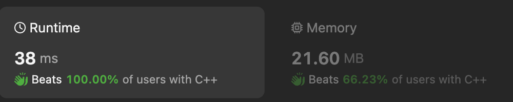

# Simple BFS beats 100%

**Author:** deydev
**Votes:** 1
**Link:** [https://leetcode.com/problems/shortest-path-to-get-food/solutions/4810409/](https://leetcode.com/problems/shortest-path-to-get-food/solutions/4810409/)

---

```
class Solution {
private:
    const int directions[4][2] = { {1, 0}, {-1, 0}, {0, 1}, {0, -1}};

public:
    // BFS
    // O(n) time | O(n) space
    int getFood(vector<vector<char>>& grid) {
        int rows = grid.size(), cols = grid[0].size();
        queue<pair<int, int>> q;
        vector<vector<bool>> seen(rows, vector<bool>(cols));
        
        bool foundStart = false;
        for (int r = 0; r < rows; ++r) {
            for (int c = 0; c < cols; ++c) {
                if (grid[r][c] == '*') {
                    q.push({r,c});
                    seen[r][c] = true;
                    foundStart = true;
                    break;
                }
            }
            if (foundStart) break;
        }

        int steps = -1;
        while (q.size() != 0) {
            int levelSize = q.size();
            ++steps;

            while (levelSize-- > 0) {
                auto [r, c] = q.front();
                q.pop();
                if (grid[r][c] == '#') return steps;

                for (auto& [rDelta, cDelta] : directions) {
                    int r2 = r + rDelta, c2 = c + cDelta;

                    if (r2 < 0 || r2 == rows ||
                        c2 < 0 || c2 == cols ||
                        grid[r2][c2] == 'X' ||
                        seen[r2][c2]) continue;
                    
                    q.push({r2, c2});
                    seen[r2][c2] = true;
                }
            }
        }
        return -1;
    }
};
```


