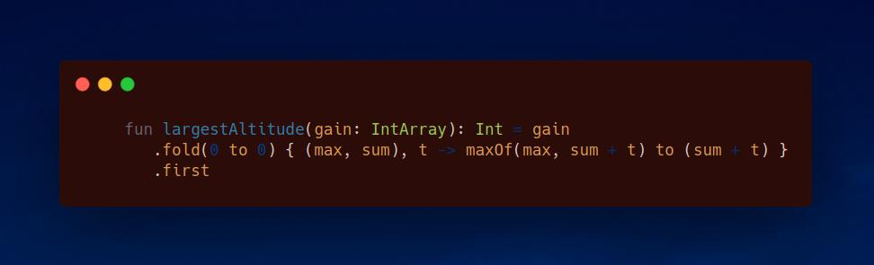

# Kotlin | one-liner

**Author:** SamoylenkoDmitry
**Votes:** 4
**Link:** [https://leetcode.com/problems/find-the-highest-altitude/solutions/3654634/](https://leetcode.com/problems/find-the-highest-altitude/solutions/3654634/)

---


#### Join me on Telegram
https://t.me/leetcode_daily_unstoppable/250
#### Problem TLDR
Max running sum
#### Intuition
Just sum all the values and compute the `max`

#### Approach
Let's write Kotlin `fold` one-liner
#### Complexity
- Time complexity:
$$O(n)$$
- Space complexity:
$$O(1)$$
#### Code
```

    fun largestAltitude(gain: IntArray): Int = gain
        .fold(0 to 0) { (max, sum), t -> maxOf(max, sum + t) to (sum + t) }
        .first

```