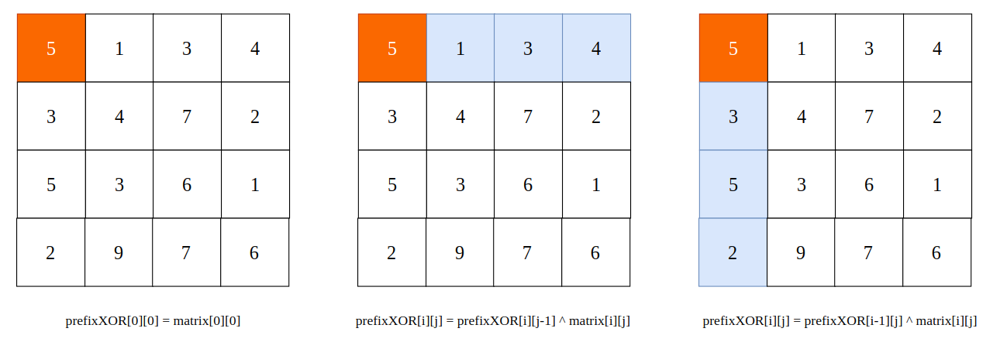
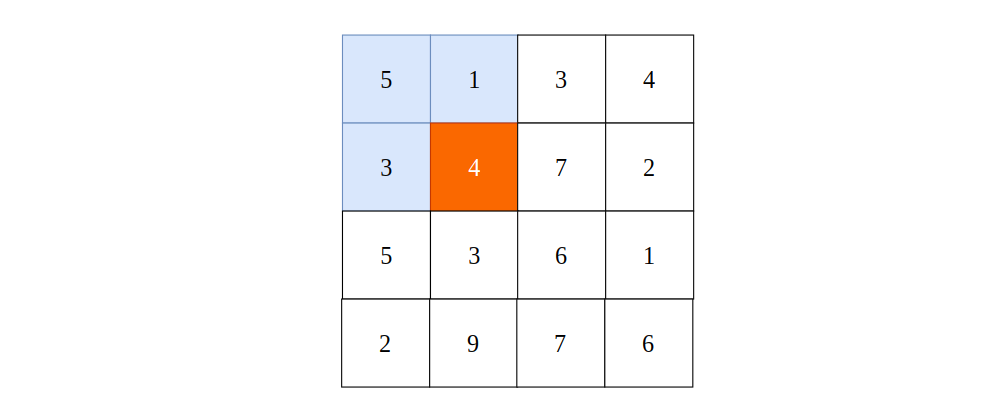

# C++ With Explaination

**Author:** SmartKeyerror
**Votes:** 5
**Link:** [https://leetcode.com/problems/find-kth-largest-xor-coordinate-value/solutions/1032054/](https://leetcode.com/problems/find-kth-largest-xor-coordinate-value/solutions/1032054/)

---

It's the same as prefixSum, but in this problem, we need to calculate prefixXOR and in a 2-D matrix.

When i == 0 and j == 0, the `predixXOR[i][j]` is just equal to `matrix[0][0]`.

When i == 0 and j != 0, the `predixXOR[i][j]` is just equal to `predixXOR[i][j-1] ^ matrix[i][j]`.

When i != 0 and j == 0, the `predixXOR[i][j]` is just equal to `predixXOR[i-1][j] ^ matrix[i][j]`.




Then how can we calculate `predixXOR[i][j]` when i != 0 and j != 0 ?




`prefixXOR[0][1] = 5 ^ 1`, `prefixXOR[1][0] = 5 ^ 3`, and `prefixXOR[1][1]` should be `5 ^ 1 ^ 3 ^ 4`.

If we use `prefixXOR[0][1] ^ prefixXOR[1][0]`, then we do a repeated calculation, so we need to "minus" this repeated calculation.

So `predixXOR[i][j] = `predixXOR[i][j-1] ^ predixXOR[i-1][j] ^ predixXOR[i-1][j-1] ^ matrix[i][j]`.

At last, we can use heap to get the K'th largest elements from our prefixXOR. Use sort solution maybe TLE.


```cpp
class Solution {
public:
    int kthLargestValue(vector<vector<int>>& matrix, int k) {
        int m = matrix.size(), n = matrix[0].size();
        
        vector<int> coordinates;
        vector<vector<int>> prefixXOR(m, vector<int>(n, 0));

        for (int i = 0; i < m; i++) {
            for (int j = 0; j < n; j++) {
                if (i == 0 && j == 0) prefixXOR[i][j] = matrix[0][0];
                else if (i == 0 && j != 0) prefixXOR[i][j] = prefixXOR[i][j-1] ^ matrix[i][j];
                else if (i != 0 && j == 0) prefixXOR[i][j] = prefixXOR[i-1][j] ^ matrix[i][j];
                else prefixXOR[i][j] = prefixXOR[i-1][j] ^ prefixXOR[i][j-1] ^ prefixXOR[i-1][j-1] ^ matrix[i][j];
            }
        }

        priority_queue<int, vector<int>, greater<int>> heap;

        for (int i = 0; i < m; i++) {
            for (int j = 0; j < n; j++) {
                if (heap.size() == k) {
                    if (prefixXOR[i][j] > heap.top()) {
                        heap.pop();
                        heap.push(prefixXOR[i][j]);
                    }
                }
                else heap.push(prefixXOR[i][j]);
            }
        }
        return heap.top();
    }
};
```