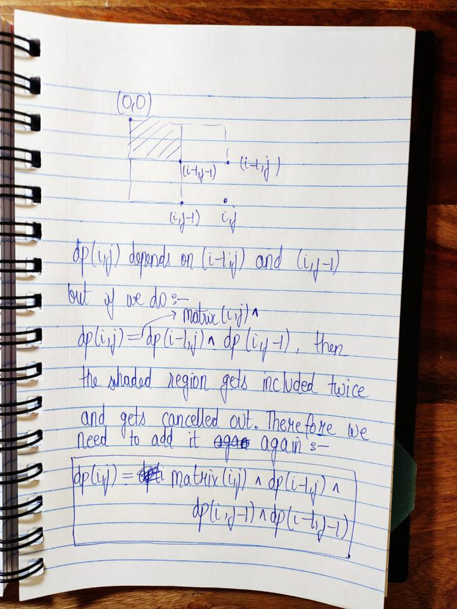

# C++ solution | Dynamic programming and Priority Queue

**Author:** Diavolos
**Votes:** 4
**Link:** [https://leetcode.com/problems/find-kth-largest-xor-coordinate-value/solutions/2169404/](https://leetcode.com/problems/find-kth-largest-xor-coordinate-value/solutions/2169404/)

---



```
class Solution {
public:
    int kthLargestValue(vector<vector<int>>& matrix, int k) {
        priority_queue<int>pq;
        pq.push(matrix[0][0]);
        for(int j=1;j<matrix[0].size();j++){
            matrix[0][j]^=matrix[0][j-1];
            pq.push(matrix[0][j]);
        }
        for(int i=1;i<matrix.size();i++){
            matrix[i][0]^=matrix[i-1][0];
            pq.push(matrix[i][0]);
        }
        for(int i=1;i<matrix.size();i++){
            for(int j=1;j<matrix[i].size();j++){
                matrix[i][j]^=matrix[i-1][j]^matrix[i][j-1]^matrix[i-1][j-1];
                pq.push(matrix[i][j]);
            }
        }
        while(--k>0){
            pq.pop();
        }
        return pq.top();
    }
};
```