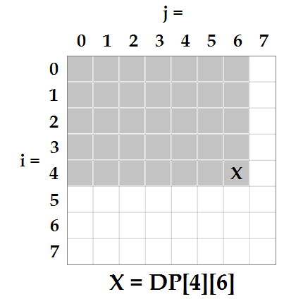
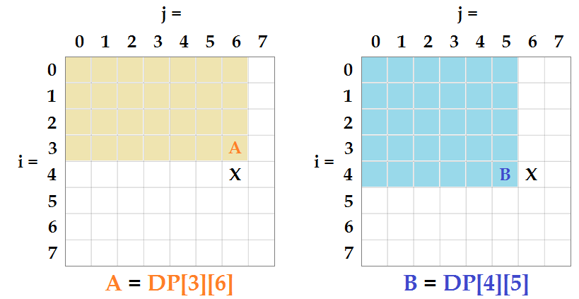
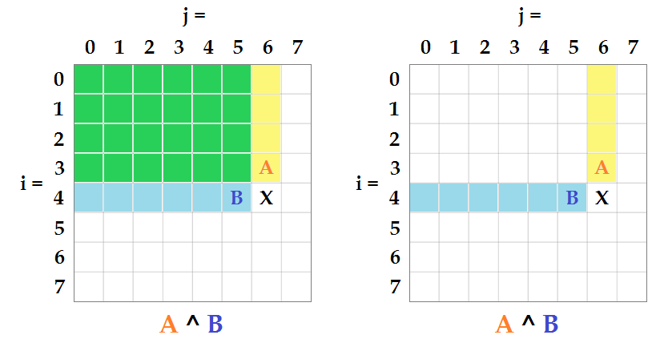
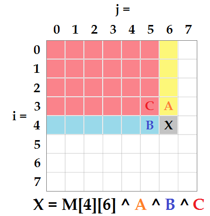

# Javascript | DP Solution (Bonus: Max-Heap) w/ Explanation | beats 100% / 100%

**Author:** sgallivan
**Votes:** 2
**Link:** [https://leetcode.com/problems/find-kth-largest-xor-coordinate-value/solutions/1033581/](https://leetcode.com/problems/find-kth-largest-xor-coordinate-value/solutions/1033581/)

---

*(Note: This is part of a series of Leetcode solution explanations ([**index**](https://dev.to/seanpgallivan/leetcode-solutions-index-57fl)). If you like this solution or find it useful,* ***please upvote*** *this post.)*

---

***Idea:***

Solving this problem with no regard for time complexity would be a simple matter, which means that the main issue is going to be finding a shortcut to not having to do the long calculations for each iteration. Since each new value that we're asked to find contains as a subset a value we've already found, it naturally brings to mind a **dynamic programming** solution.

First, each cell in our matrix **M** will have its own value, so **DP** will have to have the same dimensions as **M**. Next, let's say we're trying to find the value for **X = DP[4][6]**. From the instructions we know that it will be equal to each cell in the shaded area **bitwise XOR**'d together:



Since our **DP** matrix is being built top-to-bottom and left-to-right, we can get close to the necessary value with either **A = DP[3][6]** or **B = DP[4][5]**:



But even those shortcuts would allow the time complexity to increase exponentially with the size of **M**, since we'd still have to iterate through a whole row or column to get the other values we need for **X**. We could get even closer if we use *both* **A** and **B**, but they overlap quite a bit.

This is where it's important to realize that the **bitwise XOR** operation is its own inverse function:
```javascript
 if:    x ^ y = z
  \u21D2:    z ^ y = x
  \u21D2:    x ^ y ^ y = x
```
This means that the overlapping sections of **A** and **B** would effectively cancel each other out, as those numbers would be **XOR**'d twice each:



This opens up the immediate possibility of using a *third* **DP** value (**C = DP[4][4]**) in conjunction with **A** and **B** to leave us only one cell away from the value of **X**. That means that we can find out the **DP** value of each new cell by combing only four other cell values:



At that point, we only need to account for **i = 0** and **j = 0** values to complete our **DP** matrix. Since we won't need any previous original cell values in order to complete the **DP** matrix, we can also solve the **DP** matrix in-place.

The final step for this problem is to then sort the values in the **DP** matrix in order to find the **K**th highest value. Normally, this would call for a **max-heap** implementation, as the numbers can be readily inserted into the heap as **M** is being rewritten.

For Javascript, however, we can achieve a much faster sort through a typed array .sort() than we can with a max-heap implementation. (*Note: I've included a version of the code with a max-heap implementation below, for comparison.*)

Since the original cell values of **M** are limited to **1e6**, which is a **20**-bit binary number, the **DP** values are therefore limited to between **0** and  **2^20 - 1**. This means that we can use a **Uint32Array** to store the values more efficiently.

After a basic sort, we can **return** the Kth highest value.

---

***Javascript Code:***

The best result for the code below is **168ms / 61.9MB**.
```javascript
var kthLargestValue = function(M, K) {
    let y = M.length, x = M[0].length, ans = new Uint32Array(x*y), h = 0
    for (let i = 0; i < y; i++)
        for (let j = 0; j < x; j++) {
            let cell = M[i][j]
            if (i > 0) cell ^= M[i-1][j]
            if (j > 0) cell ^= M[i][j-1]
            if (i > 0 && j > 0) cell ^= M[i-1][j-1]
            ans[h++] = M[i][j] = cell
        }
    return ans.sort()[x*y-K]
};
```

---

***Javascript Code w/ Max-Heap:***

The best result for the code below is **360ms / 63.4MB**.
```javascript
var kthLargestValue = function(M, K) {
    let y = M.length, x = M[0].length,
        heap = new Uint32Array(x*y), hix = 0
    const heapify = num => {
        heap[hix] = num
        let i = hix++, par = (i - 1) >> 1
        while (heap[par] < heap[i]) {
            [heap[par],heap[i]] = [heap[i],heap[par]]
            i = par, par = (i - 1) >> 1
        }
    }
    const extract = () => {
        let max = heap[0], left, right
        heap[0] = heap[--hix], heap[hix] = 0
        let i = 0, child = heap[2] > heap[1] ? 2 : 1
        while (heap[i] < heap[child]) {
            [heap[i],heap[child]] = [heap[child],heap[i]]
            i = child, left = (i + 1) << 1, right = left - 1
            child = heap[right] > heap[left] ? right : left
        }
        return max
    }
    for (let i = 0; i < y; i++)
        for (let j = 0; j < x; j++) {
            let cell = M[i][j]
            if (i > 0) cell ^= M[i-1][j]
            if (j > 0) cell ^= M[i][j-1]
            if (i > 0 && j > 0) cell ^= M[i-1][j-1]
            heapify(M[i][j] = cell)
        }
    for (let i = K-1; i; i--) extract()
    return extract()
};
```