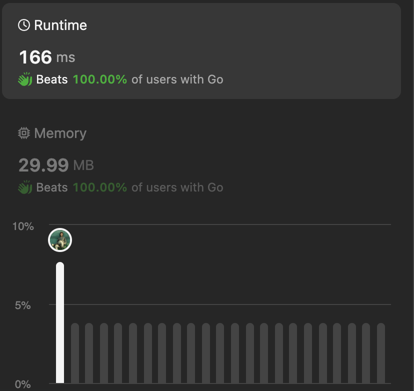

# 100% fastest golang no recursion

**Author:** gene-rode
**Votes:** 0
**Link:** [https://leetcode.com/problems/restore-the-array-from-adjacent-pairs/solutions/4759454/](https://leetcode.com/problems/restore-the-array-from-adjacent-pairs/solutions/4759454/)

---



```


func restoreArray(a [][]int) []int {
	where := make(map[int][]int,len(a))
	res := make([]int, 0, len(a))
	for k, val := range a {
		for _, v := range val {
			where[v] = append(where[v], k)
		}
	}
	var start int
	for k,v := range where {
		if len(v) == 1 {
			start = k
            break
		}
	}
	
    res = append(res, start)
	curNum := start
	curIdx := -1
	for len(where) > 1 {

		if where[curNum][0] == curIdx {
			curIdx = where[curNum][1]
		} else {
			curIdx = where[curNum][0]
		}

		delete(where, curNum)

		if a[curIdx][0] == curNum {
			curNum = a[curIdx][1]
		} else {
			curNum = a[curIdx][0]
		}
		res = append(res, curNum)

	}
	return res
}
```