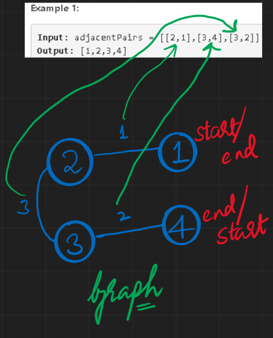

# [Java] [BFS or DFS] Code + Intuition + Visualisation

**Author:** Bodhisattva
**Votes:** 124
**Link:** [https://leetcode.com/problems/restore-the-array-from-adjacent-pairs/solutions/1043371/](https://leetcode.com/problems/restore-the-array-from-adjacent-pairs/solutions/1043371/)

---

Intuition :
1. The problem can be modelled as a graph because if one dives deep, it is clear that adjacent pairs can be modelled as edges & the elements of the array can be modelled as nodes of graph. One can even plot the pairs given in input & observe that simple traversal would give the resultant original array. Please see the attached image for more clarity on modelling as graph.

2. Once it is modelled as graph, we simply need to traverse it to get the nodes in order (since nodes are nothing but elements of array.) Here, one can do BFS or DFS traversal and both would give the result since all we need is a mere traversal.
3. One caution is that one has to start traversal from a vertex whose in-degree(number of incoming edges) is 1.This is because though starting from any vertex would traverse the entire graph but the vertices/elements of the array wouldn't be in order. 

I have provided both BFS & DFS functions & either would work fine.

```
class Solution {
    public int[] restoreArray(int[][] adjacentPairs) {
        
        //length of restoredArray would be input length+1
        int[] restoredArray = new int[adjacentPairs.length+1];
     
        Map<Integer, List<Integer>> graph = new HashMap<Integer, List<Integer>>();
        
        // 1. Build graph of number -> [adjacent numbers]
        for(int i= 0; i < adjacentPairs.length; i++){
             addToGraph(graph, adjacentPairs[i][0], adjacentPairs[i][1]);
             addToGraph(graph, adjacentPairs[i][1], adjacentPairs[i][0]);
         }
        
         // 2. Find first number with only one adjacent number i.e. in-degree = 1. That wil be our start.
		 // eg. get -3 or -2 as our start. 
        //There would always be two elements which satisfy this conditon & starting from either would suffice. 
         int start = 0;
         for(int key : graph.keySet()){
             if(graph.get(key).size()==1){
                 start = key;
                 break;
            }
         }
        Set<Integer> seenSet = new HashSet<Integer>();
        List<Integer> answerList = new ArrayList<Integer>();
        dfs(start,graph,answerList,seenSet);

        for(int i=0;i<answerList.size();i++){
            restoredArray[i] = answerList.get(i);
        }
        return restoredArray;
    }
    
    /****** Template DFS Code *******/
    private void dfs(int start,Map<Integer, List<Integer>> graph,List<Integer> answerList,Set<Integer> seenSet){
        answerList.add(start);
        seenSet.add(start);
        List<Integer> neighbors = graph.get(start);
        //loop over adjacents like you do in BFS, here adjacents are fetched from the constructed graph.
        for(Integer curr : neighbors){
            if(!seenSet.contains(curr)){
                 dfs(curr,graph,answerList,seenSet);
            }
        } 
    }
	
    //Utility function which simply builds graph of [numbers] -> [list of adjacent numbers]
    	// eg. [[4,-2],[1,4],[-3,1]]
		// map will be  4 ->[-2,1], 1->[-3,4], -2->[4], -3->[1]
	  private void addToGraph(Map<Integer, List<Integer>> graph, int key, int value) {
		     if(graph.containsKey(key)){
                 graph.get(key).add(value);
             }else{
                 List<Integer> temp = new ArrayList<Integer>();
                 temp.add(value);
                 graph.put(key, temp);
             }  
	  }
    
    //One can use this BFS function instead of DFS function as well.
    
     /****** Template BFS Code *******/
    /**
    private void bfs(int start,Map<Integer, List<Integer>> graph,int[] restoredArray){
         Queue<Integer> bfsQueue = new LinkedList<Integer>();
         Set<Integer> seenSet = new HashSet<Integer>();
         bfsQueue.add(start);
         seenSet.add(start);   

         int index=0;

         while(!bfsQueue.isEmpty()){

             int restoredValue = bfsQueue.poll();
             List<Integer> neighbors = graph.get(restoredValue);
             restoredArray[index++] = restoredValue;
            
             //loop over adjacents like you do in BFS, here adjacenets are fetched from the constructed graph.
             for(Integer curr : neighbors){
                 if(!seenSet.contains(curr)){
                    bfsQueue.offer(curr);
                    seenSet.add(curr);
                 }
             }
         }
    }
    */
}
```

Modularised the code with help from @BrownPanther007 .