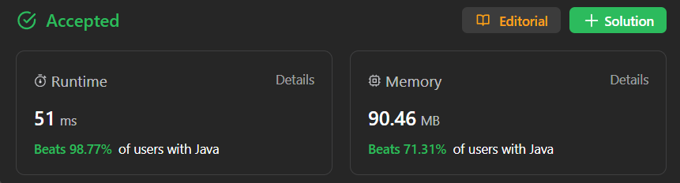

# ✅ Beats 100% - Explained with [ Video ] - HashMap - O(N) Time and Space

**Author:** millenium103
**Votes:** 43
**Link:** [https://leetcode.com/problems/restore-the-array-from-adjacent-pairs/solutions/4270966/](https://leetcode.com/problems/restore-the-array-from-adjacent-pairs/solutions/4270966/)

---



# YouTube Video Explanation:

[https://youtu.be/Zb4Z9KnJZa8](https://youtu.be/Zb4Z9KnJZa8)

**\uD83D\uDD25 Please like, share, and subscribe to support our channel's mission of making complex concepts easy to understand.**

Subscribe Link: https://www.youtube.com/@leetlogics/?sub_confirmation=1

*Subscribe Goal: 250 Subscribers*
*Current Subscribers: 209*

# Intuition
<!-- Describe your first thoughts on how to solve this problem. -->
The problem involves reconstructing the original array from the adjacent pairs. We know that each element in the original array is unique, but the order of the elements is not given. To solve this, we can create a mapping of each element to its adjacent elements using a dictionary. We iterate through the adjacent pairs and build this mapping.

Next, we find the starting element that has only one adjacent element (the first element in the original array) and begin building the original array from there. We use a result array to store the elements of the original array as we traverse the adjacent pairs.

# Approach
<!-- Describe your approach to solving the problem. -->
1. Create a dictionary `pairs` to store the mapping of each element to its adjacent elements. Initialize it with empty arrays.
2. Iterate through the adjacent pairs, updating the `pairs` dictionary.
3. Find the starting element (the one with only one adjacent element) and set it as the first element in the result array.
4. Continue building the result array by choosing the adjacent element of the current element and updating the current element. Repeat this process until we have reconstructed the entire array.
5. Return the result array as the original array.


# Complexity
- Time complexity:`O(N)`, We iterate through the adjacent pairs once to build the mapping, which takes O(n) time. We then iterate through the adjacent pairs again to reconstruct the original array, which also takes O(n) time. Overall, the time complexity of the algorithm is O(n).
<!-- Add your time complexity here, e.g. $$O(n)$$ -->
- Space complexity:`O(N)`, We use extra space to store the `pairs` dictionary and the result array, resulting in O(n) space complexity.
<!-- Add your space complexity here, e.g. $$O(n)$$ -->


# Code
## Java
```
class Solution {
    public int[] restoreArray(int[][] vals) {
        Map<Integer, int[]> pairs = new HashMap<>();
        for (int i = 0; i < vals.length; i++) {
            if (pairs.containsKey(vals[i][0])) {
                pairs.get(vals[i][0])[1] = vals[i][1];
            } else {
                pairs.put(vals[i][0], new int[] {vals[i][1], -1000000});
            }
            if (pairs.containsKey(vals[i][1])) {
                pairs.get(vals[i][1])[1] = vals[i][0];
            } else {
                pairs.put(vals[i][1], new int[] {vals[i][0], -1000000});
            }
        }
        int[] result = new int[vals.length + 1];
        int start = -1000000;
        for (Map.Entry<Integer, int[]> entry : pairs.entrySet()) {
            if (entry.getValue()[1] == -1000000) {
                start = entry.getKey();
            }
        }
        result[0] = start;
        int left = -1000000;
        for (int i = 1; i < result.length; i++) {
            int[] val = pairs.get(start);
            int newval = (val[0] == left ? val[1] : val[0]);
            result[i] = newval;
            left = start;
            start = newval;
        }
        return result;
    }
}

```
## C++
```
class Solution {
public:
    std::vector<int> restoreArray(std::vector<std::vector<int>>& vals) {
        std::unordered_map<int, std::vector<int>> pairs;
        
        for (const std::vector<int>& val : vals) {
            pairs[val[0]].push_back(val[1]);
            pairs[val[1]].push_back(val[0]);
        }
        
        std::vector<int> result;
        int start = -1000000;
        
        for (const auto& entry : pairs) {
            if (entry.second.size() == 1) {
                start = entry.first;
                break;
            }
        }
        
        int left = -1000000;
        result.push_back(start);
        
        for (int i = 1; i < vals.size() + 1; ++i) {
            const std::vector<int>& val = pairs[start];
            int newval = (val[0] == left) ? val[1] : val[0];
            result.push_back(newval);
            left = start;
            start = newval;
        }
        
        return result;
    }
};
```
## Python
```
class Solution(object):
    def restoreArray(self, vals):
        pairs = defaultdict(list)
        
        for val in vals:
            pairs[val[0]].append(val[1])
            pairs[val[1]].append(val[0])
        
        result = []
        start = -1000000
        
        for entry in pairs:
            if len(pairs[entry]) == 1:
                start = entry
                break
        
        left = -1000000
        result.append(start)
        
        for i in range(1, len(vals) + 1):
            val = pairs[start]
            newval = val[0] if val[0] != left else val[1]
            result.append(newval)
            left = start
            start = newval
        
        return result
```
## JavaScript
```
var restoreArray = function(vals) {
    const pairs = new Map();
    
    for (const val of vals) {
        if (!pairs.has(val[0])) pairs.set(val[0], []);
        if (!pairs.has(val[1])) pairs.set(val[1], []);
        pairs.get(val[0]).push(val[1]);
        pairs.get(val[1]).push(val[0]);
    }
    
    const result = [];
    let start = -1000000;
    
    for (const [entry, values] of pairs) {
        if (values.length === 1) {
            start = entry;
            break;
        }
    }
    
    let left = -1000000;
    result.push(start);
    
    for (let i = 1; i <= vals.length; i++) {
        const val = pairs.get(start);
        const newval = val[0] !== left ? val[0] : val[1];
        result.push(newval);
        left = start;
        start = newval;
    }
    
    return result;
};
```
---

