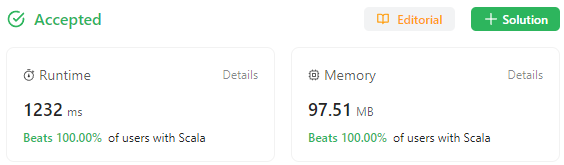

# Hash table? DFS? Gimme a break. Straightforward algorithm with 1 array and 3 loops. C++ 136 ms.

**Author:** sergei99
**Votes:** 5
**Link:** [https://leetcode.com/problems/restore-the-array-from-adjacent-pairs/solutions/4272267/](https://leetcode.com/problems/restore-the-array-from-adjacent-pairs/solutions/4272267/)

---

# Intuition
The input array contains $n-1$ pairs of elements representing essentially graph edges, with the elements being vertices. There are only two terminal vertices (those with the degree = 1), and every vertex is connected to no more than 2 other vertices. Vertices can go in any order within a pair.

The goal is to achieve nice runtime stats.
**C++**


**C**

**Java**


**Scala**



Oh, sorry, formally speaking the goal is to lay the graph out in an 1D array (of size $n$), so that every two adjacent elements are vertices connected with an edge in the input data. There would be at least two ways to traverse the graph (forward and backward). We can use either way, and LC test engine promises to accept it.

Consider e.g. the following input pairs:
| | |
|-|-|
| 1 | 2 |
| 4 | 3 |
| 2 | 3 |
| 4 | 5 |

This has two terminal vertices (`1` and `5`) - they occur in the input data only once - so each of them would only have only one neighbour, and they should take the opposite positions in the array. As mentioned before, there are two equally acceptable ways to place them:
| | | | | |
|-|-|-|-|-|
| 1 | | | | 5 |
| 5 | | | | 1 |

Then we start at any vertex of these two and pick up a vertex connected to it. E.g. `1` is connected to `2`, so we pick `2` and add it to the result:
| | | | | |
|-|-|-|-|-|
| 1 | 2 | | | |

`2` is connected to `3` and `1`, so we somehow need to mark already traversed elements, ignore `1` and pick `3`. Due to the task constraints, the last element would obviously be the other terminal vertex, i.e. `5`.
| | | | | |
|-|-|-|-|-|
| 1 | 2 | 3 | 4 | 5 |

# Approach
First, we need to keep track of the edges in such a way that we could quickly find an edge by a vertex value. Edges go in the input data in no particular order, and neither vertices do within an edge pair. So we need a mapping of $vertex \\rarr edge$, that would be our index structure.

Since the vertex range is limited to $[-10^5; 10^5]$, we hardly need any special data structures. A flat array would be just fine. What would be the array elements? As per the task constraints, a vertex can have no more than $2$ edges connected to it. We will identify edges by an index into the input array, thus we need to store up to $2$ indices. The index range is $[0; 10^5]$, so 17 bits per index is enough, and we can happily use a 32-bit integer for that. Two 32-bit integers form a 64-bit piece of data, which perfectly fits a CPU register on all today's mainstream CPUs. So we can allocate an array of up to $2 \	imes 10^5 + 1$ 64-bit elements, which would occupy almost $1.6$ MiB.

The starting point of iteration is determined by walking through the index structure and finding the first entry with exactly one element in it.

We also need to keep track of already traversed elements. This is simple: we remove edge indices from the index structure as we pass them. E.g. as we approach the vertex `2` via edge `1->2` from the example above, we remove the reference to that edge. Since all intermediate vertices are connected to no more than two edges, there would be no more than one edge left when we remove the other. So this would be a plain path from one terminal vertex to the other one. This might be called a DFS, but it's DFS in the same way as a linked list traversal is: there is only one way to go and no alternative routes to expore.

The algorithm contains just 3-4 loops: edge indexing ($n+1$ iterations), starting poing search ($\\le r$ iterations), graph traversal ($n$ iterations) and optionally index cleanup ($r$ iterations hidden within `fill`; however we could skip this by zeroing index entries as we pass though them in the traversal loop).

# Complexity
- Time complexity: $$O(n + r)$$ where $r$ is the range of vertex values.

- Space complexity: $$O(R)$$ where $R$ is the maximum possible range of vertex values.

# Micro-optimizations

The first goal (nice execution stats) is not achievable with an inefficient code. Therefore we apply some techniques.

The pairs of the edge indices are stored in a 64-bit integer. It can be in one of 3 states: empty, one element and two elements. The convention is that if it contains only one element, then it is in its lowest bits. If a half is zero, then it's empty, otherwise it contains an index into the edges array biased by `1` (so `0` becomes `1`, `1` becomes `2`, etc).

The index array has a static allocation to its max possible size (C, C++) or a single call to `new` (Java, Scala). This way we avoid memory management overhead. Once we are done with processing, we zero the actually used range out in the indices array, so it can be reused in the next test case (zeroing could be moved into the traversal loop, and in this case we wouldn't need a cleanup loop).

The destination array is preallocated up front, because we know the exact number of elements.

For C++ the O3 optimization is enabled, and the `stdio` sync disabled, as usually.

# Measurements

| Language | Time | Beating | Memory | Beating |
|-|-|-|-|-|
| C++ | 136-140 ms | 100% | 69.79-70.09 Mb | 100% |
| C | 289 ms | 100% | 47.98 Mb | 100% |
| Java | 17-18 ms | 100% | 78.18-78.53 Mb | 98.77% |
| Scala | 1169-1232 ms | 100% | 96.57-97.20 Mb | 100% |

## Submission Links
**C++**
https://leetcode.com/problems/restore-the-array-from-adjacent-pairs/submissions/1095813240/
https://leetcode.com/problems/restore-the-array-from-adjacent-pairs/submissions/1095859290/
**C**
https://leetcode.com/problems/restore-the-array-from-adjacent-pairs/submissions/1095955619/
**Java**
https://leetcode.com/problems/restore-the-array-from-adjacent-pairs/submissions/1095905729/
https://leetcode.com/problems/restore-the-array-from-adjacent-pairs/submissions/1095938152/
**Scala**
https://leetcode.com/problems/restore-the-array-from-adjacent-pairs/submissions/1095919806/
https://leetcode.com/problems/restore-the-array-from-adjacent-pairs/submissions/1095913814/

# Code
Notes:
* $n$ is actually the number of edges in the code, not the number of vertices. We only need the number of vertices once, to preallocate the destination vector, so there is no point in operating that value.
* Scala solution is in "better Java" style, not an idiomatic Scala, since its performance heavily relies on a mutable array modified at random places.
``` C++ []
class Solution {
private:
    static constexpr int MINV = -100000, MAXV = 100000;
    static constexpr unsigned RANGEV = MAXV - MINV + 1u;
    typedef unsigned long long u64;
    static u64 index[RANGEV];

    static unsigned lo(const u64 p) __attribute__((always_inline)) {
        return p & UINT_MAX;
    }

    static unsigned hi(const u64 p) __attribute__((always_inline)) {
        return p >> 32;
    }

    static void addp(u64 &p, const unsigned i) __attribute__((always_inline)) {
        p += (u64)i << ((p != 0) << 5);
    }

    static void removep(u64 &p, const unsigned i) __attribute__((always_inline)) {
        if (lo(p) == i) p = hi(p);
        else if (hi(p) == i) p = lo(p);
    }

public:
    vector<int> restoreArray(const vector<vector<int>>& apairs) {
        const unsigned n = apairs.size();
        if (n == 1) return apairs.front();
        int minv = MAXV, maxv = MINV;
        for (unsigned i = 0; i < n; i++) {
            const auto &ap = apairs[i];
            const int v0 = ap[0], v1 = ap[1];
            addp(index[v0-MINV], i + 1);
            addp(index[v1-MINV], i + 1);
            const auto [mn, mx] = minmax(v0, v1);
            minv = min(mn, minv);
            maxv = max(mx, maxv);
        }

        int head = minv;
        while (head <= maxv && index[head-MINV] - 1u >= UINT_MAX)
            head++;

        vector<int> r;
        r.reserve(n + 1);
        r.push_back(head);
        for (u64 idx = index[head-MINV]; idx; idx = index[head-MINV]) {
            const auto &ap = apairs[lo(idx) - 1];
            index[head-MINV] >>= 32;
            r.push_back(head = ap[ap[0] == head]);
            removep(index[head-MINV], lo(idx));
        }
        fill(index - MINV + minv, index - MINV + maxv + 1, 0u);
        return r;
    }
};

Solution::u64 Solution::index[RANGEV];
```
``` C []
#define MINV -100000
#define MAXV 100000
#define RANGEV (MAXV - MINV + 1u)
typedef unsigned long long u64;
static u64 eindex[RANGEV];

#define MAX(a, b) ((a) > (b) ? (a) : (b))
#define MIN(a, b) ((a) < (b) ? (a) : (b))

#define FORCE __attribute__((always_inline)) inline

static FORCE unsigned lo(const u64 p) {
    return p & UINT_MAX;
}

static FORCE unsigned hi(const u64 p) {
    return p >> 32;
}

static FORCE void addp(u64 *p, const unsigned i) {
    *p += (u64)i << ((*p != 0) << 5);
}

static FORCE void removep(u64 *p, const unsigned i) {
    if (lo(*p) == i) *p = hi(*p);
    else if (hi(*p) == i) *p = lo(*p);
}

int* restoreArray(int*const*const apairs, const unsigned n, const int* const ncol, int* const rsize) {
    if (n == 1) {
        int *r = malloc(2 * sizeof(int));
        memcpy(r, *apairs, 2 * sizeof(int));
        *rsize = 2;
        return r;
    }
    int minv = MAXV, maxv = MINV;
    for (unsigned i = 0; i < n; i++) {
        const int *ap = apairs[i];
        const int v0 = ap[0], v1 = ap[1];
        addp(eindex+v0-MINV, i + 1);
        addp(eindex+v1-MINV, i + 1);
        const int mn = MIN(v0, v1);
        const int mx = MAX(v0, v1);
        minv = MIN(mn, minv);
        maxv = MAX(mx, maxv);
    }
    
    int head = minv;
    while (head <= maxv && eindex[head-MINV] - 1u >= UINT_MAX)
        head++;

    int *const r = malloc((n + 1u) * sizeof(int));
    *r = head;
    unsigned i = 1;
    for (u64 idx = eindex[head-MINV]; idx; idx = eindex[head-MINV]) {
        const int *ap = apairs[lo(idx) - 1];
        eindex[head-MINV] >>= 32;
        removep(eindex+head-MINV, lo(idx));
        r[i++] = head = ap[ap[0] == head];
        removep(eindex+head-MINV, lo(idx));
    }
    *rsize = i;
    return r;
}
```
``` Java []
class Solution {
    private static final int MINV = -100000, MAXV = 100000,
                             RANGEV = MAXV - MINV + 1;
    private static final long UINT_MAX = 0xFFFFFFFFl;
    private static long[] index = new long[RANGEV];

    public int[] restoreArray(int[][] apairs) {
        final int n = apairs.length;
        if (n == 1) return apairs[0];
        int minv = MAXV, maxv = MINV;
        for (int i = 0; i < n; i++) {
            final var ap = apairs[i];
            final int v0 = ap[0], v1 = ap[1];
            final long j = i + 1;
            index[v0-MINV] += index[v0-MINV] == 0 ? j : j << 32;
            index[v1-MINV] += index[v1-MINV] == 0 ? j : j << 32;
            final int mn = Math.min(v0, v1);
            final int mx = Math.max(v0, v1);
            minv = Math.min(mn, minv);
            maxv = Math.max(mx, maxv);
        }

        int head = minv;
        while (head <= maxv
            && (index[head-MINV] > UINT_MAX || index[head-MINV] == 0))
            head++;

        int[] r = new int[n + 1];
        r[0] = head;
        int ri = 1;
        for (long idx = index[head-MINV]; idx != 0; idx = index[head-MINV]) {
            final int loidx = (int)(idx & UINT_MAX);
            final var ap = apairs[loidx - 1];
            index[head-MINV] >>>= 32;
            r[ri++] = head = ap[ap[0] == head ? 1 : 0];
            final int lonext = (int)(index[head-MINV] & UINT_MAX),
                      hinext = (int)(index[head-MINV] >>> 32);
            if (lonext == loidx) index[head-MINV] = hinext;
            else if (hinext == loidx) index[head-MINV] = lonext;
        }
        return r;
    }
}
```
``` Scala []
object Solution {
    private[this] val MINV = -100000
    private[this] val MAXV = 100000
    private[this] val RANGEV = MAXV - MINV + 1
    private[this] val UINT_MAX = 0xFFFFFFFFl;
    private[this] val index = Array.fill[Long](RANGEV)(0)

    def restoreArray(apairs: Array[Array[Int]]): Array[Int] =
    if (apairs.length == 1) apairs(0) else {
        val n = apairs.length
        var minv = MAXV
        var maxv = MINV
        for (i <- (0 until n)) {
            val ap = apairs(i)
            val Array(v0, v1) = ap
            val j = i + 1l
            index(v0-MINV) += (if (index(v0-MINV) == 0) j else j << 32)
            index(v1-MINV) += (if (index(v1-MINV) == 0) j else j << 32)
            minv = v0 min v1 min minv
            maxv = v0 max v1 max maxv
        }

        var head = minv
        while (head <= maxv
            && (index(head-MINV) > UINT_MAX || index(head-MINV) == 0))
            head += 1

        val r = Array.fill[Int](n + 1)(0)
        r(0) = head
        var ri = 1
        var idx = index(head-MINV)
        while (idx != 0) {
            val loidx = (idx & UINT_MAX).toInt
            val ap = apairs(loidx - 1)
            index(head-MINV) >>>= 32
            head = ap(if(ap(0) == head) 1 else 0)
            r(ri) = head; ri += 1
            val lonext = (index(head-MINV) & UINT_MAX).toInt
            val hinext = (index(head-MINV) >>> 32).toInt
            if (lonext == loidx) index(head-MINV) = hinext
            else if (hinext == loidx) index(head-MINV) = lonext
            idx = index(head-MINV)
        }
        r
    }
}
```