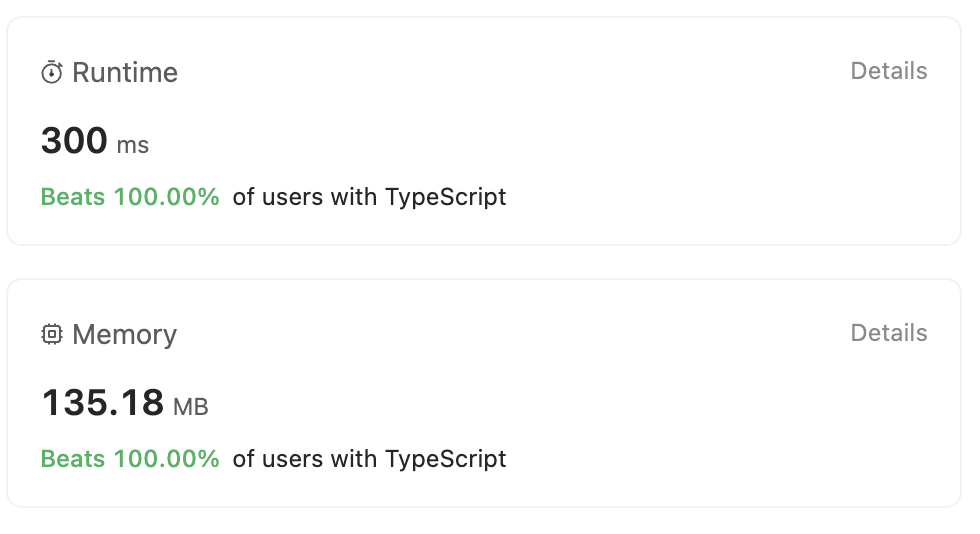

# Easiest solution using DFS which Beats ✅ 100.00% of users with TypeScript

**Author:** Sherif-Mostafa
**Votes:** 4
**Link:** [https://leetcode.com/problems/restore-the-array-from-adjacent-pairs/solutions/4273281/](https://leetcode.com/problems/restore-the-array-from-adjacent-pairs/solutions/4273281/)

---

# Intuition
The problem involves reconstructing an array from information about adjacent pairs. One intuitive approach could be to use a data structure like a graph, where each element is a node, and edges represent the adjacent pairs. By traversing this graph, we can reconstruct the original array.


# Approach
1. Build the Adjacency Map: Create an adjacency map (e.g., a hash table) to store the adjacency information. For each pair [u, v], add v to the list of neighbors of u and add u to the list of neighbors of v. This will represent the connections between elements.

2. Identify the Starting Point: Find the starting point by identifying a node with only one neighbor. This will be the starting point for the traversal.

3. Depth-First Search (DFS): Use DFS to traverse the graph starting from the identified node. During the traversal, reconstruct the original array by adding each visited node to the result array.

4. Return Result: Return the reconstructed array.




# Complexity
- Time complexity: The DFS traverses each node and edge once, resulting in a time complexity of O(n), where n is the number of elements.
- Space complexity: The space complexity depends on the storage of the adjacency map and the visited set during DFS. It is also O(n).

# Code
```
function restoreArray(adjacentPairs: number[][]): number[] {
    const adjacencyMap = new Map();

    // Populate the adjacency map
    for (const pair of adjacentPairs) {
        if (!adjacencyMap.has(pair[0])) {
            adjacencyMap.set(pair[0], []);
        }
        if (!adjacencyMap.has(pair[1])) {
            adjacencyMap.set(pair[1], []);
        }
        adjacencyMap.get(pair[0]).push(pair[1]);
        adjacencyMap.get(pair[1]).push(pair[0]);
    }

    // Find the starting point
    let start;
    for (const [key, value] of adjacencyMap) {
        if (value.length === 1) {
            start = key;
            break;
        }
    }

    // Reconstruct the array using depth-first search
    const result = [];
    const visited = new Set();

    function dfs(node) {
        visited.add(node);
        result.push(node);

        for (const neighbor of adjacencyMap.get(node)) {
            if (!visited.has(neighbor)) {
                dfs(neighbor);
            }
        }
    }

    dfs(start);
    return result;
};
```