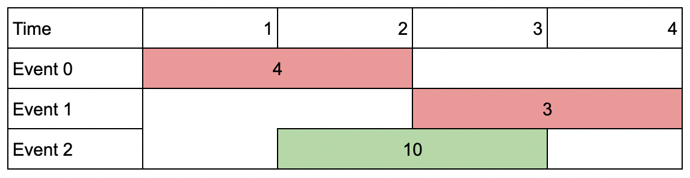
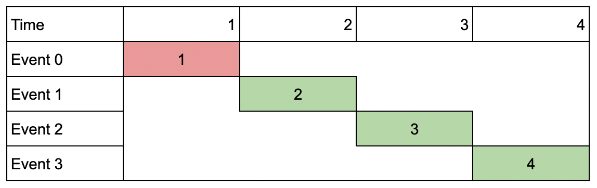

# [1751. Maximum Number of Events That Can Be Attended II](https://leetcode.com/problems/maximum-number-of-events-that-can-be-attended-ii/)

| Category | Difficulty | Likes | Dislikes |
| :------: | :--------: | :---: | :------: |
| Algorithms | Hard | 2533 | 53 |

**Tags:** [`array`](https://leetcode.com/tag/array), [`binary-search`](https://leetcode.com/tag/binary-search), [`dynamic-programming`](https://leetcode.com/tag/dynamic-programming), [`sorting`](https://leetcode.com/tag/sorting)

**Companies:** `google`, `snowflake`, `microsoft`, `amazon`, `phonepe`, `general-electric`

## Description

You are given an array of `events` where `events[i] = [startDay_i, endDay_i, value_i]`. The `i^th` event starts at `startDay_i` and ends at `endDay_i`, and if you attend this event, you will receive a value of `value_i`. You are also given an integer `k` which represents the maximum number of events you can attend.

You can only attend one event at a time. If you choose to attend an event, you must attend the **entire** event. Note that the end day is **inclusive**: that is, you cannot attend two events where one of them starts and the other ends on the same day.

Return *the **maximum sum** of values that you can receive by attending events.*

 

**Example 1:**


```

Input: events = [[1,2,4],[3,4,3],[2,3,1]], k = 2
Output: 7
Explanation: Choose the green events, 0 and 1 (0-indexed) for a total value of 4 + 3 = 7.
```

**Example 2:**



```

Input: events = [[1,2,4],[3,4,3],[2,3,10]], k = 2
Output: 10
Explanation: Choose event 2 for a total value of 10.
Notice that you cannot attend any other event as they overlap, and that you do not have to attend k events.
```

**Example 3:**

****

```

Input: events = [[1,1,1],[2,2,2],[3,3,3],[4,4,4]], k = 3
Output: 9
Explanation: Although the events do not overlap, you can only attend 3 events. Pick the highest valued three.
```

 

**Constraints:**

	- `1 <= k <= events.length`

	- `1 <= k * events.length <= 10^6`

	- `1 <= startDay_i <= endDay_i <= 10^9`

	- `1 <= value_i <= 10^6`

---

**Links:** [Submissions](https://leetcode.com/problems/maximum-number-of-events-that-can-be-attended-ii/) | [Solutions](https://leetcode.com/problems/maximum-number-of-events-that-can-be-attended-ii/)
