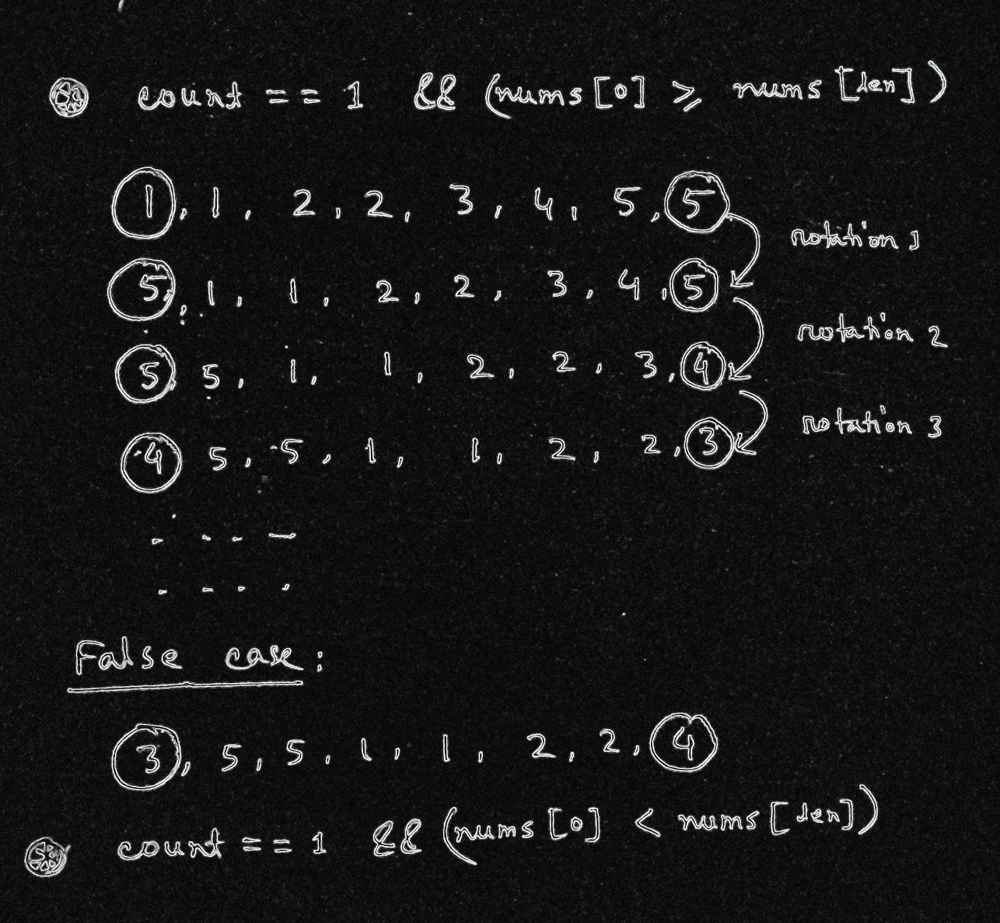

# easy understanding with explanation

**Author:** kamrulSh
**Votes:** 13
**Link:** [https://leetcode.com/problems/check-if-array-is-sorted-and-rotated/solutions/1053801/](https://leetcode.com/problems/check-if-array-is-sorted-and-rotated/solutions/1053801/)

---

**python3**
```
class Solution:
    def check(self, nums: List[int]) -> bool:
        count = 0
        length = len(nums) - 1
        for i in range(length):
            if nums[i] > nums[i + 1]:
                count+=1
    
        if count > 1 or (count == 1 and nums[0] < nums[length]):
            return False
        
        return True
```

**javascript**
```
/**
 * @param {number[]} nums
 * @return {boolean}
 */
var check = function (nums) {
    let count = 0;
    let len = nums.length - 1;
    for (let i = 0; i < len; i++) {
        if (nums[i] > nums[i + 1]) {
            count++;
        }
    }
    if (count > 1 || (count == 1 && nums[0] < nums[len])) {
        return false;
    }
    return true;
};
```
**Explanation**

