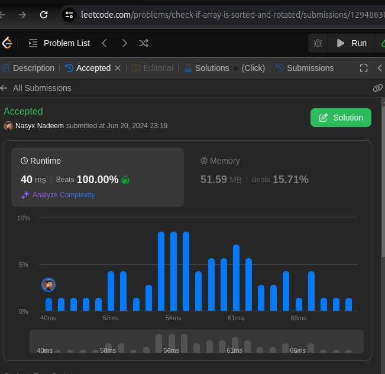

# Typescript solution beats 100% users

**Author:** sdarnadeem
**Votes:** 1
**Link:** [https://leetcode.com/problems/check-if-array-is-sorted-and-rotated/solutions/5343026/](https://leetcode.com/problems/check-if-array-is-sorted-and-rotated/solutions/5343026/)

---




# Code
```
function check(nums: number[]): boolean {
    
    let rotationPoint = 0;

    // run the loop and get the rotation point and break the loop 
    // the rotation point would be the point where ith element is greater than i+1th element
    for (let i = 0; i < nums.length - 1; i++) {
        if (nums[i] > nums[i + 1]) {
            rotationPoint = i + 1;
            break;
        }
    }

    // create a new array by rotating the input array with the calculated rotation point from the above loop
    let newArr = [...nums.slice(rotationPoint), ...nums.slice(0, rotationPoint)]


    // if at any points, the array is not sorted return false
    // i.e ith element is greater than i + 1th element
    for (let i = 0; i < newArr.length - 1; i++) {
        if (newArr[i] > newArr[i + 1]) return false;
    }

    // otherwise return true
    return true;

};
```