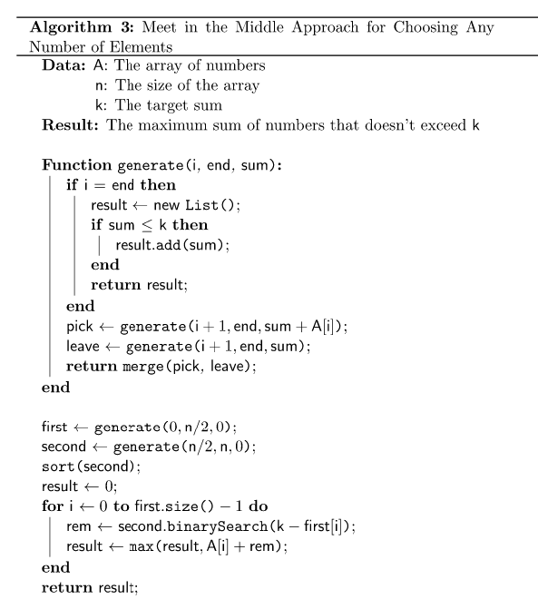

# Beginner friendly + Clean code : Meet in the middle with sources

**Author:** 2pac_shakur
**Votes:** 2
**Link:** [https://leetcode.com/problems/closest-subsequence-sum/solutions/1054021/](https://leetcode.com/problems/closest-subsequence-sum/solutions/1054021/)

---


```
fun minAbsDifference(nums: IntArray, goal: Int): Int {
    val n = nums.size
    val left = TreeSet(sums(nums, 0, n / 2))
    val right = sums(nums, n / 2, n)
    var ans = Math.abs(goal)
    for (x in right) {
        val y = goal - x // hoping to find a value as close to 'y'
        val greaterOrEqual = left.ceiling(y) // >= y
        if (greaterOrEqual != null)
            ans = minOf(ans, greaterOrEqual - y)
        val lessOrEqual = left.floor(y) // <= y
        if (lessOrEqual != null)
            ans = minOf(ans, y - lessOrEqual)
    }
    return ans
}

fun sums(A: IntArray, l: Int, r: Int): Set<Int> { // generate all possible sub-seq sums of Array A[l:r]
    var ans = HashSet<Int>()
    ans.add(0)
    for (i in l until r) {
        val temp = HashSet(ans)
        for (x in ans)
            temp.add(x + A[i])
        ans = temp
    }
    ans.remove(0)
    return ans
}
```

```
Example: [1,2,3,4]
5

Left = [1, 2, 3] considering the left half as [1,2]
Right = [3, 4, 7] considering the right half as [3,4]

Ans = 0 
since 1(left) + 4(right) - 5 == 0
```


Source1: https://www.baeldung.com/cs/subset-of-numbers-closest-to-target#3-meet-in-the-middle-approach
Source2[Video]: https://bit.ly/2YQq5Gv