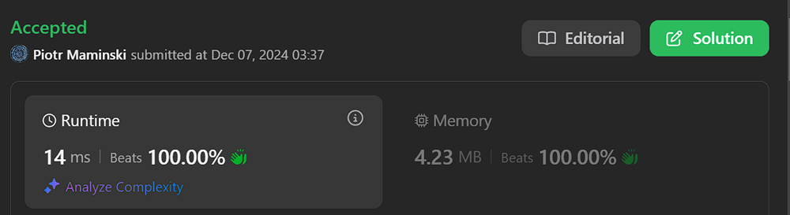
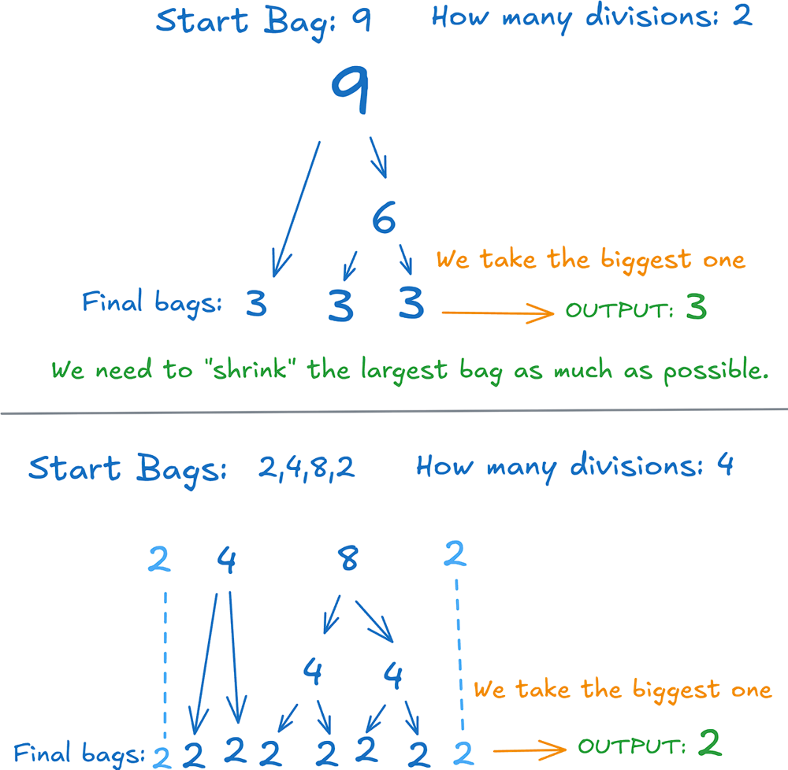
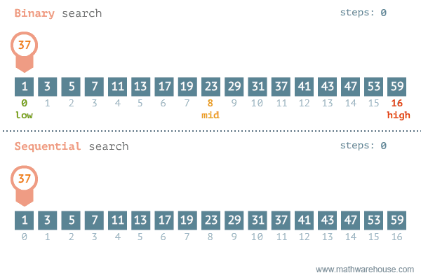

# ✅ Video | Short & Simple | Explained Step by Step

**Author:** Piotr_Maminski
**Votes:** 106
**Link:** [https://leetcode.com/problems/minimum-limit-of-balls-in-a-bag/solutions/6121496/](https://leetcode.com/problems/minimum-limit-of-balls-in-a-bag/solutions/6121496/)

---



https://youtu.be/MQlC8EoOdZ0?si=C_lZEWnN1uTFcqwH

# #1 Binary Search - Short & Simple
```python []
class Solution:
    def minimumSize(self, nums: List[int], maxOps: int) -> int:
        low, high = 1, max(nums) # min and max posible bags
        while low < high:
            mid = (low + high) // 2
            if sum((n - 1) // mid for n in nums) <= maxOps: high = mid
            else: low = mid + 1
        return high
```
```cpp []
class Solution {
public:
    int minimumSize(vector<int>& nums, int maxOps) {
        int low = 1, high = *max_element(nums.begin(), nums.end());
        while (low < high) {
            int mid = low + (high - low) / 2;
            int ops = 0;
            for (int n : nums) if ((ops += (n - 1) / mid) > maxOps) break;
            ops <= maxOps ? high = mid : low = mid + 1;
        }
        return high;
    }
};
```
```java []
class Solution {
    public int minimumSize(int[] nums, int maxOps) {
        int low = 1, high = Arrays.stream(nums).max().getAsInt();
        while (low < high) {
            int mid = (low + high) / 2;
            int ops = 0;
            for (int n : nums) {
                ops += (n - 1) / mid;
            }
            if (ops <= maxOps) high = mid;
            else low = mid + 1;
        }
        return high;
    }
}
```
```csharp []
public class Solution {
    public int MinimumSize(int[] nums, int maxOps) {
        int low = 1, high = nums.Max();
        while (low < high) {
            int mid = (low + high) / 2;
            int ops = nums.Sum(n => (n - 1) / mid);
            if (ops <= maxOps) high = mid;
            else low = mid + 1;
        }
        return high;
    }
}
```
```golang []
func minimumSize(nums []int, maxOps int) int {
    low, high := 1, 0
    for _, n := range nums {
        if n > high {
            high = n
        }
    }
    
    for low < high {
        mid := (low + high) / 2
        ops := 0
        for _, n := range nums {
            ops += (n - 1) / mid
        }
        if ops <= maxOps {
            high = mid
        } else {
            low = mid + 1
        }
    }
    return high
}
```
```swift []
class Solution {
    func minimumSize(_ nums: [Int], _ maxOps: Int) -> Int {
        var low = 1
        var high = nums.max()!
        
        while low < high {
            let mid = (low + high) / 2
            let ops = nums.reduce(0) { $0 + (($1 - 1) / mid) }
            if ops <= maxOps {
                high = mid
            } else {
                low = mid + 1
            }
        }
        return high
    }
}
```
```javascript [JS]
// JavaScript

function minimumSize(n, maxOps) {
    let low = 1;
    let high = Math.max(...n);
    while (low < high) {
        const mid = (low + high) >> 1;
        let cnt = 0;
        for (const x of n) {
            cnt += ~~((x - 1) / mid);
        }
        if (cnt <= maxOps) {
            high = mid;
        } else {
            low = mid + 1;
        }
    }
    return low;
}
```
```typescript [TS]
// TypeScript

function minimumSize(n: number[], maxOps: number): number {
    let low = 1;
    let high = Math.max(...n);
    while (low < high) {
        const mid = (low + high) >> 1;
        let cnt = 0;
        for (const x of n) {
            cnt += ~~((x - 1) / mid);
        }
        if (cnt <= maxOps) {
            high = mid;
        } else {
            low = mid + 1;
        }
    }
    return low;
}
```
```rust []
impl Solution {
    pub fn minimum_size(nums: Vec<i32>, max_ops: i32) -> i32 {
        let mut low = 1;
        let mut high = *nums.iter().max().unwrap();
        while low < high {
            let mid = (low + high) / 2;
            let ops = nums.iter().map(|&n| (n - 1) / mid).sum::<i32>();
            if ops <= max_ops { high = mid } else { low = mid + 1 }
        }
        high
    }
}
```
```ruby []
def minimum_size(nums, max_ops)
    low, high = 1, nums.max
    while low < high
        mid = (low + high) / 2
        ops = nums.sum { |n| (n - 1) / mid }
        ops <= max_ops ? high = mid : low = mid + 1
    end
    high
end
```
- Complexity: O(N * log M) & Space O(1)

# #2 Binary Search (NC version from Video)

```python3 []
class Solution:
    def minimumSize(self, nums: List[int], maxOperations: int) -> int:
        def can_divide(max_balls):
            ops = 0
            for n in nums:
                ops += ceil(n / max_balls) - 1
                if ops > maxOperations:
                    return False
            return True

        # O(n * logm)
        l, r = 1, max(nums)
        res = r
        while l < r:
            m = l + ((r - l) // 2)
            if can_divide(m):
                r = m
                res = r
            else:
                l = m + 1
        return res
```
```cpp []
class Solution {
public:
    bool canDivide(vector<int>& nums, int maxBalls, int maxOperations) {
        int ops = 0;
        for (int n : nums) {
            ops += (n + maxBalls - 1) / maxBalls - 1;
            if (ops > maxOperations) return false;
        }
        return true;
    }
    
    int minimumSize(vector<int>& nums, int maxOperations) {
        int left = 1, right = *max_element(nums.begin(), nums.end());
        int res = right;
        
        while (left < right) {
            int mid = left + (right - left) / 2;
            if (canDivide(nums, mid, maxOperations)) {
                right = mid;
                res = right;
            } else {
                left = mid + 1;
            }
        }
        return res;
    }
};
```
```java []
class Solution {
    private boolean canDivide(int[] nums, int maxBalls, int maxOperations) {
        int ops = 0;
        for (int n : nums) {
            ops += (n + maxBalls - 1) / maxBalls - 1;
            if (ops > maxOperations) return false;
        }
        return true;
    }
    
    public int minimumSize(int[] nums, int maxOperations) {
        int left = 1, right = Arrays.stream(nums).max().getAsInt();
        int res = right;
        
        while (left < right) {
            int mid = left + (right - left) / 2;
            if (canDivide(nums, mid, maxOperations)) {
                right = mid;
                res = right;
            } else {
                left = mid + 1;
            }
        }
        return res;
    }
}
```
```csharp []
public class Solution {
    private bool CanDivide(int[] nums, int maxBalls, int maxOperations) {
        int ops = 0;
        foreach (int n in nums) {
            ops += (n + maxBalls - 1) / maxBalls - 1;
            if (ops > maxOperations) return false;
        }
        return true;
    }
    
    public int MinimumSize(int[] nums, int maxOperations) {
        int left = 1, right = nums.Max();
        int res = right;
        
        while (left < right) {
            int mid = left + (right - left) / 2;
            if (CanDivide(nums, mid, maxOperations)) {
                right = mid;
                res = right;
            } else {
                left = mid + 1;
            }
        }
        return res;
    }
}
```
```golang []
func canDivide(nums []int, maxBalls int, maxOperations int) bool {
    ops := 0
    for _, n := range nums {
        ops += (n + maxBalls - 1) / maxBalls - 1
        if ops > maxOperations {
            return false
        }
    }
    return true
}

func minimumSize(nums []int, maxOperations int) int {
    left, right := 1, 0
    for _, n := range nums {
        if n > right {
            right = n
        }
    }
    res := right
    
    for left < right {
        mid := left + (right - left) / 2
        if canDivide(nums, mid, maxOperations) {
            right = mid
            res = right
        } else {
            left = mid + 1
        }
    }
    return res
}
```
```swift []
class Solution {
    private func canDivide(_ nums: [Int], _ maxBalls: Int, _ maxOperations: Int) -> Bool {
        var ops = 0
        for n in nums {
            ops += (n + maxBalls - 1) / maxBalls - 1
            if ops > maxOperations { return false }
        }
        return true
    }
    
    func minimumSize(_ nums: [Int], _ maxOperations: Int) -> Int {
        var left = 1
        var right = nums.max()!
        var res = right
        
        while left < right {
            let mid = left + (right - left) / 2
            if canDivide(nums, mid, maxOperations) {
                right = mid
                res = right
            } else {
                left = mid + 1
            }
        }
        return res
    }
}
```
```javascript [JS]
// JavaScript

var minimumSize = function(nums, maxOperations) {
    const canDivide = (maxBalls) => {
        let ops = 0;
        for (const n of nums) {
            ops += Math.ceil(n / maxBalls) - 1;
            if (ops > maxOperations) return false;
        }
        return true;
    };
    
    let left = 1;
    let right = Math.max(...nums);
    let res = right;
    
    while (left < right) {
        const mid = left + Math.floor((right - left) / 2);
        if (canDivide(mid)) {
            right = mid;
            res = right;
        } else {
            left = mid + 1;
        }
    }
    return res;
};
```
```typescript [TS]
// TypeScript

function canDivide(nums: number[], maxBalls: number, maxOperations: number): boolean {
    let ops = 0;
    for (const n of nums) {
        ops += Math.ceil(n / maxBalls) - 1;
        if (ops > maxOperations) return false;
    }
    return true;
}

function minimumSize(nums: number[], maxOperations: number): number {
    let left = 1;
    let right = Math.max(...nums);
    let res = right;
    
    while (left < right) {
        const mid = left + Math.floor((right - left) / 2);
        if (canDivide(nums, mid, maxOperations)) {
            right = mid;
            res = right;
        } else {
            left = mid + 1;
        }
    }
    return res;
}
```
```rust []
impl Solution {
    fn can_divide(nums: &Vec<i32>, max_balls: i32, max_operations: i32) -> bool {
        let mut ops = 0;
        for &n in nums {
            ops += (n + max_balls - 1) / max_balls - 1;
            if ops > max_operations {
                return false;
            }
        }
        true
    }
    
    pub fn minimum_size(nums: Vec<i32>, max_operations: i32) -> i32 {
        let mut left = 1;
        let mut right = *nums.iter().max().unwrap();
        let mut res = right;
        
        while left < right {
            let mid = left + (right - left) / 2;
            if Self::can_divide(&nums, mid, max_operations) {
                right = mid;
                res = right;
            } else {
                left = mid + 1;
            }
        }
        res
    }
}
```
```ruby []
def can_divide(nums, max_balls, max_operations)
    ops = 0
    nums.each do |n|
        ops += (n.to_f / max_balls).ceil - 1
        return false if ops > max_operations
    end
    true
end

def minimum_size(nums, max_operations)
    left = 1
    right = nums.max
    res = right
    
    while left < right
        mid = left + (right - left) / 2
        if can_divide(nums, mid, max_operations)
            right = mid
            res = right
        else
            left = mid + 1
        end
    end
    res
end
```


- Complexity: O(N * log M) & Space O(1)

# Explanation

---

# Intuition





# Approach #1

 `low =  1` - Less than 1 we can't return
 `high =  max(nums)` - And we don't have option to return more than input bag

- `mid` - Is us potential "bigest bags" after " splitting". We need that in Binarry. We need to test if we can split all starting bags(input: `nums`) into bag of size `mid` in divisions that we have (`maxOps`).

- First we calc "middle" value between lowest possible and greatest possible bags.
`mid = (low + high) // 2`

### Binary Search

*Starting to learn binary search with this problem doesn't seem like the best idea, so I've recommended something to learn below.*


1. Continues **while** `low < high`
2. Calc "mid" value (avg): `mid = (low + high) // 2`
3. Max operation verfication for each `n` in `numbs`: `<= maxOps: high = mid`
4. Loop:
    - **If** total operations **\u2264** maxOps:
        - Solution might be possible with smaller piles
            - Set `high = mid`
    - **If** total operations **>** maxOps:
        - Need larger piles
            - Set `low = mid + 1`
- End loop **when** low **=** high
5. Return result: `high`

Done. 

**UpVote** if you think it is helpful and will help others


---

## Still dont understand binary search

- (IMO) the best explaining Video (if you know a better one, please write in the comments)
https://youtu.be/GU7DpgHINWQ?si=8uz0mYAwLrAV6cm4

- Binary Search vs Linear Search (Visual explanation how it works)

    


---
- Similar problems: 
    - [[2064. Minimized Maximum of Products Distributed to Any Store]](https://leetcode.com/problems/minimized-maximum-of-products-distributed-to-any-store/solutions/6043943/beats-90-100-video-clean-list-most-common-array-interview-problems) 
    - [[875. Koko Eating Bananas]](https://leetcode.com/problems/koko-eating-bananas/solutions/6044132/solution)


# Most common Array Interview Problems
List based on my research (interviews, reddit, github) Probably not 100% accurate but very close to my recruitments. Leetcode Premium is probably more accurate [I don't have]


**Easy:** [[1. Two Sum]](https://leetcode.com/problems/two-sum/solutions/5999466/beats-100-explained-step-by-step-list-most-common-array-inverview) **(common warm-up)** [[121. Best Time to Buy and Sell Stock]](https://leetcode.com/discuss/topic/6027720/solution/) [[88. Merge Sorted Array]](https://leetcode.com/problems/merge-sorted-array/solutions/6031394/beats-100-explained-step-by-step-list-most-common-string-interview-problems) [[27. Remove Element]](https://leetcode.com/problems/remove-element/solutions/6031528/beats-100-explained-step-by-step-list-most-common-array-interview-problems) [[929. Unique Email Addresses]](https://leetcode.com/problems/unique-email-addresses/solutions/6031687/explained-step-by-step-video-list-most-common-array-interview-problems) 

**Medium/Hard:** [[15. 3Sum]](https://leetcode.com/problems/3sum/description/) [[42. Trapping Rain Water]](https://leetcode.com/problems/trapping-rain-water/?envType=problem-list-v2&envId=atbyk0mj) [[56. Merge Intervals]](https://leetcode.com/problems/merge-intervals/description/) [[57. Insert Interval]](https://leetcode.com/problems/insert-interval/description/) [[46. Permutations]](https://leetcode.com/problems/permutations/description/) [[53. Maximum Subarray]](https://leetcode.com/problems/maximum-subarray/description/) [[73. Set Matrix Zeroes]](https://leetcode.com/problems/set-matrix-zeroes/description/) [[284. Peeking Iterator]](https://leetcode.com/problems/peeking-iterator/description/)

####  [Interview Questions and Answers Repository](https://github.com/RooTinfinite/Interview-questions-and-answers)


