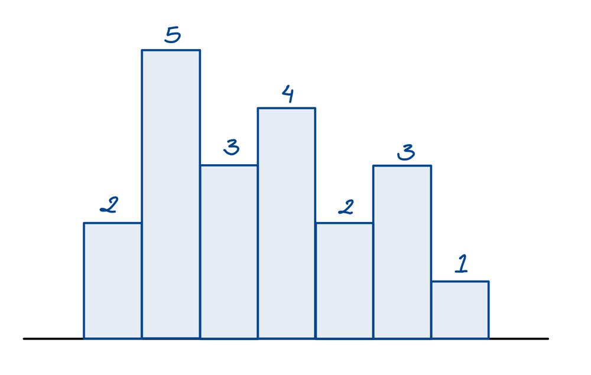
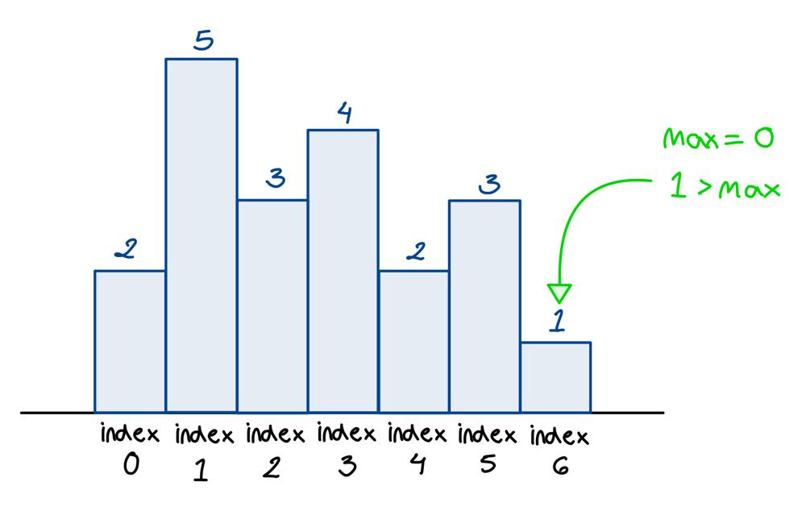
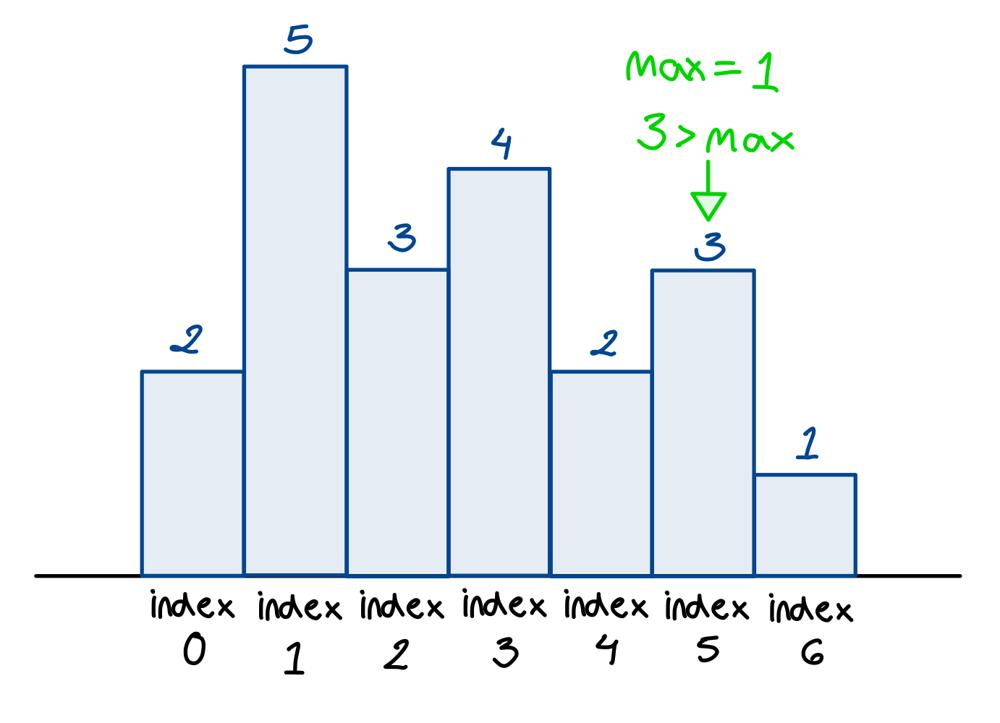
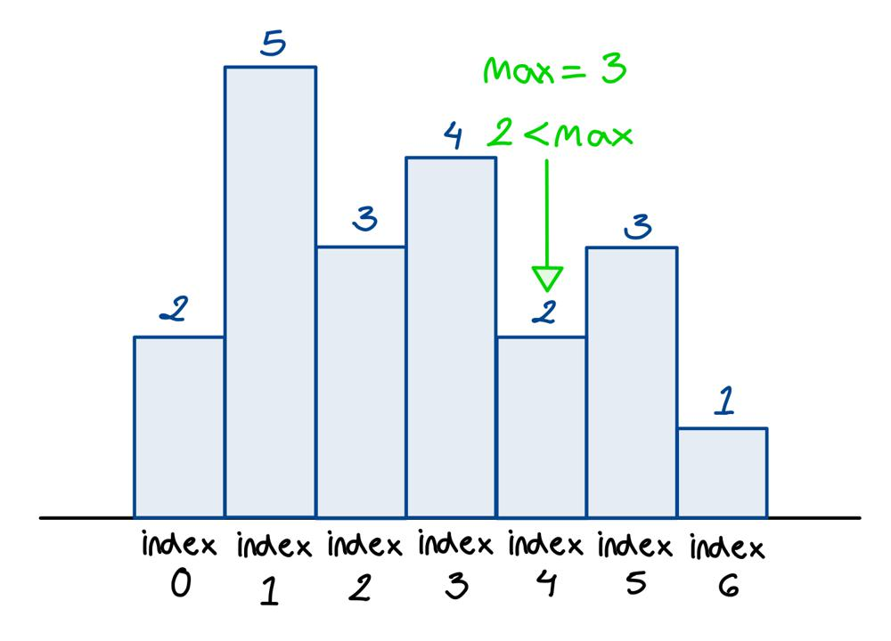
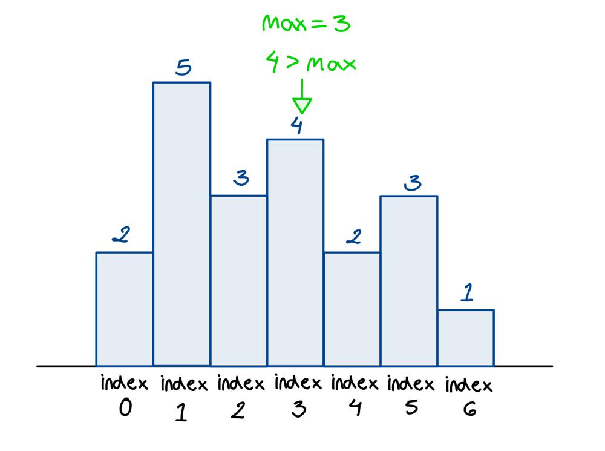
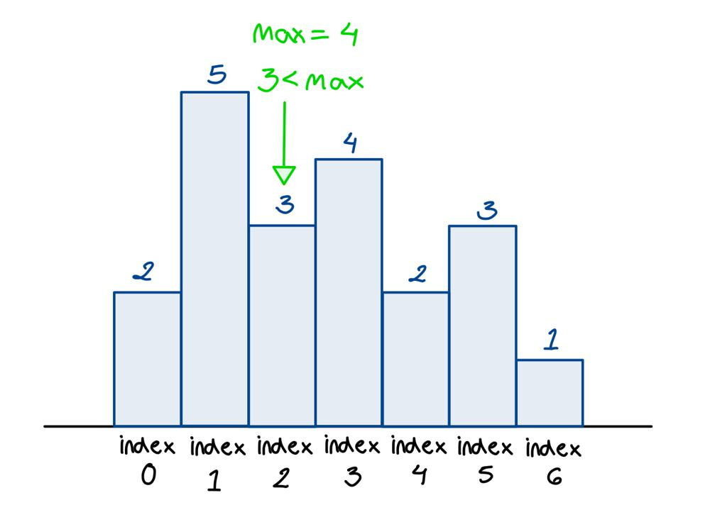
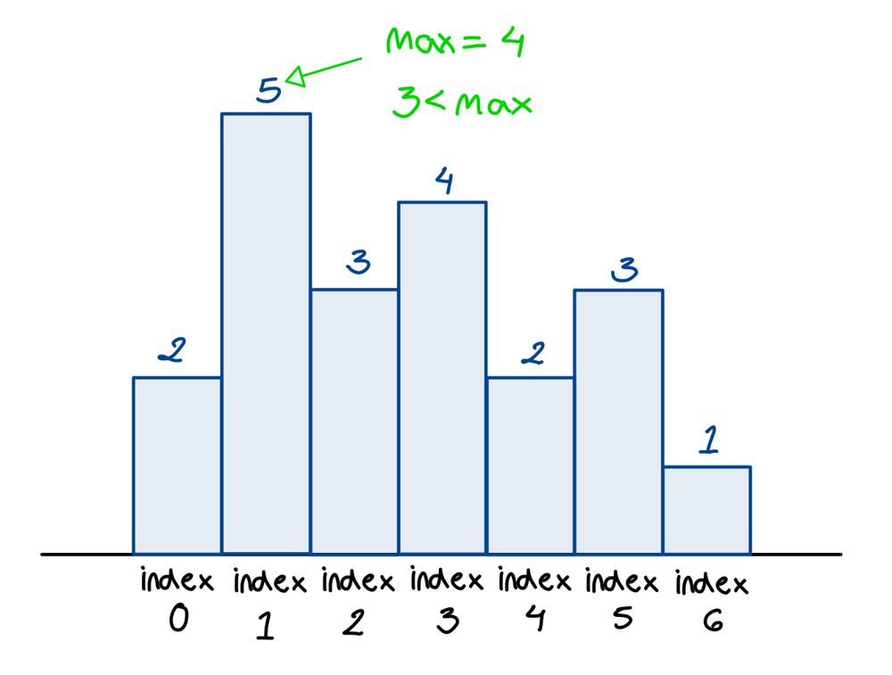
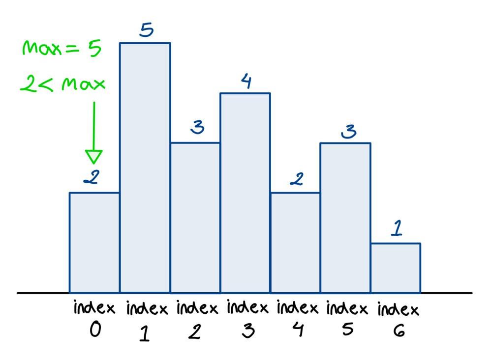

# Golang solution 100%, 100% with explanation and images

**Author:** nathannaveen
**Votes:** 9
**Link:** [https://leetcode.com/problems/buildings-with-an-ocean-view/solutions/1117054/](https://leetcode.com/problems/buildings-with-an-ocean-view/solutions/1117054/)

---

**The idea of the solution:**

The idea of this solution is to loop through the array `heights` backwards. Then we just have to find if a height that is greater that the curent height. After that we can reverse the resulting array because the problem asks us to give us the sorted array of indexes that have an ocean view. 

If you don't understand the explaination just look at the following images:

#### The input:







> Since `max = 0` and `heights[6] = 1`. Since `1 > 0` we add the index `6` to the resulting array `arr`, right now `arr = []`, and if we add `6` to it we get `arr = [6]`. We also have to make `max = 1` because that is how we know that we can't see the ocean if it is smaller than or equal to `max`.




> Now we are at index `5`. Right now we have `max = 1`, and as we can see `3` is greater than `max` so we can add the index `5` to `arr`, and make `arr = [6, 5]`.




> Since `max = 3` and `heights[4] = 2`, so we don't add `4` to `arr`. 




> At index `3` and we have `max = 3`. Since `heights[3] = 4` and `4 > 3` we can add the index `3` to `arr`. So now `arr = [6, 5, 3]`




> We are at index `2` and we have `max = 4`. Since `heights[2] = 3` we don't add `2` to `arr` because `3 < 4`




> Now we are at index `1`, and `heights[1] = 5` while `max = 4`. Since `5 > 4` we add `1` to `arr`. Now `arr = [6, 5, 3, 1]`.




> As we can see at index `0` `heights[0] = 2`, while `max = 5`. Since `2 < 5` we don't add to `arr`.


After all of this we get the array `arr = [6, 5, 3, 1]`. Now the problem asks us to return the array sorted in a increasing order, so all we have to do is reverse `arr` and we get `arr = [1, 3, 5, 6]`. Now we can return `arr`.


``` go
func findBuildings(heights []int) []int {
    maximum := 0
    arr := []int{}
    for i := len(heights) - 1; i >= 0; i-- {
        if heights[i] > maximum {
            maximum = heights[i]
            arr = append(arr, i)
        }
    }
    return reverseArr(arr)
}

func reverseArr(arr []int) []int {
    left, right := 0, len(arr)-1

    for left < right {
        arr[left], arr[right] = arr[right], arr[left]
        left, right = left+1, right-1
    }
    return arr
}
```