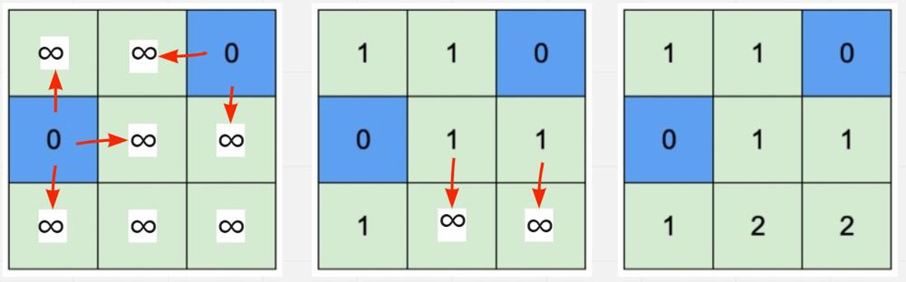

# [C++] Easy to Understand BFS - With diagrammatic explanation

**Author:** kpratyush12345
**Votes:** 21
**Link:** [https://leetcode.com/problems/map-of-highest-peak/solutions/1429668/](https://leetcode.com/problems/map-of-highest-peak/solutions/1429668/)

---



So Here the simple intuition is that we take a 2d answer matrix and initialize all its values to INT_MAX. Then when we find any water block (isWater[i][j] == 1) then i will push those indexes inside the queue and mark the ans[i][j] = 0 as the water block should have height 0. Now my x contains the I index and y will contain the j index values. now we iterate in all 4 directions checking if the position is valid and if ans[xx][yy] (adjacent block) is greater than 1 + ans[x][y] (current block) we want absolute height difference to be at most 1 so we check this condition and update the value and pushing the new block index to the queue so that its adjacent elements get filled up. Lastly, we return the ans vector. 

```
class Solution {
public:
    vector<vector<int>> highestPeak(vector<vector<int>>& isWater) {
        int r = isWater.size();
        int c = isWater[0].size();
        vector<vector<int>> ans(r,vector<int>(c,INT_MAX));
        queue<pair<int,int>> q;
        
        for(int i = 0;i<r;i++){
            for(int j = 0;j<c;j++){
                if(isWater[i][j] == 1){
                    q.push({i,j});
                    ans[i][j] = 0;
                }
            }
        }
        
        while(!q.empty()){
            int x = q.front().first;
            int y = q.front().second;
            q.pop();
            int dx[4] = {0,0,-1,1};
            int dy[4] = {-1,1,0,0};
            
            for(int i = 0;i<4;i++){
                int xx = x + dx[i];
                int yy = y + dy[i];
                
                if(xx>=0 && xx<r && yy>=0 && yy<c && ans[xx][yy] > 1 + ans[x][y]){
                    ans[xx][yy] = 1 + ans[x][y];
                    q.push({xx,yy});
                }
            }
        }
        return ans;
    }
};
```

**Upvote if this helps you :)**